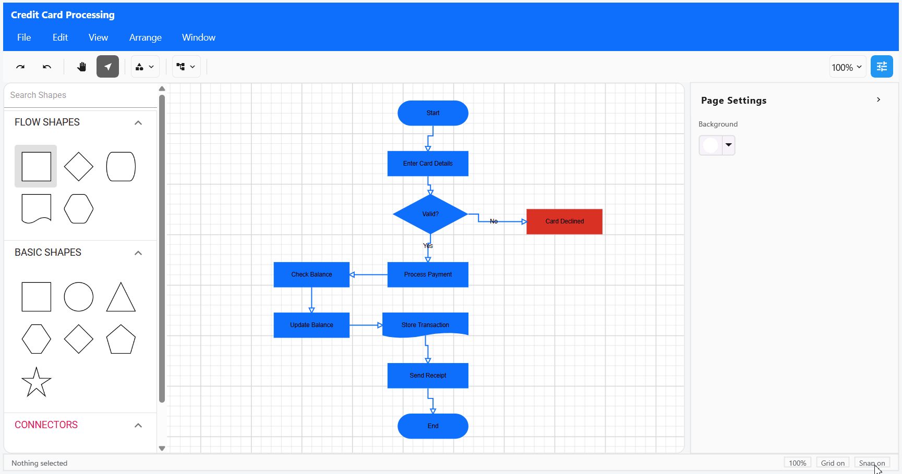

# Diagram Builder: .NET MAUI Use Case Sample

Diagram Builder is a diagram-editing sample built with .NET MAUI and Syncfusion controls. It lets users create flow charts, mind maps, and organization charts from blank canvases or bundled templates, edit diagram elements, and save, export, or print their work.

## Overview

The sample demonstrates a diagram designer with a stencil, canvas, toolbar, menus, and a property panel. It is intended for developers exploring diagram-editing workflows and Syncfusion's .NET MAUI Diagram control.

- **Diagram types**: Flow charts, mind maps, and organization charts.
- **Starting points**: Blank diagrams and bundled examples for credit-card processing, product planning, and company hierarchy.
- **Editing**: Add shapes and connectors, edit selected element properties, arrange objects, and control zoom, grid, and snapping.
- **Files**: Open diagram JSON files and save diagrams as JSON. Export to PNG, JPEG, PDF, or SVG, or print with region and page settings.
- **Execution**: The app uses bundled template data and local file storage; it does not require a backend or external data service.

## Key Features

- Create blank diagrams or start from one of the bundled predefined templates.
- Browse flow-shape, basic-shape, and connector stencils and add items to the canvas.
- Edit selected nodes and connectors, including dimensions, fill and border appearance, opacity, and text properties.
- Use menu and toolbar commands for selection, copy/paste, delete, undo/redo, zoom, object ordering, alignment, distribution, matching sizes, grouping, and ungrouping.
- Toggle the toolbar, stencil, and property panel; the designer switches to a compact layout on narrower windows.
- Open supported local `.json` diagram files and save diagrams as JSON.
- Export the canvas content or page region to PNG, JPEG, PDF, or SVG.
- Print the content or page region with paper size, orientation, and scale-to-fit options.

## User Workflow

1. Choose a blank diagram or a predefined template from the Flow Chart, Mind Map, or Organization Chart category.
2. Add stencil shapes or connectors to the canvas and edit them with the toolbar, menus, or property panel.
3. Use File > Open to select a JSON diagram, or use Save / Save As to save the current diagram.
4. Use File > Export or File > Print to choose the required output options.

## File Behavior

- **Open** accepts JSON files containing a Diagram Builder document. Other file extensions and invalid diagram documents are rejected.
- **Save** does not request a name. The first save uses `Untitled Diagram` (adding a number if that name already exists); later saves update that same file.
- **Save As** prompts for a file name and creates a uniquely named file; later Save commands update that file.
- **Export** supports PNG, JPEG, PDF, and SVG, with the content or page settings region as the export area.
- **Print** supports the content or page settings region, Letter, Legal, Tabloid, A3, A4, A5, A6, or custom paper size, portrait or landscape orientation, and scale-to-fit.
- On Windows, saved files are written to the user's `Downloads` folder. On other platforms, files are written to an app-specific `Downloads` folder under `FileSystem.AppDataDirectory`.

## Controls Used

- **`SfDiagram` and `SymbolPalette`** (`Syncfusion.Maui.Diagram`): Diagram canvas, nodes, connectors, and stencil symbols.
- **`SfPopup`** (`Syncfusion.Maui.Popup`): Menu popups and Save As, Export, and Print dialogs.
- **`SfButton` and `SfSwitch`** (`Syncfusion.Maui.Buttons`): Menu, toolbar, and toggle interactions.
- **`SfListView`** (`Syncfusion.Maui.ListView`): Diagram-category selection in the create dialog.
- **`SfComboBox`, `SfNumericEntry`, and `SfColorPicker`** (`Syncfusion.Maui.Inputs`): Option selection, numeric properties, and color selection.
- **`SfExpander`** (`Syncfusion.Maui.Expander`): Expandable property sections.
- **`SfSlider`** (`Syncfusion.Maui.Sliders`): Continuous property values such as opacity.
- **CommunityToolkit.Mvvm**: Observable view-model properties and commands.

## Architecture

The sample uses MVVM with `CommunityToolkit.Mvvm`.

- **Views**: `CreateDiagramPage` presents the category/template chooser. `DiagramDesignerPage` hosts the designer, manages responsive layout, and connects dialog and diagram interactions.
- **Controls**: `DiagramWorkspaceControl` hosts the diagram and symbol palette. Other controls implement the menu bar, toolbar, stencil-related UI, zoom indicator, property panel, and color picker button.
- **ViewModels**: `CreateDiagramViewModel` handles template selection and diagram creation. `DiagramDesignerViewModel` coordinates document commands and child view models for menus, toolbar, properties, zoom, arrangement, export, and print.
- **Services**: `TemplateService` loads bundled template JSON and supplies seed templates if those assets cannot be loaded. `DiagramFileService` handles local file picking and saving. `DiagramModelAdapter` maps between sample document models and Syncfusion diagram models. Other services handle diagram state, selection, properties, page background settings, and dialogs.
- **Models**: Diagram documents, shapes, connectors, templates, export formats, print options, and property-editor data.
- **Resources**: Theme styles, fonts, app assets, and the bundled templates in `Resources/Raw/Templates/`.

## Prerequisites

- .NET 10 SDK.
- .NET MAUI workload and the workload for the target platform.
- An Android emulator/device, Windows machine, or Apple build environment as appropriate for the selected target.
- A valid Syncfusion license for non-evaluation use.

The project declares target frameworks for Android, iOS, Mac Catalyst, and Windows. Platform targets are included conditionally based on the build host. Syncfusion and CommunityToolkit.Mvvm package references use floating versions in the project file, so NuGet resolves versions during restore.

## Configuration and Licensing

The sample requires no API keys, environment variables, or backend configuration.

`MauiProgram.cs` registers the Syncfusion license using the `SYNCFUSION_LICENSE_KEY` placeholder. Replace it with a valid license key for licensed use. Do not commit a real license key to source control. See [Syncfusion MAUI license registration](https://help.syncfusion.com/common/licensing/how-to-register-maui-license-key).

## Run

From the `DiagramBuilder` sample directory, build and run on Windows:

```bash
dotnet build DiagramBuilder/DiagramBuilder/DiagramBuilder.csproj -t:Run -f net10.0-windows10.0.19041.0
```

Other target frameworks configured by the project:

```bash
dotnet build DiagramBuilder/DiagramBuilder/DiagramBuilder.csproj -t:Run -f net10.0-android
dotnet build DiagramBuilder/DiagramBuilder/DiagramBuilder.csproj -t:Run -f net10.0-ios
dotnet build DiagramBuilder/DiagramBuilder/DiagramBuilder.csproj -t:Run -f net10.0-maccatalyst
```

Open `DiagramBuilder/DiagramBuilder.slnx` in Visual Studio or VS Code with .NET MAUI support to select a target device and run the sample.

## Output



## Project Structure

- `DiagramBuilder/DiagramBuilder/Views/` — Create and designer pages, plus Save As, Export, and Print dialogs.
- `DiagramBuilder/DiagramBuilder/Controls/` — Diagram workspace, toolbar, menu bar, property panel, and supporting controls.
- `DiagramBuilder/DiagramBuilder/ViewModels/` — MVVM state and commands for pages and designer features.
- `DiagramBuilder/DiagramBuilder/Models/` — Diagram, template, export, print, and property models.
- `DiagramBuilder/DiagramBuilder/Services/` — Diagram mapping and state, templates, properties, dialogs, and local file operations.
- `DiagramBuilder/DiagramBuilder/Behaviors/` — Diagram interaction and keyboard behavior.
- `DiagramBuilder/DiagramBuilder/Resources/` — Styles, fonts, images, and bundled template JSON.

## Troubleshooting

**The project cannot build for the selected target.**  
Confirm the .NET 10 SDK and the corresponding .NET MAUI platform workload are installed. iOS and Mac Catalyst builds require an Apple build environment.

**A selected file cannot be opened.**  
Open supports `.json` diagram files in the Diagram Builder document format; arbitrary JSON files are not diagram documents.

**A Syncfusion evaluation notice is displayed.**  
Register a valid Syncfusion license key in `MauiProgram.cs` as described above.

## Security and Privacy Notes

- The sample does not use a backend or external data service.
- Diagram templates are bundled with the app, and diagram files are stored locally.
- Keep Syncfusion license keys out of committed source code.

## Supported Platforms

- Android
- iOS
- Windows
- macOS (Mac Catalyst)
