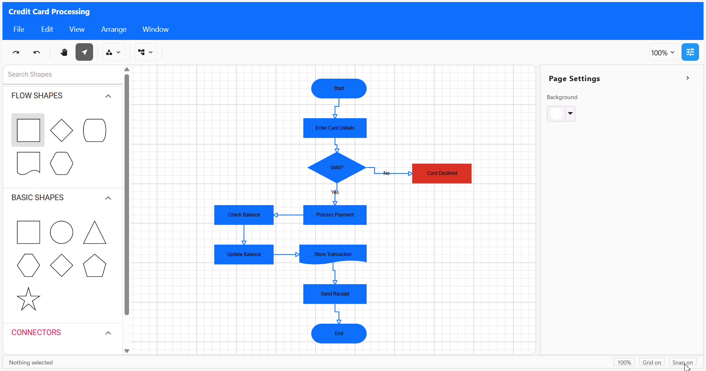

# Diagram Builder: .NET MAUI Use Case Sample



A diagram-design application built with [Syncfusion .NET MAUI controls](https://help.syncfusion.com/maui/overview) for creating flow charts, mind maps, and organization charts, editing diagram elements, and saving or exporting diagrams locally.

---

## Overview

Diagram Builder demonstrates a responsive diagram-editing workspace using Syncfusion `SfDiagram` and related controls. It includes a template picker, stencil palette, canvas, toolbar, menu commands, property editor, zoom controls, local file operations, export, and print workflows.

The sample starts from bundled templates or blank diagrams. It uses local JSON templates and local file storage; it does not require a backend or external data service.

---

## Key Features

### Diagram Creation

- Create blank Flow Chart, Mind Map, or Organization Chart diagrams.
- Start from a credit-card processing flow, product planning mind map, or company hierarchy template.
- The template service loads packaged JSON templates and falls back to built-in C# seed templates if a JSON asset cannot be loaded.

### Diagram Editing

- Add nodes and connectors from the stencil.
- Edit selected node and connector properties.
- Use toolbar, menu, arrangement, selection, zoom, alignment, grouping, copy, paste, undo, and redo commands.
- Switch between the workspace, stencil, toolbar, and property panel surfaces.
- Use a compact layout when the application window is narrow.

### File Operations

- Open local `.json` diagram documents.
- Save to the current document path or use Save As.
- Reject JSON files that do not contain the expected diagram document structure.
- Generate unique file names when a requested diagram name already exists.
- Export diagram content or page-region settings to PNG, JPEG, PDF, or SVG.
- Print diagram content or page-region settings with supported paper sizes and orientations.

### Responsive Workspace

- The designer exposes menu, toolbar, stencil, canvas, zoom, and property panels.
- The layout adapts to wider and narrower application widths.

---

## Syncfusion Controls Used

| Control | Purpose |
|---|---|
| `SfDiagram` | Diagram canvas, nodes, connectors, selection, and editing |
| `SymbolPalette` | Shape and connector stencil |
| `SfPopup` | Menus and Save, Export, and Print dialogs |
| `SfButton` | Toolbar and menu actions |
| `SfSwitch` | Toolbar and panel toggle options |
| `SfListView` | Diagram-category and template selection |
| `SfComboBox` | Property and dialog option selection |
| `SfNumericEntry` | Numeric property editing |
| `SfColorPicker` | Node and connector color selection |
| `SfExpander` | Property-panel sections |
| `SfSlider` | Continuous property values |

### Additional Technologies

- CommunityToolkit.Mvvm
- Dependency Injection
- MVVM architecture pattern
- JSON serialization
- Local file picker and app-package file access
- `PdfExportWriter` for PDF export content

---

## Supported Platforms

| Platform | Target Framework |
|---|---|
| Android | `net10.0-android` |
| iOS | `net10.0-ios` |
| macOS (Mac Catalyst) | `net10.0-maccatalyst` |
| Windows | `net10.0-windows10.0.19041.0` |

> iOS and Mac Catalyst targets require a compatible non-Linux host. The Windows target is available on Windows hosts.

---

## Prerequisites

- .NET 10 SDK or later
- .NET MAUI workloads
- Visual Studio 2022 (17.14+), Visual Studio Code with the .NET MAUI extension, or JetBrains Rider
- A platform emulator, simulator, or physical device
- A valid Syncfusion license for production use

---

## Getting Started

### Open the Solution

```text
DiagramBuilder/DiagramBuilder.slnx
```

### Restore Packages

```bash
dotnet restore DiagramBuilder/DiagramBuilder/DiagramBuilder/DiagramBuilder.csproj
```

### Build and Run

Select a supported target and run the `DiagramBuilder` project.

Example for Windows:

```bash
dotnet build DiagramBuilder/DiagramBuilder/DiagramBuilder/DiagramBuilder.csproj -f net10.0-windows10.0.19041.0
```

Example for Android:

```bash
dotnet build DiagramBuilder/DiagramBuilder/DiagramBuilder/DiagramBuilder.csproj -f net10.0-android
```

---

## Architecture

### Core Layers

- **Views** (`Views/`) - `CreateDiagramPage` and `DiagramDesignerPage`.
- **Controls** (`Controls/`) - diagram workspace, menu bar, toolbar, property panel, zoom indicator, color picker, and supporting controls.
- **ViewModels** (`ViewModels/`) - template creation and document, menu, toolbar, stencil, property, zoom, arrangement, export, and print state.
- **Models** (`Models/`) - diagram documents, items, connectors, templates, export artifacts, print settings, stencil groups, and property models.
- **Services** (`Services/`) - template loading, file operations, diagram mapping, document state, selection, properties, page settings, dialogs, and PDF export.
- **Behaviors** (`Behaviors/`) - keyboard and diagram surface interaction behavior.
- **Templates** (`Templates/`) - property editor and template-card templates.
- **Resources** (`Resources/`) - styles and bundled assets.

### Runtime Flow

1. `MauiProgram.CreateMauiApp()` registers diagram, template, file, selection, property, page-settings, and dialog services.
2. `TemplateService.PreloadAsync()` loads bundled JSON templates or built-in fallback templates.
3. `CreateDiagramViewModel` presents blank and predefined templates and creates the initial diagram document.
4. `DiagramDesignerViewModel` coordinates document commands and the child view models for menu, toolbar, stencil, properties, zoom, arrangement, export, and print.
5. `DiagramModelAdapter` maps sample document models to Syncfusion diagram models and maps changes back to the sample document.
6. `DiagramFileService` validates, opens, saves, and exports local JSON and output files.

---

## Project Structure

```text
DiagramBuilder/
├── DiagramBuilder.slnx
└── DiagramBuilder/
    └── DiagramBuilder/
        ├── Views/
        ├── Controls/
        ├── ViewModels/
        ├── Models/
        ├── Services/
        ├── Behaviors/
        ├── Templates/
        ├── Resources/
        └── Platforms/
```

---

## Configuration

No API keys or backend configuration are required.

- Set `SYNCFUSION_LICENSE_KEY` to a valid license key before launching the app for licensed use.
- The sample skips license registration when the environment variable is unset or contains the placeholder value `SYNCFUSION_LICENSE_KEY`.
- Template JSON assets are loaded from the app package.
- Diagram and export files are written to local storage.

---

## Syncfusion Licensing

```bash
set SYNCFUSION_LICENSE_KEY=YOUR_LICENSE_KEY
```

Do not commit a real license key to source control. For additional information, refer to the [Syncfusion Licensing Documentation](https://help.syncfusion.com/common/licensing/how-to-register-maui-license-key).

---

## Limitations

- Open accepts only `.json` files in the implemented diagram document format.
- Save and export operations use local storage only.
- Windows saves to the user's Downloads folder; other platforms use an app-data Downloads folder.
- Diagram changes are not persisted until the user saves or exports a file.
- External diagram collaboration and cloud storage are not implemented.

---

## Troubleshooting

### A JSON File Cannot Be Opened

The file must use the `DiagramDocument` structure and contain valid `Items`, `Connectors`, and `Category` values.

### A Template Is Missing

`TemplateService` uses built-in C# fallback templates if packaged JSON assets cannot be loaded.

### Syncfusion Evaluation Warning

Set `SYNCFUSION_LICENSE_KEY` before starting the app or register a valid license key through the documented licensing setup.

### Target Platform Build Errors

Install the .NET MAUI workload and the platform-specific workload for the selected target.

---

## Related Documentation

- [.NET MAUI Documentation](https://learn.microsoft.com/dotnet/maui/)
- [.NET MAUI MVVM Guidance](https://learn.microsoft.com/dotnet/architecture/maui/mvvm)
- [Syncfusion .NET MAUI Diagram](https://help.syncfusion.com/maui/diagram/overview)
- [Syncfusion MAUI Licensing](https://help.syncfusion.com/common/licensing/how-to-register-maui-license-key)

---

## License

This sample is provided for demonstration and learning purposes. Syncfusion controls used in this sample require a valid Syncfusion license for production use.
