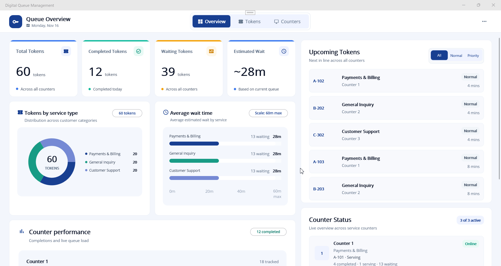

# Digital Queue Management: .NET MAUI Use Case Sample



A .NET MAUI queue-management application built with Syncfusion controls for issuing and managing customer-service queue tokens across service counters.

---

## Overview

Digital Queue Management demonstrates a desktop and mobile service-counter workflow with Overview, Tokens, and Counters sections. The sample uses a shared in-memory `QueueStore` to coordinate waiting, serving, skipped, and completed tokens.

The application includes queue summaries, counter management, token operations, activity charts, and responsive desktop dialogs or mobile bottom sheets.

---

## Key Features

### Queue Overview

- Show queue and counter summaries.
- Track completed, serving, and waiting token counts.
- Display queue progress and activity analytics.
- Switch among queue status and analytics views.

### Token Management

- Call the next waiting token for a selected counter.
- Complete or skip the currently serving token.
- Recall a skipped token.
- Transfer tokens between online counters.
- Edit token service, priority, and counter assignments.
- Delete a token.

### Counter Management

- Add counters with a supported queue service.
- Edit counter service and online/offline state.
- Remove a counter and move its tokens to another online counter.
- Preserve at least one counter when counter deletion is requested.

### Responsive Interaction

- Desktop surfaces use popup dialogs and larger layouts.
- Phone surfaces use bottom-sheet hosts.
- Overview, Tokens, and Counters navigation adapts to the selected layout.

---

## Syncfusion Controls Used

| Control | Purpose |
|---|---|
| `SfCardView` | Queue and counter summary cards |
| `SfChip` | Status and count badges |
| `SfListView` | Queue tokens and counter lists |
| `SfSegmentedControl` | Section navigation and token filtering |
| `SfLinearProgressBar` | Queue progress |
| `SfCircularChart` | Queue activity summaries |
| `SfPopup` | Desktop dialogs and mobile bottom-sheet presentation |

### Additional Technologies

- CommunityToolkit.Mvvm
- Dependency Injection
- MVVM architecture pattern
- Local in-memory state

---

## Supported Platforms

| Platform | Target Framework |
|---|---|
| Android | `net10.0-android` |
| iOS | `net10.0-ios` |
| macOS (Mac Catalyst) | `net10.0-maccatalyst` |
| Windows | `net10.0-windows10.0.19041.0` |

> iOS and Mac Catalyst targets require a compatible non-Linux host. The Windows target is available on Windows hosts.

---

## Prerequisites

- .NET 10 SDK or later
- .NET MAUI workloads
- Visual Studio 2022 (17.14+), Visual Studio Code with the .NET MAUI extension, or JetBrains Rider
- A platform emulator, simulator, or physical device
- Syncfusion .NET MAUI NuGet packages restored from NuGet

---

## Getting Started

### Open the Solution

```text
DigitalQueueManagement/DigitalQueueManagement.slnx
```

### Restore Packages

```bash
dotnet restore DigitalQueueManagement/DigitalQueueManagement/DigitalQueueManagement.csproj
```

### Build and Run

Example for Windows:

```bash
dotnet build DigitalQueueManagement/DigitalQueueManagement/DigitalQueueManagement.csproj -f net10.0-windows10.0.19041.0
```

Example for Android:

```bash
dotnet build DigitalQueueManagement/DigitalQueueManagement/DigitalQueueManagement.csproj -f net10.0-android
```

---

## Architecture

### Core Layers

- **Views** (`Views/`) - `MainPage`, Overview, Tokens, Counters, and desktop/mobile popup hosts.
- **Controls** (`Controls/`) - popup hosts, priority filter, summary cards, and borderless entry.
- **ViewModels** (`ViewModel/`) - shell, queue session, overview, token management, counter operations, and page coordination.
- **Models** (`Model/`) - `QueueToken`, `QueueCounter`, token priority/status, analytics points, and queue summaries.
- **State** (`QueueStore`) - the shared in-memory source of truth for tokens and counters.

### Runtime Flow

1. `MauiProgram.CreateMauiApp()` registers `QueueStore` and the queue view models.
2. `QueueStore` seeds three counters and the initial token list.
3. `QueueSessionViewModel` coordinates counters and token operations.
4. Token and counter view models read the store and raise changes after mutations.
5. `QueueStore` validates services and counter availability, updates token status, and raises `Changed`.
6. Overview and counter summaries derive completed, serving, and waiting counts from the current store.

---

## Project Structure

```text
DigitalQueueManagement/
├── DigitalQueueManagement.slnx
└── DigitalQueueManagement/
    ├── Views/
    ├── Controls/
    ├── ViewModel/
    ├── Model/
    ├── Resources/
    └── Platforms/
```

---

## Configuration

- The sample has no AI provider or external backend.
- Queue state is created from local seed data.
- No API key or credential is required.
- Set `SYNCFUSION_LICENSE_KEY` to register a Syncfusion license in the application host.

---

## Syncfusion Licensing

Set `SYNCFUSION_LICENSE_KEY` in the application environment before launching.

Do not commit a license key to source control. For details, refer to [Syncfusion Licensing Documentation](https://help.syncfusion.com/common/licensing/how-to-register-maui-license-key).

---

## Limitations

- Queue tokens and counters reset when the app restarts.
- The sample does not persist operations or queue history.
- Counter and token data is local deterministic sample data.
- The app does not integrate with notification services or external queue systems.

---

## Troubleshooting

### Queue Changes Reset

This is expected because `QueueStore` is an in-memory store.

### A Counter Cannot Be Deleted

At least one counter must remain, and counter deletion requires an online destination counter.

### The Selected Counter Cannot Serve a Token

An offline counter cannot call or receive tokens. A counter already serving a token cannot start another token.

### Syncfusion Evaluation Warning

Set `SYNCFUSION_LICENSE_KEY` before starting the app or register a valid license key.

---

## Related Documentation

- [.NET MAUI Documentation](https://learn.microsoft.com/dotnet/maui/)
- [.NET MAUI MVVM Guidance](https://learn.microsoft.com/dotnet/architecture/maui/mvvm)
- [Syncfusion .NET MAUI Controls](https://help.syncfusion.com/maui/overview)
- [Syncfusion Licensing Documentation](https://help.syncfusion.com/common/licensing/how-to-register-maui-license-key)

---

## License

This sample is provided for demonstration and learning purposes. Syncfusion controls used in this sample require a valid Syncfusion license for production use.
