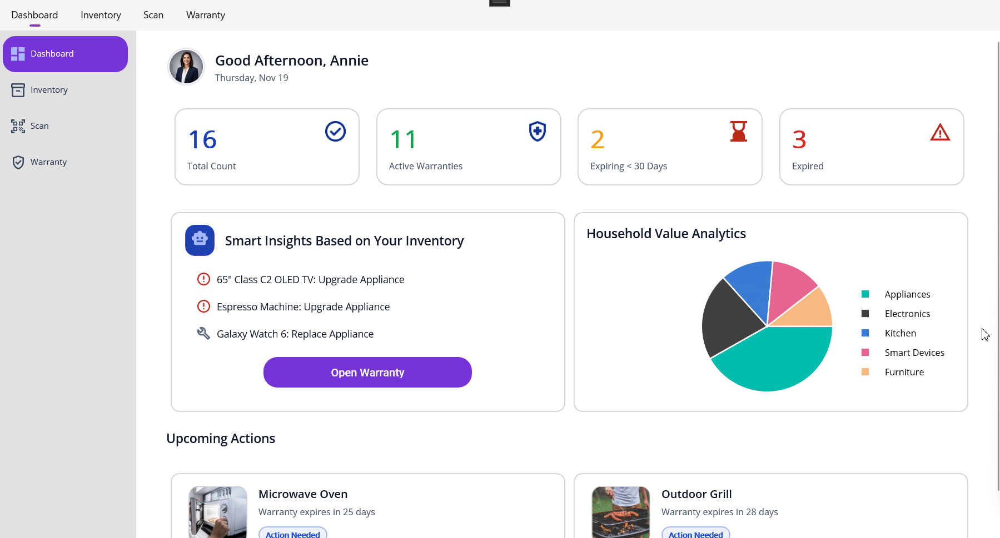

# Home Inventory Manager: .NET MAUI Use Case Sample



A cross-platform household asset and warranty-management sample built with [Syncfusion .NET MAUI controls](https://help.syncfusion.com/maui/overview). It demonstrates inventory browsing, warranty tracking, lifecycle analytics, and a simulated add-item workflow using local data.

---

## Overview

Home Inventory Manager provides Dashboard, Inventory, Scan, and Warranty experiences. The app starts with seeded household assets and uses `MockAIService` to provide deterministic category, lifespan, health, and recommendation calculations.

The scan workflow accepts a camera photo or selected file and presents an editable review form. Recognition is simulated; it does not perform OCR or send files to a remote AI service.

---

## Key Features

### Dashboard

- Summarize inventory and warranty counts.
- Show asset value and category charts.
- Generate local household health and dashboard insight copy.
- List upcoming warranty actions.

### Inventory

- Browse seeded household items.
- Filter by category and search by name, brand, or category.
- Open item details and an empty state for unmatched items.

### Scan and Add Item

- Capture or select a product image.
- Attach a PDF or image for the demo workflow.
- Edit product name, brand, category, purchase price, purchase date, warranty dates, and image.
- Validate required fields and save the item to the shared in-memory inventory.

### Warranty Center

- Summarize active, expiring, and expired warranty state.
- Calculate appliance health scores.
- Show age and replacement analytics.
- Filter assets by warranty or health status.

---

## Syncfusion Controls Used

| Control | Purpose |
|---|---|
| `SfListView` | Dashboard collections and inventory/warranty rows |
| `SfCircularChart` | Asset category and lifecycle summaries |
| `SfCartesianChart` | Age and lifecycle visualizations |
| `SfChipGroup` | Category, warranty, and health filters |
| `SfTextInputLayout` | Add-item form fields |
| `SfNumericEntry` | Purchase price and numeric values |
| `SfMaskedEntry` | Formatted value entry |
| `SfAvatarView` | Profile and item visuals |
| `SfButton` | Add, save, and navigation actions |
| `SfShimmer` | Loading placeholders |

### Additional Technologies

- CommunityToolkit.Mvvm
- .NET MAUI Shell
- Dependency Injection
- MVVM architecture pattern
- `IAIService` and deterministic `MockAIService`
- Local in-memory inventory collections

---

## Supported Platforms

| Platform | Target Framework |
|---|---|
| Android | `net10.0-android` |
| iOS | `net10.0-ios` |
| macOS (Mac Catalyst) | `net10.0-maccatalyst` |
| Windows | `net10.0-windows10.0.19041.0` |

> iOS and Mac Catalyst targets require a compatible non-Linux host. The Windows target is available on Windows hosts.

---

## Prerequisites

- .NET 10 SDK or later
- .NET MAUI workloads
- Visual Studio 2022 (17.14+), Visual Studio Code with the .NET MAUI extension, or JetBrains Rider
- Camera permission for device capture, or access to a device photo/file picker
- Syncfusion .NET MAUI NuGet packages restored from NuGet

---

## Getting Started

### Open the Solution

```text
HomeInventoryManager/HomeInventoryManager.slnx
```

### Restore Packages

```bash
dotnet restore HomeInventoryManager/HomeInventoryManager/HomeInventoryManager.csproj
```

### Build and Run

Example for Android:

```bash
dotnet build HomeInventoryManager/HomeInventoryManager/HomeInventoryManager.csproj -f net10.0-android
```

---

## Architecture

### Core Layers

- **Views** (`Views/`) - Dashboard, Inventory, Scan, and Warranty pages plus `AppSideBar`.
- **ViewModels** (`ViewModel/`) - Dashboard, Inventory, Scan, and Warranty presentation state.
- **Models** (`Model/`) - inventory, warranty, scan, recommendation, analytics, and chart summary types.
- **Services** (`Services/`) - `IAIService` and the deterministic `MockAIService`.
- **Converters**, **Behaviors**, **Style**, and **Resources** - binding conversion, tap behavior, styles, fonts, and app assets.

### Runtime Flow

1. The app starts with seeded inventory items.
2. Dashboard and Inventory view models read the shared process-local item collection.
3. Search and category filters create projected inventory views.
4. The Scan page captures or selects a file and validates an editable review form.
5. Saving adds the item to the shared inventory collection and navigates to Inventory.
6. Dashboard, warranty, and health projections derive from the current inventory and warranty data.
7. `MockAIService` calculates category, lifespan, risk, health, and insight values locally.

---

## Project Structure

```text
HomeInventoryManager/
├── HomeInventoryManager.slnx
├── HomeInventoryManager/
│   ├── Views/
│   ├── ViewModel/
│   ├── Model/
│   ├── Services/
│   ├── Behaviors/
│   ├── Converters/
│   ├── Style/
│   ├── Resources/
│   └── Platforms/
└── HomeInventoryManagerDemo.gif
```

---

## Configuration

No API key, backend, database connection, or external AI endpoint is required.

- Initial inventory and recommendations are local seed data.
- Camera capture and file selection are user-initiated.
- PDF and image attachments are not processed with OCR.
- Inventory additions remain in memory for the current app session.

---

## Syncfusion Licensing

Syncfusion controls may display evaluation notices until a valid license is registered.

Do not commit license keys to source control. For details, refer to [Syncfusion Licensing Documentation](https://help.syncfusion.com/common/licensing/how-to-register-maui-license-key).

---

## Limitations

- New inventory items are not persisted after restart.
- `MockAIService` provides deterministic simulated classification and health calculations.
- Camera, photo, and PDF workflows do not upload or recognize real document content.
- The sample does not synchronize with a household asset database.
- `sqlite-net-pcl` is referenced by the project, but the inventory workflow currently uses in-memory collections.

---

## Troubleshooting

### Camera Is Unavailable

Enable camera permission or use the photo/file-selection option.

### Product Details Are Not Filled Automatically

This is expected: the scan workflow is simulated and does not perform OCR or AI extraction.

### Save Is Disabled or Validation Fails

Provide the required product name, brand, category, positive purchase price, and image fields implemented by the review form.

### Inventory Disappears After Restart

The inventory is stored in memory only.

### Syncfusion Evaluation Warning

Register a valid Syncfusion license in the app startup configuration.

---

## Related Documentation

- [.NET MAUI Documentation](https://learn.microsoft.com/dotnet/maui/)
- [.NET MAUI Shell](https://learn.microsoft.com/dotnet/maui/fundamentals/shell/)
- [.NET MAUI MVVM Guidance](https://learn.microsoft.com/dotnet/architecture/maui/mvvm)
- [Syncfusion .NET MAUI Controls](https://help.syncfusion.com/maui/overview)
- [Syncfusion Licensing Documentation](https://help.syncfusion.com/common/licensing/how-to-register-maui-license-key)

---

## License

This sample is provided for demonstration and learning purposes. Syncfusion controls used in this sample require a valid Syncfusion license for production use.
