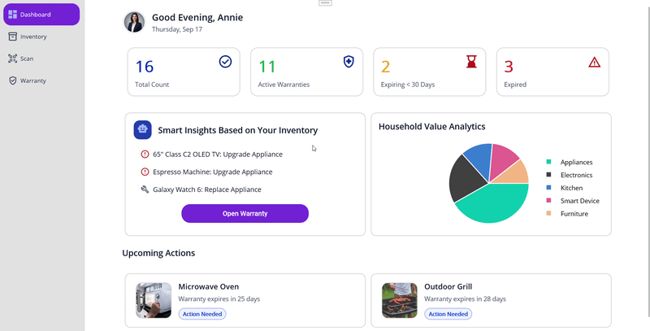

# Home Inventory Manager: .NET MAUI Use Case Sample

A cross-platform household asset and warranty-management sample built with .NET MAUI and Syncfusion controls. It demonstrates inventory browsing, warranty tracking, lifecycle analytics, and a camera/file-based add-item workflow. Its AI-style features are implemented with local mock logic.

## Overview

Home Inventory Manager is intended for developers exploring household asset tracking and dashboard experiences. The app opens to a summary dashboard and provides Inventory, Scan, and Warranty tabs. Seed data and the mock recommendation service make the workflow available without an account, backend, or network connection.

## Key Features

- **Dashboard**: inventory and warranty counts, asset-value/category visualization, local recommendations, and upcoming warranty actions.
- **Inventory**: seeded household items, category chips, search by name/brand/category, item details, and an empty state.
- **Add an item**: capture or select a product photo, attach an invoice PDF or product photo, edit the item details, validate, and save.
- **Warranty Center**: warranty status and expiration summaries, appliance health scores, age and replacement analytics, and health/warranty filters.
- **Responsive navigation**: four Shell destinations with a sidebar on wider layouts and bottom navigation on phones.

## Data Flow

1. The app starts with a locally seeded set of household assets. Dashboard and Inventory view models read the shared process-local item collection.
2. The Dashboard derives inventory and warranty KPIs, category totals, upcoming actions, and recommendation text from the current assets.
3. Inventory applies the selected category and search term to the shared item list.
4. The Scan page accepts a camera photo, image selection, or invoice PDF; its review form lets the user edit product name, brand, category, price, dates, and image before saving.
5. Saving validates required item fields, adds the item to the shared in-memory list, and navigates to Inventory. Warranty analytics are derived from that inventory.

**Scanning is simulated:** the app can capture or select files, but it does not perform OCR or send the files to an AI service. `MockAIService` provides deterministic, local category, lifespan, health, and maintenance recommendation logic. Inventory is not persisted; the seeded state returns when the app restarts.

## Controls Used

- `SfListView`: dashboard summary/recommendation/action collections and inventory/warranty rows.
- `SfCircularChart` / `SfCartesianChart`: category and lifecycle visualizations.
- `SfChipGroup`: category and warranty/health filters.
- `SfTextInputLayout`, `SfNumericEntry`, and `SfMaskedEntry`: add-item form fields.
- `SfAvatarView`, `SfButton`, and `SfShimmer`: profile/insight visuals, actions, and loading placeholders.
- MAUI Shell and a custom `AppSideBar`: Dashboard, Inventory, Scan, and Warranty navigation.

## Architecture

The sample uses CommunityToolkit.Mvvm view models with XAML pages:

- **Views** (`Views/`): `DashboardPage`, `InventoryPage`, `ScanPage`, `WarrantyPage`, and the shared sidebar.
- **View models** (`ViewModel/`): dashboard metrics, inventory filters, scan/review state, and warranty analytics.
- **Models** (`Model/`): inventory items, warranties, scan data, recommendations, and chart summaries.
- **Services** (`Services/`): `IAIService` and the local `MockAIService`.
- **Supporting UI** (`Behaviors/`, `Converters/`, `Style/`, `Resources/`): tap behavior, binding converters, styles, fonts, and images.

The Scan page updates the inventory view model when an item is saved. The dashboard and warranty projections are calculated from the same local inventory data; no database or remote service is configured.

## Prerequisites

- .NET 10 SDK and the .NET MAUI workload.
- A platform workload/device for Android, iOS, Mac Catalyst, or Windows.
- Visual Studio with MAUI support or VS Code with the .NET MAUI extension.
- Syncfusion MAUI packages restored from NuGet. A valid Syncfusion license may be needed to remove evaluation watermarks.

## Configuration

No application configuration is required. The sample uses local seed data and a mock AI service.

### Default Behavior

- The initial inventory and AI-style recommendations are local sample data/logic.
- Camera capture and file selection are initiated by the user; selected content is processed only by the sample’s simulated flow.
- Inventory additions are held in memory for the current app session and are not saved after restart.

### Environment Variables / Secrets

None required. There is no AI endpoint, weather feed, database connection, or credential.

### Notes

- Camera capture may prompt for camera permission; if camera capture is unavailable, choose an existing image.
- An invoice PDF can be attached for the demo workflow, but the app does not extract text from it.
- If a Syncfusion license is required, register it in the MAUI startup configuration. Do not commit the license key. See [Syncfusion MAUI licensing](https://help.syncfusion.com/common/licensing/how-to-register-maui-license-key).
- A SQLite package is listed as a project dependency, but the inventory workflow described here uses the in-memory collection and does not persist inventory to SQLite.

## Run

From the repository root, build for a platform workload installed on your machine:

```bash
dotnet build HomeInventoryManager/HomeInventoryManager/HomeInventoryManager.csproj -f net10.0-android
```

Other supported target frameworks are `net10.0-ios`, `net10.0-maccatalyst`, and `net10.0-windows10.0.19041.0`. Alternatively, open [`HomeInventoryManager.slnx`](HomeInventoryManager.slnx) in Visual Studio or VS Code, choose a target, and deploy to a device or emulator.

## Output



## Project Structure

- `HomeInventoryManager.slnx`: solution file.
- `HomeInventoryManager/`: MAUI project.
- `HomeInventoryManager/Views/`: Dashboard, Inventory, Scan, Warranty, and sidebar XAML.
- `HomeInventoryManager/ViewModel/`: page view models.
- `HomeInventoryManager/Model/`: inventory, warranty, scan, and analytics models.
- `HomeInventoryManager/Services/`: mock AI service contracts and implementation.
- `HomeInventoryManager/Resources/`: app icon, images, fonts, and styles.

## Troubleshooting

**Camera is unavailable or permission is denied**  
Use the photo-library/file-selection option instead, or enable camera permission for the app in the device settings.

**The scan screen does not fill in product details automatically**  
This is expected: image/PDF recognition is simulated. Enter or correct the fields in the review form before saving.

**Save is unavailable or validation reports missing data**  
Provide a product name, brand, category, positive purchase price, and image.

**New inventory disappears after restarting**  
Inventory is held in memory only. The app starts from its sample seed on each launch.

**Syncfusion evaluation watermark appears**  
Register a valid Syncfusion license in the app startup configuration; see Configuration → Notes.

## Security and Privacy Notes

- Seeded inventory and recommendation content is fictional.
- The app does not send inventory details, photos, or PDFs to a remote AI provider or backend.
- Do not use this sample as a warranty authority or enter real household information that should be private.
- Keep any Syncfusion license key out of source control.

## Supported Platforms

- Android
- iOS
- Windows
- macOS (Mac Catalyst)
