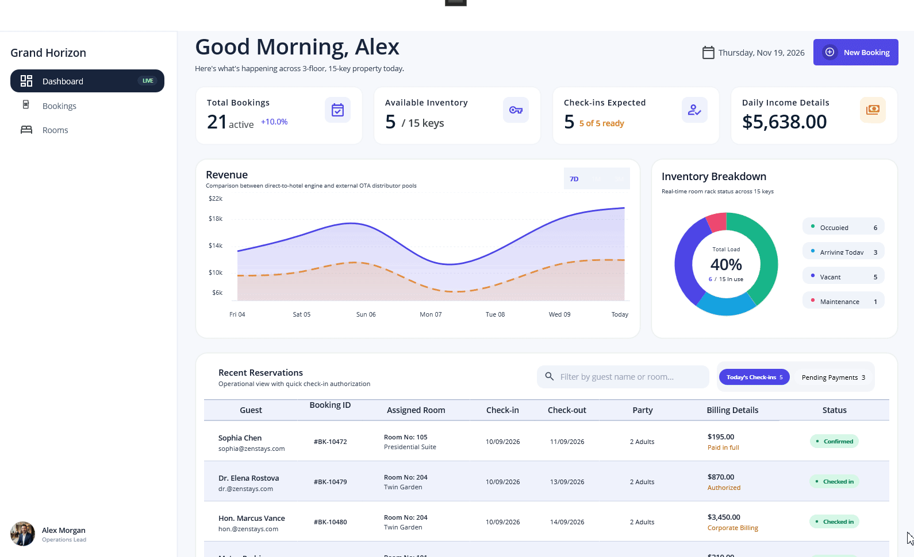

# Hotel Booking Management: .NET MAUI Use Case Sample



A cross-platform hotel front-office application built with [Syncfusion .NET MAUI controls](https://help.syncfusion.com/maui/overview), demonstrating reservations, room and housekeeping status, dashboard analytics, and responsive desktop/mobile layouts.

---

## Overview

Hotel Booking Management demonstrates a 15-room hotel sample with Dashboard, Rooms, and Bookings surfaces. A shared `IHotelStore` instance provides the rooms and reservations to desktop and mobile view models.

The app uses deterministic local seed data anchored to a fixed reference date. It does not implement authentication, database persistence, network hotel services, or payment processing.

---

## Key Features

### Dashboard

- Show arrivals, in-house guests, folio totals, and room inventory KPIs.
- Visualize room status and revenue.
- Select 7-day, 1-month, or 3-month chart ranges.
- Search and page recent reservations.

### Rooms

- Browse a 15-room inventory across three floors.
- Filter by floor and room status.
- Show room type, nightly rate, and operational status.
- Display room cards on narrow layouts and table views on desktop layouts.

### Bookings

- Search and page reservation records.
- Show booking KPIs and selected-booking detail.
- Validate and create bookings from a desktop popup or mobile page.
- Update shared room and dashboard state after a successful booking.

### Responsive Experience

- Android and iOS phone layouts use the mobile `SfTabView` shell.
- Desktop and other idioms use the sidebar and `NavigationPage` experience.

---

## Syncfusion Controls Used

| Control | Purpose |
|---|---|
| `SfDataGrid` | Desktop dashboard and booking tables |
| `SfDataPager` | Reservation paging |
| `SfListView` | Room cards and mobile lists |
| `SfCartesianChart` | Revenue visualizations |
| `SfCircularChart` | Room-status visualizations |
| `SfChipGroup` | Room, floor, and reservation filters |
| `SfPopup` | Desktop add-booking form |
| `SfCalendar` | Stay-date selection |
| `SfComboBox` | Booking form selections |
| `SfTextInputLayout` | Guest and stay form fields |
| `SfTabView` | Mobile section navigation |
| `SfExpander` | Mobile booking form sections |
| `SfButton` | Booking and action commands |
| `SfBusyIndicator` | Mobile busy feedback |

### Additional Technologies

- Dependency Injection
- Page-specific view models
- Shared `IHotelStore` singleton
- MVVM architecture pattern

---

## Supported Platforms

| Platform | Target Framework |
|---|---|
| Android | `net10.0-android` |
| iOS | `net10.0-ios` |
| macOS (Mac Catalyst) | `net10.0-maccatalyst` |
| Windows | `net10.0-windows10.0.19041.0` |

> iOS and Mac Catalyst targets require a compatible non-Linux host. The Windows target is available on Windows hosts.

---

## Prerequisites

- .NET 10 SDK or later
- .NET MAUI workloads
- Visual Studio 2022 (17.14+), Visual Studio Code with the .NET MAUI extension, or JetBrains Rider
- A platform emulator, simulator, or physical device
- Syncfusion .NET MAUI NuGet packages restored from NuGet

---

## Getting Started

### Open the Solution

```text
HotelBookingManagement/HotelManagerSample.slnx
```

### Restore Packages

```bash
dotnet restore HotelBookingManagement/HotelManagerSample/HotelManagerSample.csproj
```

### Build and Run

Example for Android:

```bash
dotnet build HotelBookingManagement/HotelManagerSample/HotelManagerSample.csproj -f net10.0-android
```

---

## Architecture

### Core Layers

- **Models** (`Models/`) - hotel configuration, rooms, bookings, navigation tabs, selectable bookings, and `IHotelStore`/`HotelStore`.
- **Desktop ViewModels** (`ViewModels/`) - Dashboard, Rooms, Bookings, and Add Booking state.
- **Desktop Views** (`Views/DesktopUI/`) - desktop Dashboard, Rooms, and Bookings pages.
- **Mobile Views** (`Views/MobileUI/`) - mobile shell, dashboard, rooms, bookings, and new-booking pages/view models.
- **Controls** (`Controls/`) - sidebar, booking popup content, entry, and platform behavior helpers.
- **Converters** and **Resources** - presentation conversion and platform styles/assets.

### Runtime Flow

1. `HotelStore` seeds 15 rooms and the configured demonstration bookings.
2. Dashboard, Rooms, and Bookings view models resolve the same singleton `IHotelStore`.
3. Filters, searches, paging, and selections derive local view data from the shared store.
4. Add Booking validates guest and stay details, floor, date, and available room selection.
5. A successful booking is appended to `Bookings`, and the assigned room status becomes `Reserved`.
6. `BookingsChanged` and `RoomsChanged` notify view models to refresh derived lists and KPI values.

---

## Project Structure

```text
HotelBookingManagement/
├── HotelManagerSample.slnx
├── HotelBookingManagementDemo.gif
└── HotelManagerSample/
    ├── Models/
    ├── ViewModels/
    ├── Views/
    │   ├── DesktopUI/
    │   └── MobileUI/
    ├── Controls/
    ├── Converters/
    ├── Resources/
    └── Platforms/
```

---

## Configuration

- No runtime API configuration is required.
- The sample uses `HotelConfig.ReferenceToday`, fixed to September 10, 2026, for date-dependent seed data.
- Room and booking changes remain in memory.
- Restarting recreates the seeded hotel state.

---

## Syncfusion Licensing

Register a valid Syncfusion license for licensed use.

Do not commit license keys to source control. For details, refer to [Syncfusion Licensing Documentation](https://help.syncfusion.com/common/licensing/how-to-register-maui-license-key).

---

## Limitations

- The sample does not provide a database or persistence layer.
- Room and booking changes reset after an app restart.
- No authentication or guest account system is implemented.
- No payment provider or card information is used.
- Booking totals and status labels are demonstration data.

---

## Troubleshooting

### The App Opens in the Wrong Layout

The app chooses mobile presentation for Android/iOS phone idioms and desktop presentation for other idioms. Check the selected target and device idiom.

### Dashboard Dates Do Not Match Today

Date-dependent demo content is intentionally anchored to September 10, 2026 through `HotelConfig.ReferenceToday`.

### Changes Disappear After Restart

The shared hotel store is in memory and recreates its seed on launch.

### Changes Do Not Update Across Pages

Desktop and mobile pages should resolve the singleton `IHotelStore` registered in `MauiProgram.cs`.

### Syncfusion Evaluation Warning

Register a valid Syncfusion license.

---

## Related Documentation

- [.NET MAUI Documentation](https://learn.microsoft.com/dotnet/maui/)
- [.NET MAUI Shell and Navigation](https://learn.microsoft.com/dotnet/maui/fundamentals/)
- [.NET MAUI MVVM Guidance](https://learn.microsoft.com/dotnet/architecture/maui/mvvm)
- [Syncfusion .NET MAUI Controls](https://help.syncfusion.com/maui/overview)
- [Syncfusion Licensing Documentation](https://help.syncfusion.com/common/licensing/how-to-register-maui-license-key)

---

## License

This sample is provided for demonstration and learning purposes. Syncfusion controls used in this sample require a valid Syncfusion license for production use.
