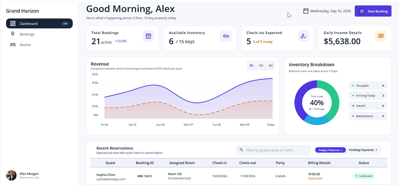

# Hotel Booking Management - .NET MAUI Sample

A Syncfusion-powered .NET MAUI front-office application for a 15-room hotel: dashboard, rooms, bookings, and an add-booking flow with adaptive desktop and mobile surfaces.

## Overview

A small hotel front-office team needs a single app to manage reservations, room inventory, and housekeeping status across a 15-key property.

- **What the sample does** - Dashboard with KPI tiles and revenue / inventory charts, a 15-key housekeeping board, paginated bookings grid with selection detail, and a validated add-booking form.
- **Who it is for** - Hotel front-office staff and managers running a small property.
- **What AI capability it uses** - None. The sample is a pure Syncfusion UI showcase with deterministic in-memory mock data; no AI service is wired in.
- **What outcome the user gets** - A working front-office shell that can be extended with AI (e.g. demand forecasting on the revenue chart) in future iterations.

## Key Features

- Dashboard with greeting header, today's-arrivals / in-house / folio KPI tiles, inventory doughnut, revenue spline area chart with a 7D / 1M / 3M toggle.
- Paginated recent-reservations table with a segmented "Today's Check-Ins / Pending Payments" filter and search box.
- Rooms housekeeping board with card-view (`SfListView`) and table-view (`SfDataGrid`) toggle, floor / status chip filters, and KPI strip.
- Paginated bookings grid with live row selection, detail strip, sortable columns, and per-page paging.
- Add-Booking flow: `SfPopup` with calendar range picker on desktop, two `SfExpander` sections on mobile - both validated identically and routed through `IHotelStore.AddBooking`.
- Adaptive shell: `MobileShell` (`SfTabView`) on phones and iOS / MacCatalyst, sidebar + `NavigationPage` on tablet / desktop / Windows.
- Mobile busy overlay via `SfBusyIndicator` and a New-Booking FAB via `SfButton`.

## App Flow

1. Operator launches the app - `App.CreateWindow` picks `MobileShell` or `NavigationPage(DashboardPage)` based on `App.IsMobileRuntime()`.
2. Dashboard, Rooms, and Bookings pages subscribe to `IHotelStore.BookingsChanged` / `RoomsChanged`.
3. Operator switches tabs (mobile) or pages (desktop) and applies filters / paging from the view-model.
4. Operator opens Add-Booking, fills the form, and commits via `IHotelStore.AddBooking`.
5. The store flips the assigned room's status and raises `BookingsChanged` + `RoomsChanged`.
6. KPI tiles, charts, grids, and the rooms board all refresh in a single cascade from the same store.

## Controls Used

- `SfDataGrid` - Bookings table, Rooms table view, Dashboard reservations table.
- `SfDataPager` - Pagination for Bookings and Dashboard tables.
- `SfListView` (GridLayout) - Rooms card view.
- `SfChipGroup` / `SfChip` - Floor / status / booking-status filters; Add-Booking floor picker.
- `SfButton` - Mobile New-Booking FAB.
- `SfCartesianChart` (SplineAreaSeries) - Revenue trend chart.
- `SfCircularChart` (DoughnutSeries) - Inventory doughnut.
- `SfExpander` - Mobile New-Booking Guest / Stay sections.
- `SfPopup` - Desktop Add-Booking modal.
- `SfCalendar` - Add-Booking check-in / check-out range picker.
- `SfTextInputLayout` - Add-Booking field labels.
- `SfTabView` - `MobileShell` bottom-tab host.
- `SfBusyIndicator` - Mobile busy overlay.
- `SfEntry` - Borderless search inputs (local `Controls/SfEntry.cs`).

## Architecture

MVVM with a shared in-memory store. Every view-model subscribes to `IHotelStore` change events; no page talks to another page.

- **View / Page** - `Views/DesktopUI/` (Dashboard, Rooms, Bookings), `Views/MobileUI/` (MobileShell, Dashboard, Rooms, Bookings, NewBooking)
- **ViewModel** - `ViewModels/` (DashboardViewModel, RoomsViewModel, BookingsViewModel, AddBookingViewModel)
- **Models** - `Models/` (Room, Booking, SelectableBooking, HotelConfig, HotelData)
- **AI service** - *Not used. The single source of truth is `IHotelStore` / `HotelStore` (in-memory).*
- **Supporting UI components** - `Controls/` (AppSidebar, AddBookingPopupContent, SfEntry, PhoneSanitiser), `Converters/`

Data flow: `IHotelStore` exposes `BookingsChanged` and `RoomsChanged`. Mutations (add booking, status changes) raise these events; every visible KPI, chart, and grid refreshes at once.

## Prerequisites

- **.NET SDK 10.0.x** with the **MAUI workload** (`maui-android`, plus `maui-ios` / `maui-maccatalyst` / `maui-windows` for those targets)
- **Visual Studio 2026** (or equivalent) with the MAUI workload installed
- **Syncfusion MAUI licence** - required at build and run time. See [Syncfusion licensing](https://www.syncfusion.com/sales/license).
- **No AI provider account** - this sample runs fully offline.

## AI Configuration

This sample does not use AI. See [Data Configuration](#data-configuration) below.

## Data Configuration

### Default Behavior

The sample uses **deterministic, in-memory mock data only**:

- Inventory is **15 rooms** across 3 floors × 5 rooms (`HotelConfig.TotalRooms`).
- Seed data is 9 hand-authored bookings plus ~15 generated ones, seeded with `Random(20260910)`.
- Reference date is fixed to `2026-09-10` (`HotelConfig.ReferenceToday`) so the dashboard renders identically on every cold start.
- A single `IHotelStore` / `HotelStore` singleton is registered in `MauiProgram`.
- No network calls, no database, no external services - the app is fully offline.

### Environment Variables / Secrets

| Variable | Required | Description |
|---|---|---|
| *None* | - | No environment variables are required. The app has no external dependencies. |

### Notes

- Reloading the app restores the original seeded state - there is no persistence.
- Change `HotelConfig.ReferenceToday` in `Models/HotelModels.cs` to shift the whole dataset relative to a real "today".
- `SfGauges` is referenced by the project but no gauge control is currently instantiated in the XAML.
- If you intend to extend the sample with an AI service (e.g. demand forecasting for the revenue chart), wire it through a new service implementation behind an interface so existing view-models remain unchanged.

## Run

```bash
dotnet build HotelBookingManagement/HotelManagerSample.slnx -t:Run -f net10.0-android
```

Other target frameworks:

```bash
# iOS (macOS host)
dotnet build HotelBookingManagement/HotelManagerSample.slnx -t:Run -f net10.0-ios
# Mac Catalyst (macOS host)
dotnet build HotelBookingManagement/HotelManagerSample.slnx -t:Run -f net10.0-maccatalyst
# Windows
dotnet build HotelBookingManagement/HotelManagerSample.slnx -t:Run -f net10.0-windows10.0.19041.0
```

From Visual Studio: open `HotelBookingManagement/HotelManagerSample.slnx`, set `HotelManagerSample` as the startup project, pick a target framework, press **F5**.

To exercise both surfaces on a single machine: run on Windows to get the desktop layout and on an Android emulator (phone profile) to get the mobile layout.

## Output



## Project Structure

```
HotelManagerSample/
├── MauiProgram.cs             # Host bootstrap, Syncfusion + font registration, DI
├── App.xaml(.cs)              # Application root, surface routing, service-provider capture
├── Models/                    # IHotelStore, HotelStore, Room, Booking, HotelConfig, HotelData
├── ViewModels/                # DashboardViewModel, RoomsViewModel, BookingsViewModel, AddBookingViewModel
├── Views/
│   ├── DesktopUI/             # DashboardPage, RoomsPage, BookingsPage
│   └── MobileUI/              # MobileShell + Dashboard, Rooms, Bookings, NewBooking
├── Controls/                  # AppSidebar, AddBookingPopupContent, SfEntry, PhoneSanitiser
├── Converters/                # Status→brush, avatars, chips, active-state, mobile CTA
├── Resources/Fonts/           # OpenSans-Regular, OpenSans-Semibold, MauiMaterialAssets
└── Platforms/                 # Android / iOS / MacCatalyst / Windows heads
```

- **Views/** - UI pages and layouts (split by surface)
- **ViewModels/** - presentation logic
- **Models/** - data structures and the in-memory store
- **Services/** - AI and helper services *(no AI service in this sample)*
- **Resources/** - styles, images, and assets

## Troubleshooting

### Path too long exception

If you encounter a "Path Too Long" exception while building the project, close Visual Studio, rename the repository folder to a shorter name, and rebuild the project.