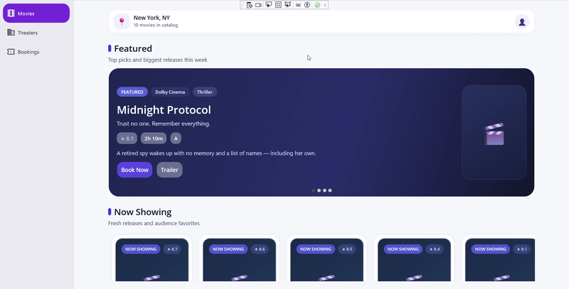

# Movie Booking: .NET MAUI Use Case Sample

A cross-platform movie-discovery and ticket-booking sample built with .NET MAUI and Syncfusion controls. Explore a local movie catalog, choose a theater and showtime, select seats, and view a simulated booking confirmation with a barcode.

## Overview

The Shell navigation provides Movies, Theaters, and Bookings destinations. Seat selection and confirmation complete the booking flow. A local movie assistant matches keywords to sample responses; it does not use AI.

## Key Features

- Featured, popular, and coming-soon movie listings.
- Theater, date, and locally generated showtime selection.
- Seat map with selectable seats, subtotal, convenience fee, and total.
- Simulated confirmation with a generated booking ID and barcode.
- In-memory booking list for the current app session.
- Local keyword-based movie suggestions and sample responses; no AI model is used.

## Data Flow

1. `AppSeed` provides the fictional movie and theater catalog; showtimes are generated locally for the selected movie, theater, and date.
2. The user selects a movie, theater, date, and showtime. These choices are held in the singleton `BookingSession`.
3. `SeatLayoutFactory` builds the sample seat layout. Selecting available seats updates the session and computes subtotal, convenience fee, and total.
4. The confirmation view simulates processing with a short delay, creates a booking record, adds it to `BookingRepository`, resets the session, and displays the generated booking ID/barcode.
5. Bookings displays records in the current process. The repository is in memory and does not restore bookings after restart.
6. Movie-assistant prompts are matched locally to a small set of keywords (such as family, action, top/best/rated, and compare); no AI model or service is used.

The payment step does not contact a payment provider, use card details, or charge money.

## Controls Used

- `SfRotator`: featured-movie carousel.
- `SfListView`: movie, theater, showtime, booking, and assistant-message collections.
- `SfCardView`: movie, booking, and assistant cards.
- `SfPopup`: seat/booking confirmation overlay.
- `SfBarcodeGenerator`: booking barcode on confirmation and booking cards.
- `SfButton`: booking and navigation actions.

The chat-style movie-assistant transcript is composed with `SfListView`; the sample does not use `SfAIAssistView` or an AI service.

## Architecture

The sample uses CommunityToolkit.Mvvm, Shell routes, and dependency-injected services:

- **Views** (`MovieBooking/MovieBooking/Views/`): Movies, Theaters, Bookings, Seat Selection, Payment Confirmation, and the movie assistant.
- **View models** (`MovieBooking/MovieBooking/ViewModels/`): page state and selection/booking commands.
- **Models** (`MovieBooking/MovieBooking/Models/`): movies, theaters, showtimes, seats, and bookings.
- **Services** (`MovieBooking/MovieBooking/Services/`): catalog/showtime services, seat-layout factory, `BookingSession`, in-memory `BookingRepository`, and the local keyword-based movie assistant.
- **Seed data** (`MovieBooking/MovieBooking/AppSeed.cs`): movie and theater data plus showtime generation.

## Prerequisites

- .NET 10 SDK and the .NET MAUI workload.
- A platform workload/device for Android, iOS, Mac Catalyst, or Windows.
- Visual Studio with MAUI support or VS Code with the .NET MAUI extension.
- Syncfusion MAUI packages restored from NuGet. A valid Syncfusion license may be needed to remove evaluation watermarks.

## Configuration

No movie service, payment account, or AI provider is configured. The catalog, bookings, and assistant replies are local sample data/logic.

### Default Behavior

- Movie, theater, showtime, seat, and booking state is local to the app.
- The movie assistant returns sample responses based on prompt keywords; no AI model is used.
- Booking confirmation simulates processing; no payment is taken.

### Environment Variables / Secrets

| Variable | Required | Description |
| --- | --- | --- |
| `SYNCFUSION_LICENSE_KEY` | No | Optional Syncfusion license key. `MauiProgram.cs` registers it when present. |

No AI or payment credentials are required. Do not commit license keys.

### Notes

- Bookings are held in memory and are cleared when the app process restarts.
- A prompt outside the movie assistant's keyword cases receives a generic sample response.
- Register a Syncfusion license through the documented licensing setup if required. See [Syncfusion MAUI licensing](https://help.syncfusion.com/common/licensing/how-to-register-maui-license-key).

## Run

From the repository root, build for a platform workload installed on your machine:

```bash
dotnet build MovieBooking/MovieBooking/MovieBooking/MovieBooking.csproj -f net10.0-android
```

Other supported target frameworks are `net10.0-ios`, `net10.0-maccatalyst`, and `net10.0-windows10.0.19041.0`. You can also open [`MovieBooking.slnx`](MovieBooking/MovieBooking.slnx) in Visual Studio or VS Code, choose a target, and deploy to a device or emulator.

## Output



## Project Structure

- `MovieBooking/MovieBooking.slnx`: solution file.
- `MovieBooking/MovieBooking/`: MAUI app project.
- `MovieBooking/MovieBooking/Views/`: movie browsing, theater/showtime selection, seat selection, confirmation, bookings, and the movie assistant.
- `MovieBooking/MovieBooking/ViewModels/`: presentation state and commands.
- `MovieBooking/MovieBooking/Models/`: movie, theater, showtime, seat, and booking data types.
- `MovieBooking/MovieBooking/Services/`: local data services, session, repository, seat layout, and keyword-based assistant logic.

## Troubleshooting

**No bookings appear after restarting**

Bookings are stored in the in-memory repository and are not persisted.

**No seats can be selected**

Only seats marked Available by the local seat layout can be selected. Choose another showtime to generate a different sample layout.

**The movie assistant gives a generic response**

The local assistant recognizes a small set of keywords; it does not use AI or understand arbitrary prompts.

**Syncfusion evaluation watermark appears**

Set `SYNCFUSION_LICENSE_KEY` before starting the app or register a key through the documented setup; see Configuration → Notes.

## Security and Privacy Notes

- The sample does not require network access, user accounts, or AI services.
- The payment flow is simulated and must not be used for real transactions.
- Movie and booking content is sample data; bookings are not persisted.
- Keep any Syncfusion license key out of source control.

## Supported Platforms

- Android
- iOS
- Windows
- macOS (Mac Catalyst)
