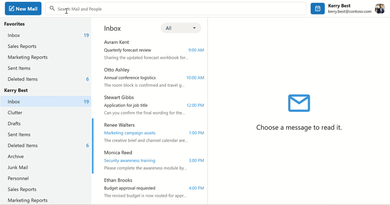

# Fluent Mail: .NET MAUI Use Case Sample



An Outlook-style mail workspace built with [Syncfusion .NET MAUI controls](https://help.syncfusion.com/maui/overview), demonstrating adaptive inbox management, message search and filtering, mail composition, calendar scheduling, and mobile mail workflows using local mock data.

---

## Overview

Fluent Mail is a responsive mail productivity sample built with .NET MAUI and Syncfusion controls. It uses a shared MVVM implementation to provide different desktop and phone experiences from the same local mailbox and calendar state.

The sample demonstrates:

- Desktop and phone mailbox layouts.
- Folder navigation and in-memory folder counts.
- Message search, filters, read and flagged states, archive, and delete actions.
- Desktop rich-text composition and phone plain-text composition.
- Desktop and phone calendar experiences.
- Mobile search, top-contact search, recent searches, swipe actions, and message readers.

All mail, account, contact, attachment, and calendar data is local mock data. The sample does not connect to an email provider or transmit real email.

---

## Key Features

### Adaptive Mail Experience

- Desktop and tablet layouts provide folder navigation, a message list, a reading pane or composer, and a desktop calendar flyout.
- Phone layouts provide a focused/other inbox switcher, grouped mail items, a folder popup, bottom tab navigation, and full-screen message and composer views.
- The interface switches between layouts using `DeviceInfo.Idiom`.

### Folder and Message Management

- Mock folders are grouped under `Favorites` and `Kerry Best`.
- Inbox, Sent Items, Drafts, Archive, Deleted Items, and additional mock folders are created by `MockData.CreateMailbox()`.
- Opening a message marks it as read and refreshes unread folder counts.
- Desktop messages can be marked read or unread, flagged or unflagged, archived, or deleted.
- Phone mail items support swipe-right delete and swipe-left archive actions.

### Mobile Inbox

- Inbox messages are divided into `Focused` and `Other` collections.
- The focused view contains messages in the Inbox folder.
- The other view contains messages from Inbox folder categories such as Personnel, Sales Reports, Clutter, and Marketing Reports.
- Users can sort mobile messages by unread first or newest first.
- The mobile mail tab badge shows the total unread count.

### Search and Filtering

- Desktop search filters the currently selected folder by sender, subject, and preview text.
- Desktop folder filters provide All, Unread, and Flagged views.
- Mobile search spans the Inbox, Sent Items, and Archive collections.
- Mobile filters support text search, unread, flagged, to-me, and attachments.
- The mobile search page includes top contacts, recent searches, and a full-screen result reader.

### Compose Mail

- The desktop compose view uses `SfAutocomplete` for To and Cc recipients and `SfRichTextEditor` for rich-text content.
- The phone compose view uses `SfAutocomplete` for recipients and a plain `Editor`.
- Sending validates that at least one recipient or typed email address is present.
- A sent message is inserted at the top of `SentItems` and the composer resets.
- The Send action displays a demo confirmation and does not call an email service.

### Calendar Management

- Desktop users open a `SfCalendar` flyout from the mailbox header.
- The flyout shows a month calendar, agenda entries for the selected date, and add/delete actions.
- Phone users navigate to a dedicated Calendar page with Agenda, Day, and Month modes.
- The calendar view supports selected dates, day badges, event and reminder entries, locations, and marker icons.
- Adding an entry requires a title and uses the selected date plus the selected time.

---

## Syncfusion Controls Used

| Control | Purpose |
|---|---|
| `SfListView` | Desktop folder/message lists, mobile grouped mail, and calendar agenda lists |
| `SfCalendar` | Desktop calendar flyout and mobile calendar views |
| `SfPopup` | Mobile folder-selection popup |
| `SfAutocomplete` | Desktop and phone recipient selection |
| `SfRichTextEditor` | Desktop rich-text composition |
| `SfComboBox` | Desktop folder filtering and phone mailbox sorting |
| `SfButton` | New mail, send, discard, and calendar actions |

### Additional Technologies

- .NET MAUI Shell
- CommunityToolkit.Mvvm
- Dependency Injection
- MVVM architecture pattern
- `SfListView` DataSource grouping

---

## Supported Platforms

| Platform | Target Framework |
|---|---|
| Android | `net10.0-android` |
| iOS | `net10.0-ios` |
| macOS (Mac Catalyst) | `net10.0-maccatalyst` |
| Windows | `net10.0-windows10.0.19041.0` |

> iOS and Mac Catalyst targets require a compatible non-Linux host. The Windows target is available on Windows hosts.

---

## Prerequisites

- .NET 10 SDK or later
- .NET MAUI workloads
- Visual Studio 2022 (17.14+), Visual Studio Code with the .NET MAUI extension, or JetBrains Rider
- A platform emulator, simulator, or physical device
- Syncfusion .NET MAUI NuGet packages restored from NuGet

Verify the SDK and workloads:

```bash
dotnet --version
dotnet workload list
```

---

## Getting Started

### Open the Solution

Open the following solution from the repository root:

```text
OutlookMail/FluentMail.sln
```

### Restore Packages

```bash
dotnet restore OutlookMail/FluentMail/FluentMail.csproj
```

### Build and Run

Select Android, iOS, Mac Catalyst, or Windows as the target and run the `FluentMail` project.

Example for Android:

```bash
dotnet build OutlookMail/FluentMail/FluentMail.csproj -f net10.0-android
```

The Android build uses the `net10.0-android` target framework.

---

## Architecture

The application uses MVVM and three `.NET MAUI Shell` routes.

### Core Layers

- **Views** (`Views/`) - `MailWorkspacePage`, `SearchPage`, and `CalendarPage`, plus reusable controls in `Views/Controls/`.
- **ViewModels** (`ViewModels/`) - `MailWorkspaceViewModel`, `ComposeViewModel`, `SearchViewModel`, and `CalendarViewModel`.
- **Models** (`Models/`) - mail, folder, contact, account, agenda, calendar, top-contact, and file-item types.
- **Data** (`Data/`) - `Mailbox`, `MockData`, and `CalendarData` contain the local mock collections.
- **Services** (`Services/`) - `IAlertService` and `AlertService` display compose confirmation messages.
- **Converters** (`Converters/`) - UI converters for initials, Boolean negation, date-group titles, and group ordering.

### Runtime Flow

1. `MauiProgram.CreateMauiApp()` registers Syncfusion controls, fonts, the mailbox, alert service, view models, and pages with dependency injection.
2. `MockData.CreateMailbox()` creates folders, mock inbox and sent mail, drafts, archive and deleted items, and contacts.
3. `Mailbox` holds the shared `ObservableCollection` instances and recalculates folder counts through `RefreshCounts()`.
4. `MailWorkspaceViewModel` builds desktop message collections and phone focused/other collections from `Mailbox`.
5. Desktop and phone UI actions add, remove, move, read, flag, and sort messages by updating those shared collections.
6. `ComposeViewModel` adds sent messages to `Mailbox.SentItems` and resets the compose fields.
7. `CalendarViewModel` reads and updates `CalendarData.Entries`, then refreshes agenda groups and calendar markers.

### Navigation

The application uses three primary Shell routes:

- `MailPage`
- `SearchPage`
- `CalendarPage`

The Shell tab bar is disabled; the phone experience provides its own `MobileTabBar` control.

---

## Project Structure

```text
OutlookMail/
├── FluentMail/
│   ├── Views/
│   │   └── Controls/
│   ├── ViewModels/
│   ├── Models/
│   ├── Data/
│   ├── Services/
│   ├── Converters/
│   ├── Resources/
│   └── Platforms/
├── FluentMail.sln
└── OutlookSampleDemo.gif
```

---

## Configuration

No API keys or external service configuration are required.

- All mailbox, contact, calendar, and search data is mock data.
- Mailbox and calendar changes remain in memory for the lifetime of the application process.
- Desktop/tablet and phone layouts are selected using MAUI device idiom.
- Sending mail only creates a local Sent Items entry and shows an alert.

---

## Syncfusion Licensing

Syncfusion controls run in evaluation mode unless a valid license key is registered.

1. Obtain a license key from the [Syncfusion License Portal](https://www.syncfusion.com/account/license).
2. Replace `"YOUR_LICENSE_KEY"` in the `App` constructor in `App.xaml.cs`:

   ```csharp
   Syncfusion.Licensing.SyncfusionLicenseProvider.RegisterLicense("YOUR_LICENSE_KEY");
   ```

For additional information, refer to the [Syncfusion Licensing Documentation](https://help.syncfusion.com/common/licensing/how-to-register-maui-license-key).

> Do not commit license keys to source control.

---

## Limitations

- Mailbox and calendar data are not persisted.
- Application changes are recreated from mock data after a restart.
- Compose actions do not transmit email.
- Search state and recent searches are not persisted.
- The sample does not implement authentication, account synchronization, or external attachments.
- Rich-text composition is available in desktop/tablet layouts; phone composition uses `Editor`.
- Attachment names and file items are simulated data and are not backed by external file storage.

---

## Troubleshooting

### Build Errors

Verify the SDK and installed workloads:

```bash
dotnet --version
dotnet workload list
```

Install the .NET MAUI workload and the workload for the selected platform.

### Syncfusion Evaluation Warning

Ensure a valid Syncfusion license key is registered in `App.xaml.cs`.

### Data Resets After Restart

The sample recreates its mock mailbox and calendar state whenever the application launches.

### Rich Text Editor Not Available on Mobile

The phone compose experience uses a standard `Editor`. Rich-text composition is available in desktop/tablet layouts because `MailWorkspacePage.xaml.cs` binds `SfRichTextEditor` only outside the phone idiom.

### Folder or Unread Counts Look Stale

Folder counts are recalculated after mailbox actions and read-state changes. Reopening or reselecting a folder refreshes the desktop view. The phone view rebuilds mobile collections when unread state changes.

---

## Related Documentation

- [.NET MAUI Documentation](https://learn.microsoft.com/dotnet/maui/)
- [.NET MAUI Shell](https://learn.microsoft.com/dotnet/maui/fundamentals/shell/)
- [.NET MAUI MVVM Guidance](https://learn.microsoft.com/dotnet/architecture/maui/mvvm)
- [Syncfusion .NET MAUI Controls](https://help.syncfusion.com/maui/overview)
- [Syncfusion Licensing Documentation](https://help.syncfusion.com/common/licensing/how-to-register-maui-license-key)

---

## License

This sample is provided for demonstration and learning purposes. Syncfusion controls used in this sample require a valid Syncfusion license for production use.
