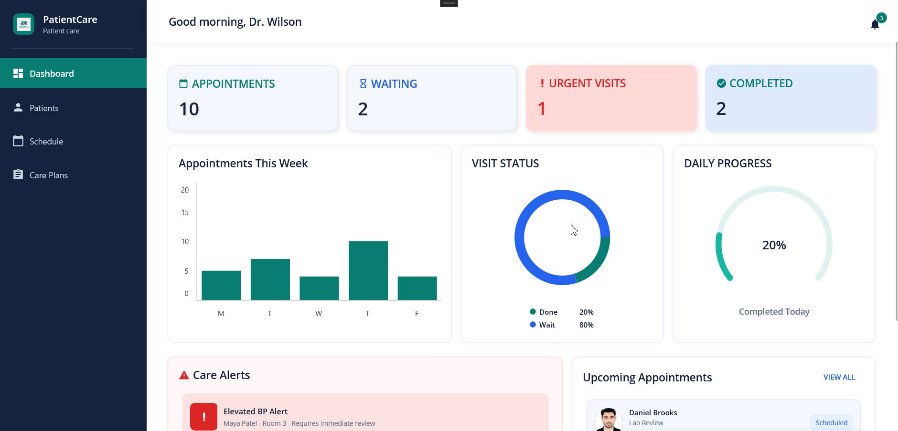

# Patient Care: .NET MAUI Use Case Sample



A clinician-focused healthcare dashboard built with [Syncfusion .NET MAUI controls](https://help.syncfusion.com/maui/overview), demonstrating patient care, schedules, appointments, notifications, and care-plan workflows using local mock data.

---

## Overview

Patient Care demonstrates a desktop and mobile clinical management experience. It provides Dashboard, Patients, Appointments, and Care Plans destinations backed by local services that seed and expose mock clinical data.

The sample does not connect to an electronic health record, notification provider, or external patient system.

---

## Key Features

### Dashboard

- Show clinician and patient-care summaries.
- Display schedule, patient, and care-plan information.
- Navigate between clinical workspace sections.

### Patients

- Browse the local patient directory.
- Select a patient and review the patient presentation.
- Use dashboard services and patient services for derived view state.

### Appointments

- Show scheduled appointments.
- Use the scheduler and appointment data models.
- Navigate and review schedule information.

### Care Plans

- Browse local care plans.
- Display care-plan details and status.
- Use care-plan and notification services.

### Responsive Navigation

- Desktop layouts use sidebar navigation.
- Phone layouts use bottom navigation.
- The app uses device idiom and responsive page layouts.

---

## Syncfusion Controls Used

| Control | Purpose |
|---|---|
| `SfScheduler` | Appointment scheduling |
| `SfListView` | Patient, appointment, and care-plan lists |
| `SfCharts` | Dashboard analytics |
| `SfProgressBar` | Progress and status visualization |
| `SfPopup` | Overlay and dialog workflows |
| `SfTextInputLayout` | Form fields |
| `SfButton` | Application actions |

### Additional Technologies

- .NET MAUI Shell
- Dependency Injection
- Page-specific MVVM view models
- Local mock data services

---

## Supported Platforms

| Platform | Target Framework |
|---|---|
| Android | `net10.0-android` |
| iOS | `net10.0-ios` |
| macOS (Mac Catalyst) | `net10.0-maccatalyst` |
| Windows | `net10.0-windows10.0.19041.0` |

> iOS and Mac Catalyst targets require a compatible non-Linux host. The Windows target is available on Windows hosts.

---

## Prerequisites

- .NET 10 SDK or later
- .NET MAUI workloads
- Visual Studio 2022 (17.14+), Visual Studio Code with the .NET MAUI extension, or JetBrains Rider
- A platform emulator, simulator, or physical device
- Syncfusion .NET MAUI NuGet packages restored from NuGet

---

## Getting Started

### Open the Solution

```text
PatientCare/PatientCare.slnx
```

### Restore Packages

```bash
dotnet restore PatientCare/PatientCare/PatientCare.csproj
```

### Build and Run

Example for Android:

```bash
dotnet build PatientCare/PatientCare/PatientCare.csproj -f net10.0-android
```

---

## Architecture

### Core Layers

- **Views** (`Views/`) - Dashboard, Patients, Appointments, Care Plans, and Splash pages.
- **Controls** (`Controls/`) - sidebar and bottom-navigation controls.
- **ViewModels** (`ViewModels/`) - page state and presentation logic.
- **Models** (`Models/`) - care-plan, dashboard, patient, and schedule entities.
- **Services** (`Services/`) - dashboard, patient, schedule, care-plan, and notification data services.
- **Converters** (`Converters/`) - clinician highlight and status color conversion.

### Runtime Flow

1. `MauiProgram.CreateMauiApp()` registers Syncfusion controls and local data services.
2. Dashboard, patient, schedule, care-plan, and notification services provide seeded data.
3. Page view models consume those services and expose observable presentation state.
4. Desktop and phone navigation surfaces bind to the same application data.
5. Changes remain local to the application process because the sample uses mock services.

---

## Project Structure

```text
PatientCare/
├── PatientCare.slnx
├── patient-care-demo.gif
└── PatientCare/
    ├── Views/
    ├── Controls/
    ├── ViewModels/
    ├── Models/
    ├── Services/
    ├── Converters/
    ├── Resources/
    └── Platforms/
```

---

## Configuration

No external service credentials or API keys are required.

- All patient, clinician, schedule, notification, and care-plan data is mock data.
- The app does not persist changes unless persistence is added.
- The sample is for interface demonstration and must not be used as a clinical system.

---

## Syncfusion Licensing

Register a valid Syncfusion license for licensed use.

Do not commit license keys to source control. For details, refer to [Syncfusion Licensing Documentation](https://help.syncfusion.com/common/licensing/how-to-register-maui-license-key).

---

## Limitations

- Patient and appointment data is not persisted.
- The app does not integrate with an EHR or medical backend.
- Notifications are local mock behavior.
- The sample is not suitable for clinical decision support or real patient data.

---

## Troubleshooting

### Patient or Schedule Data Does Not Persist

The local data services recreate or hold process-local mock data.

### Syncfusion Evaluation Warning

Register a valid Syncfusion license.

### Target Platform Build Errors

Install the required .NET MAUI platform workload and verify the selected target.

---

## Related Documentation

- [.NET MAUI Documentation](https://learn.microsoft.com/dotnet/maui/)
- [.NET MAUI Shell](https://learn.microsoft.com/dotnet/maui/fundamentals/shell/)
- [.NET MAUI MVVM Guidance](https://learn.microsoft.com/dotnet/architecture/maui/mvvm)
- [Syncfusion .NET MAUI Controls](https://help.syncfusion.com/maui/overview)
- [Syncfusion Licensing Documentation](https://help.syncfusion.com/common/licensing/how-to-register-maui-license-key)

---

## License

This sample is provided for demonstration and learning purposes. Syncfusion controls used in this sample require a valid Syncfusion license for production use.
