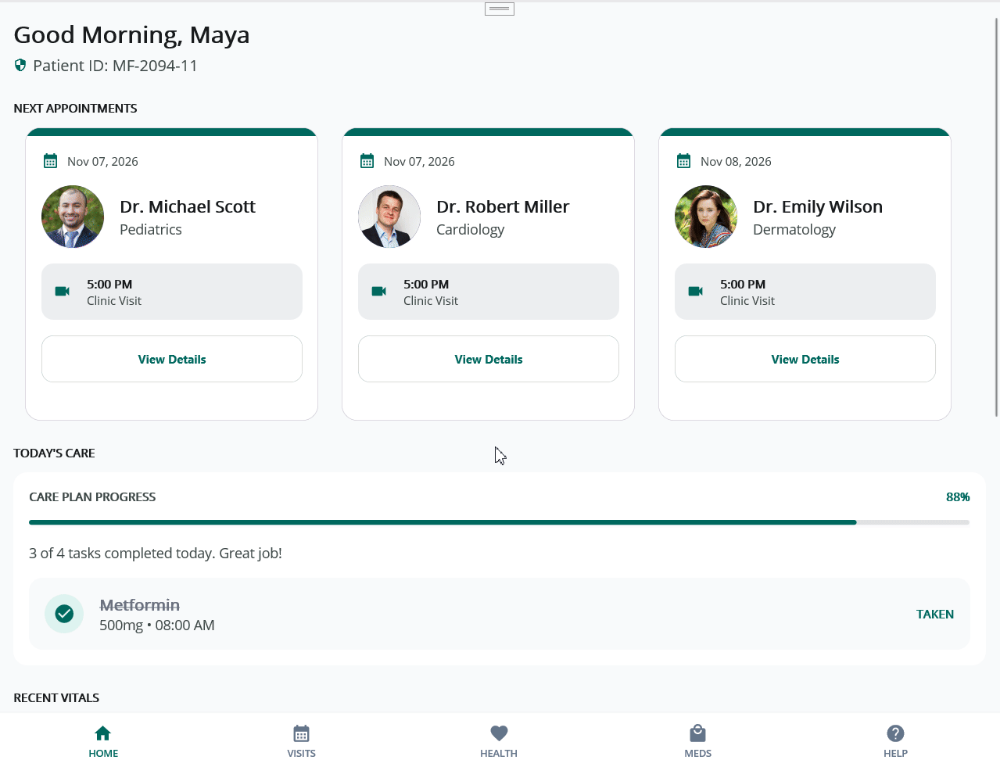

# Patient Companion: .NET MAUI Use Case Sample



A patient-facing healthcare application built with [Syncfusion .NET MAUI controls](https://help.syncfusion.com/maui/overview), demonstrating appointments, doctors, medications, health metrics, visits, records, and responsive navigation using local mock data.

---

## Overview

Patient Companion provides Home, Visits, Medications, Health, Records, Doctors, and appointment-booking experiences. It uses `MockDataService`, `AppointmentService`, and `WorldMapAssetService` with MVVM pages and reusable card controls.

The sample does not connect to a healthcare backend and does not process real medical data.

---

## Key Features

### Home Dashboard

- Show health metrics and upcoming appointments.
- Provide quick actions for visits, medications, records, and appointment booking.
- Navigate to the main patient surfaces.

### Appointments

- Select specialty and doctor.
- Choose date and time.
- Review the appointment before booking.
- Store the booking through the local `AppointmentService`.

### Visits and Records

- Display visit cards and medical record lists.
- Browse visit history and record details.

### Medications

- Display medication groups and medication status.
- Present medication cards and schedules.

### Health

- Display health chart and vital summary cards.
- Show blood-pressure and health chart points.
- Present progress and metric visualizations.

### Doctors and World Map

- Browse doctors and specialties.
- Filter or select doctor availability.
- Load the bundled world-map asset through `WorldMapAssetService`.

---

## Syncfusion Controls Used

| Control | Purpose |
|---|---|
| `SfCardView` | Health and dashboard cards |
| `SfButton` | Appointment and navigation actions |
| `SfCarousel` | Carousels in companion surfaces |
| `SfCircularChart` | Health and metric visualizations |
| `SfListView` | Doctors, visits, records, and medications |
| `SfMaps` | World-map visual asset |
| `SfLinearProgressBar` | Progress indicators |

### Additional Technologies

- CommunityToolkit.Maui
- CommunityToolkit.Mvvm
- .NET MAUI Shell
- Dependency Injection
- MVVM architecture pattern

---

## Supported Platforms

| Platform | Target Framework |
|---|---|
| Android | `net10.0-android` |
| iOS | `net10.0-ios` |
| macOS (Mac Catalyst) | `net10.0-maccatalyst` |
| Windows | `net10.0-windows10.0.19041.0` |

> iOS and Mac Catalyst targets require a compatible non-Linux host. The Windows target is available on Windows hosts.

---

## Prerequisites

- .NET 10 SDK or later
- .NET MAUI workloads
- Visual Studio 2022 (17.14+), Visual Studio Code with the .NET MAUI extension, or JetBrains Rider
- A platform emulator, simulator, or physical device
- Syncfusion .NET MAUI NuGet packages restored from NuGet

---

## Getting Started

### Open the Solution

```text
PatientCompanion/PatientCompanion.slnx
```

### Restore Packages

```bash
dotnet restore PatientCompanion/PatientCompanion/PatientCompanion.csproj
```

### Build and Run

Example for Android:

```bash
dotnet build PatientCompanion/PatientCompanion/PatientCompanion.csproj -f net10.0-android
```

---

## Architecture

### Core Layers

- **Views** (`Views/`) - Home, Visits, Medications, Health, Records, Doctors, and appointment booking pages.
- **Controls** (`Controls/`) - reusable page layout, navigation, card, chart, visit, and progress controls.
- **ViewModels** (`ViewModels/`) - home, visits, doctors, appointments, medications, health, records, and appointment steps.
- **Models** (`Models/`) - appointments, doctors, health metrics, medications, visits, records, and chart types.
- **Services** (`Services/`) - mock data, appointment storage, and world-map asset loading.

### Runtime Flow

1. `MauiProgram.CreateMauiApp()` registers CommunityToolkit packages, Syncfusion controls, services, view models, and pages.
2. `MockDataService` provides the local sample models.
3. `AppointmentService` holds local appointment-booking state.
4. `WorldMapAssetService` reads the bundled map asset for map-based UI.
5. Appointment steps share view-model state for specialty, doctor, date/time, and review.
6. Pages bind to view models that derive presentation data from local mock collections.

---

## Project Structure

```text
PatientCompanion/
├── PatientCompanion.slnx
├── PatientCompanion.gif
└── PatientCompanion/
    ├── Views/
    ├── Controls/
    ├── ViewModels/
    ├── Models/
    ├── Services/
    ├── Converters/
    ├── Resources/
    └── Platforms/
```

---

## Configuration

No API key or backend configuration is required.

- Patient, appointment, medication, health, doctor, and visit data is mock data.
- Appointment state is held by the local application services.
- The sample does not send or receive real health information.

---

## Syncfusion Licensing

Register a valid Syncfusion license for licensed use.

Do not commit license keys to source control. For details, refer to [Syncfusion Licensing Documentation](https://help.syncfusion.com/common/licensing/how-to-register-maui-license-key).

---

## Limitations

- The sample does not persist health or appointment data unless persistence is added.
- It does not integrate with healthcare records or appointment providers.
- Appointment and medical content is fictional.
- The app is not suitable for clinical use or real patient records.

---

## Troubleshooting

### Appointment Data Is Lost

The app stores sample appointment state in local services and does not provide a database.

### Map Assets Do Not Display

Verify that the packaged world-map asset is included in the app resources and that `WorldMapAssetService` can load it.

### Syncfusion Evaluation Warning

Register a valid Syncfusion license.

---

## Related Documentation

- [.NET MAUI Documentation](https://learn.microsoft.com/dotnet/maui/)
- [.NET MAUI Shell](https://learn.microsoft.com/dotnet/maui/fundamentals/shell/)
- [.NET MAUI MVVM Guidance](https://learn.microsoft.com/dotnet/architecture/maui/mvvm)
- [Syncfusion .NET MAUI Controls](https://help.syncfusion.com/maui/overview)
- [Syncfusion Licensing Documentation](https://help.syncfusion.com/common/licensing/how-to-register-maui-license-key)

---

## License

This sample is provided for demonstration and learning purposes. Syncfusion controls used in this sample require a valid Syncfusion license for production use.
