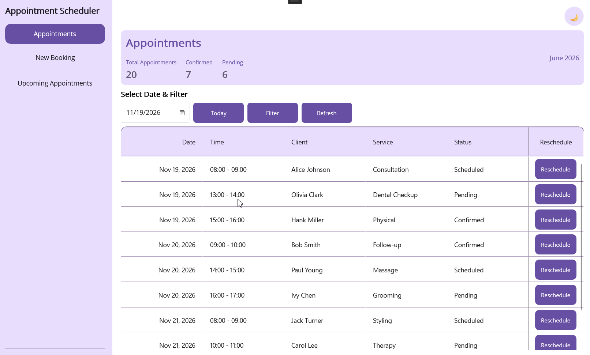

# Appointment Scheduler: .NET MAUI Use Case Sample

An appointment-management sample built with **Syncfusion .NET MAUI SfDataGrid**. It displays locally generated appointment records and demonstrates date filtering, appointment booking, editing, deletion, and rescheduling in platform-specific navigation layouts.

## Overview

The sample provides an appointment list with summary counts, an appointment booking form, an upcoming-appointments view, and appointment details:

- **What the sample does**: Displays appointments and their date, time, client, service, and status; lets users filter by date, book an appointment, reschedule an existing appointment, and edit or delete appointment details.
- **Who it is for**: Developers exploring appointment-management interfaces with .NET MAUI and Syncfusion DataGrid.
- **What it demonstrates**: Binding a Syncfusion `SfDataGrid` to an in-memory service, using viewmodels for list and form state, and adapting navigation for mobile and desktop idioms.
- **What outcome the user gets**: A runnable sample whose appointment data is initialized in memory; no backend or account is configured.

## Key Features

- Appointment list with total, confirmed, and pending counts.
- Date picker and Filter action for the selected date, plus a Refresh action that reloads service data.
- Booking form for client contact information, service, provider, date/time, cost, status, and notes. The booking command uses the viewmodel's one-hour duration; the duration picker shown in the form is not bound to that value.
- Reschedule overlay with date and time pickers; the existing appointment duration is retained.
- Appointment details page with editable client, service, status, cost, and notes fields, plus Save, Delete, and Cancel commands.
- Upcoming view showing appointments in the next seven days; appointment cards can open details.
- Light/dark theme toggle. Phones and tablets use Shell tabs; desktop idioms use a left navigation area.

## Data Flow

1. The app creates an `AppointmentService`, which seeds 20 appointment records in memory.
2. `MainViewModel` loads those records, exposes them to the list, and calculates summary counts.
3. The list binds the records to `SfDataGrid`; the Filter command narrows the grid to the selected date.
4. Booking, editing, deletion, and rescheduling commands call the service and update its in-memory records.
5. The upcoming view requests appointments within seven days from the service.
6. No appointment data is read from or written to a remote service or persistent database.

## Controls Used

- `SfDataGrid` (Syncfusion DataGrid): Appointment rows, date/time and service columns, status, and a row-level Reschedule button.
- `DatePicker` / `TimePicker` (MAUI): Select a list date, booking date/time, or rescheduling date/time.
- `Entry`, `Picker`, and `Editor` (MAUI): Appointment form fields.
- `Button` (MAUI): Today, Filter, Refresh, booking, and detail actions.
- `CollectionView` (MAUI): Upcoming appointment cards.
- `ActivityIndicator` (MAUI): Loading feedback on booking and detail views.

## Architecture

The sample uses viewmodels and an in-memory service:

- **Views**: `MainPage.xaml` shows the appointment grid; `BookingPage.xaml` and `AppointmentDetailsPage.xaml` provide booking and editing forms. `RootPage.xaml` hosts desktop navigation and upcoming cards; `AppShell.xaml` defines the mobile routes and tabs.
- **ViewModels**: `MainViewModel`, `BookingViewModel`, and `AppointmentDetailsViewModel` expose data and commands for their views.
- **Models**: `Appointment.cs` stores appointment and client fields and computes the displayed time slot.
- **Services**: `AppointmentService.cs` seeds and manages the in-memory appointment list. It is registered in `MauiProgram.cs`.
- **Helpers and resources**: `Helpers/RelayCommand.cs` implements the commands; `Resources/Styles/` contains light and dark theme dictionaries.

Data flows from `AppointmentService` to the viewmodels and then to bound XAML controls. The service state is not persisted between app launches.

## Prerequisites

- .NET 10 SDK
- .NET MAUI workload and the workload for the target platform
- Visual Studio 2022 (17.14+) or VS Code with the MAUI extension
- Syncfusion .NET MAUI DataGrid package (the project uses a floating `*` package version and restores it from NuGet)

## Configuration

No application configuration, API keys, or environment variables are required. Appointment records are created by `AppointmentService` in memory.

### Default Behavior

- **Local data**: Each service instance initializes its own set of 20 sample appointment records. Changes are not saved to disk or a backend.
- **Navigation**: The app selects a Shell tab layout on phones and tablets, and a `RootPage` layout on other idioms.

### Environment Variables / Secrets

None required. The sample does not call an external service.

### Notes

- `MauiProgram.cs` does not register a Syncfusion license key. If your Syncfusion license requires registration, add it in `CreateMauiApp()` and keep the key out of source control. See [Syncfusion licensing](https://help.syncfusion.com/common/licensing/how-to-register-maui-license-key).

## Run

From the repository root, build and run on Android:

```bash
dotnet build "SfDataGrid\AppointmentScheduler\AppointmentScheduler\AppointmentScheduler.csproj" -t:Run -f net10.0-android
```

Other target frameworks configured by the project:

```bash
dotnet build "SfDataGrid\AppointmentScheduler\AppointmentScheduler\AppointmentScheduler.csproj" -t:Run -f net10.0-ios
dotnet build "SfDataGrid\AppointmentScheduler\AppointmentScheduler\AppointmentScheduler.csproj" -t:Run -f net10.0-maccatalyst
dotnet build "SfDataGrid\AppointmentScheduler\AppointmentScheduler\AppointmentScheduler.csproj" -t:Run -f net10.0-windows10.0.19041.0
```

The project adds iOS and Mac Catalyst targets outside Linux builds and adds Windows when built on Windows. The sample solution is `SfDataGrid\AppointmentScheduler\AppointmentScheduler.slnx`.

## Output



## Project Structure

- `AppointmentScheduler/`: MAUI app project, app startup, Shell, and page XAML/code-behind
- `AppointmentScheduler/ViewModels/`: Appointment list, booking, and details presentation logic
- `AppointmentScheduler/Models/`: Appointment data model
- `AppointmentScheduler/Services/`: In-memory appointment data service
- `AppointmentScheduler/Helpers/`: Command helper
- `AppointmentScheduler/Resources/`: Theme dictionaries, images, fonts, app icon, and splash screen
- `AppointmentScheduler/Platforms/`: Platform startup and configuration

## Troubleshooting

**Issue 1: The grid still shows appointments from other dates**  
Cause: Changing the date picker updates the selected date, but the grid's explicit date filter is applied by the Filter button.  
Fix: Choose a date and tap **Filter**.

**Issue 2: The booking duration does not change when another duration is selected**  
Cause: The duration `Picker` in `BookingPage.xaml` is not bound to `BookingViewModel.DurationTime`.  
Fix: The current booking command uses the viewmodel's one-hour default; bind the picker to the viewmodel if selectable durations are needed.

**Issue 3: Build or workload errors**  
Cause: The .NET 10 SDK, MAUI workload, or platform workload is missing.  
Fix: Check `dotnet --version` and install the required MAUI workload (`dotnet workload install maui`).

## Security and Privacy Notes

- Appointment data is generated in the app and held in memory; there is no authentication, backend, or network request.
- The sample includes client contact fields and notes. Do not replace the sample records with real personal data without adding suitable storage and privacy protections.
- Do not commit a Syncfusion license key to source control.

## Supported Platforms

- Android
- iOS
- Windows
- macOS (Mac Catalyst)
