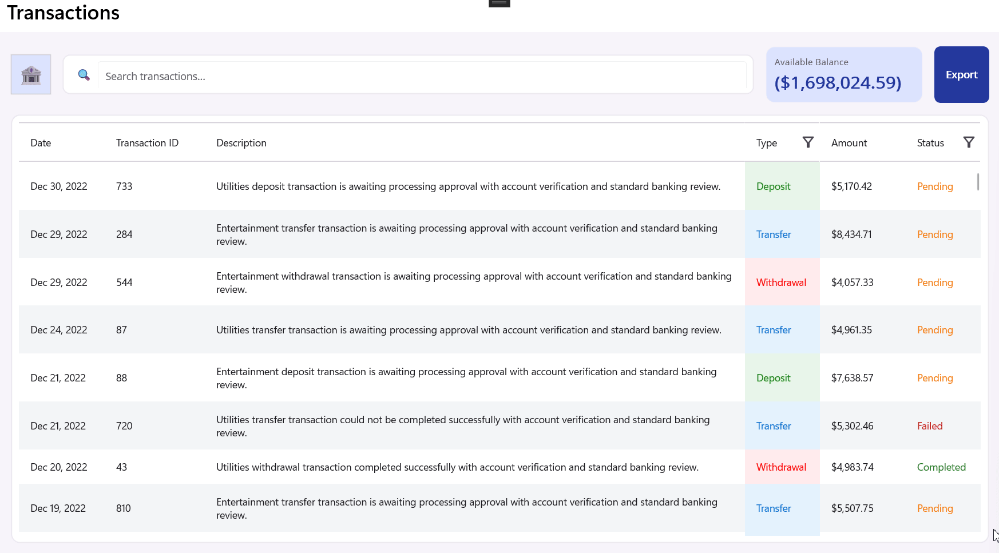

# Banking Transaction: .NET MAUI Use Case Sample

A transaction viewer built with **Syncfusion .NET MAUI SfDataGrid**. It loads a bundled CSV, shows a calculated balance and searchable transaction list, opens selected transaction details, and provides a PDF export action.

## Overview

The sample presents transaction records in a responsive banking-style screen:

- **What the sample does**: Loads `BankingTransaction_Data.csv`, calculates a displayed balance from transaction types, filters rows by search text, opens a details page for a selected transaction, and exports the grid to PDF.
- **Who it is for**: Developers building transaction lists or data-grid export workflows with .NET MAUI.
- **What it demonstrates**: Loading and parsing a bundled CSV, binding an `SfDataGrid`, responsive header layouts, selected-row navigation, and Syncfusion PDF grid export.
- **What outcome the user gets**: A locally loaded transaction sample with no banking account connection or backend.

## Key Features

- Available Balance calculated by adding deposit amounts and subtracting amounts for other transaction types.
- Search by transaction ID, description, type, or status.
- Transaction grid with date, transaction ID, type, amount, and status; description is visible on the wider layout.
- Type and status columns allow DataGrid filtering.
- Selecting a row opens a transaction details page with account fields, amount, fee, status, and notes.
- Export action uses the Syncfusion DataGrid PDF exporter and passes the PDF to a platform save-and-view service.
- Responsive header switches between desktop and mobile layouts at an 800-pixel window width.

## Data Flow

1. `MainPage` calls `TransactionsViewModel.InitializeAsync()` when the page loads.
2. `TransactionDataService` opens the bundled `BankingTransaction_Data.csv` (embedded resource first, with file-path fallbacks), parses its rows, and returns transactions ordered by date descending.
3. `TransactionsViewModel` calculates the balance and applies the current search text to the transaction collection.
4. The `SfDataGrid` binds that collection; selecting a row opens a details page, which loads the matching transaction from the CSV by transaction ID.
5. The Export button exports the displayed grid to a PDF and invokes the platform `SaveService`.
6. The app does not connect to a bank or persist edits to transaction data.

## Controls Used

- `SfDataGrid` (Syncfusion DataGrid): Transaction table, row selection, filtering, and intrinsic row heights.
- `DataGridPdfExportingController` (Syncfusion DataGrid Export): Exports the grid contents to PDF.
- `Entry` (MAUI): Search field bound to `SearchText`.
- `Border`, `Grid`, and `VisualStateManager` (MAUI): Responsive balance/search headers and layout.
- `Button` (MAUI): Export action.
- `NavigationPage` / Shell navigation (MAUI): Transaction details navigation.

## Architecture

The sample separates CSV loading, presentation state, and page rendering:

- **Views**: `MainPage.xaml` contains the responsive transaction list and export button; `TransactionDetailsPage.xaml` displays the selected transaction.
- **ViewModels**: `TransactionsViewModel` loads, filters, and calculates the balance; `TransactionDetailsViewModel` resolves the selected transaction.
- **Models**: `BankTransaction.cs` defines transaction fields and display properties for date, amount, and fee.
- **Services**: `TransactionDataService.cs` reads and parses the packaged CSV; `SaveService.cs` is implemented with platform-specific save behavior under `Platforms/`.
- **Converters and resources**: `Converters/TypeToColorConverter.cs` and related converters style type/status cells; `Resources/Styles/` contains the app styles.
- **Startup and navigation**: `MauiProgram.cs` registers the data service, viewmodels, pages, and `AppShell`; the Shell creates the main transaction page.

Data flows from the bundled CSV through `TransactionDataService` and `TransactionsViewModel` to the bound grid and details view.

## Prerequisites

- .NET 10 SDK
- .NET MAUI workload and the workload for the target platform
- Visual Studio 2022 (17.14+) or VS Code with the MAUI extension
- Syncfusion .NET MAUI DataGrid and DataGrid Export packages (v34.2.5 in the project); restore them from NuGet

## Configuration

No API configuration or credentials are required. The project includes `BankingTransaction_Data.csv` as both a MAUI asset and an embedded resource.

### Default Behavior

- **Local data**: Transactions are loaded from the packaged CSV. Search and balance calculation run locally.
- **Export**: The PDF export writes through platform-specific code in `Platforms/SaveService.cs` and may open a file picker or viewer according to platform.

### Environment Variables / Secrets

None required. The sample does not call an external service.

### Notes

- `MauiProgram.cs` does not register a Syncfusion license key. If your Syncfusion license requires registration, add it in `CreateMauiApp()` and keep the key out of source control. See [Syncfusion licensing](https://help.syncfusion.com/common/licensing/how-to-register-maui-license-key).

## Run

From the repository root, build and run on Android:

```bash
dotnet build "SfDataGrid\BankingTransaction\BankingTransaction\BankingTransaction.csproj" -t:Run -f net10.0-android
```

Other target frameworks configured by the project:

```bash
dotnet build "SfDataGrid\BankingTransaction\BankingTransaction\BankingTransaction.csproj" -t:Run -f net10.0-ios
dotnet build "SfDataGrid\BankingTransaction\BankingTransaction\BankingTransaction.csproj" -t:Run -f net10.0-maccatalyst
dotnet build "SfDataGrid\BankingTransaction\BankingTransaction\BankingTransaction.csproj" -t:Run -f net10.0-windows10.0.19041.0
```

The project adds iOS and Mac Catalyst targets outside Linux builds and adds Windows when built on Windows. The solution is `SfDataGrid\BankingTransaction\BankingTransaction.slnx`.

## Output



## Project Structure

- `BankingTransaction/`: MAUI app project, startup, Shell, and transaction pages
- `BankingTransaction/ViewModels/`: Transaction-list and detail presentation logic
- `BankingTransaction/Models/`: Transaction data model and formatted values
- `BankingTransaction/Services/`: CSV loader/parser and save service
- `BankingTransaction/Converters/`: Grid cell color converters
- `BankingTransaction/Platforms/`: Platform startup and file save implementations
- `BankingTransaction/Resources/`: App icon, splash screen, images, and styles
- `BankingTransaction/BankingTransaction_Data.csv`: Bundled transaction data

## Troubleshooting

**Issue 1: The transaction list is empty**  
Cause: The CSV asset/resource cannot be found or contains no valid rows.  
Fix: Confirm `BankingTransaction_Data.csv` remains included as both a `MauiAsset` and `EmbeddedResource` in the project file.

**Issue 2: The exported PDF does not open or save**  
Cause: Saving and viewing are delegated to platform-specific `SaveService` code and platform file APIs.  
Fix: Verify the target platform's `SaveService.cs` implementation and file/viewer permissions or picker behavior.

**Issue 3: Build or workload errors**  
Cause: The .NET 10 SDK, MAUI workload, or platform workload is missing.  
Fix: Check `dotnet --version` and install the required MAUI workload (`dotnet workload install maui`).

## Security and Privacy Notes

- The CSV is packaged with the app and includes transaction and account-like fields. Treat it as sample data; do not insert real account or transaction details without appropriate access controls and storage protections.
- The app has no authentication, bank connection, or external data service.
- Exported PDFs can contain the transaction data shown in the grid. Store and share exported files carefully.
- Do not commit a Syncfusion license key to source control.

## Supported Platforms

- Android
- iOS
- Windows
- macOS (Mac Catalyst)
