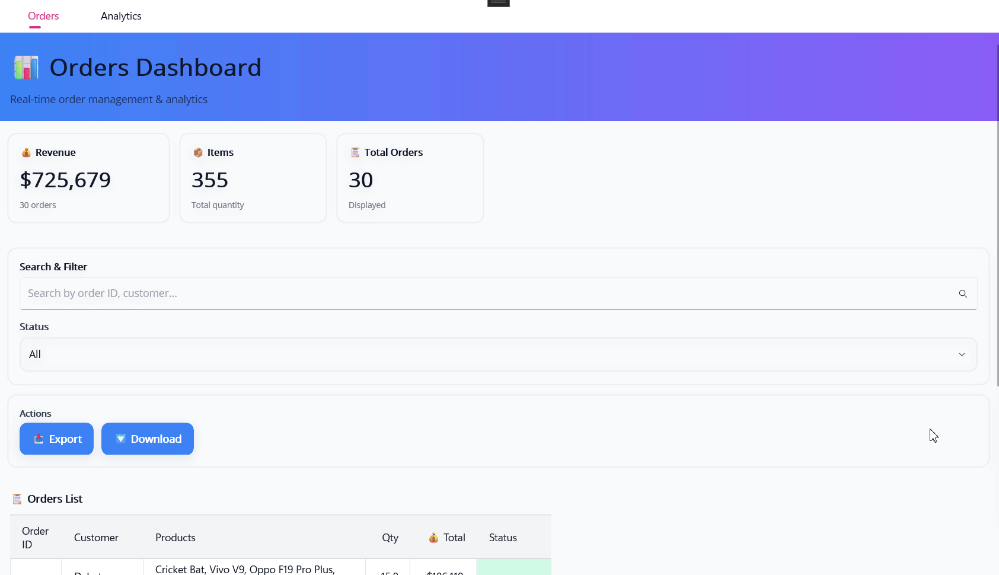

# E-Commerce Orders: .NET MAUI Use Case Sample

An order-list and sales-analytics sample built with **Syncfusion .NET MAUI controls**. It fetches order-like records from public JSON APIs, supports search and status filtering, displays order details and summary metrics, and includes PDF and Excel export actions.

## Overview

The sample combines a paged order list, a sales analytics tab, and an order detail workflow:

- **What the sample does**: Requests data from FakeStoreAPI `/orders` and DummyJSON `/carts`, maps the responses to order models, and displays the combined results in an order grid.
- **Who it is for**: Developers exploring order-management lists, filtering, data paging, analytics summaries, and grid export in .NET MAUI.
- **What it demonstrates**: Syncfusion `SfDataGrid`, `SfDataPager`, popup workflows, DataGrid PDF/Excel export, and viewmodels that shape HTTP response data for XAML.
- **What outcome the user gets**: An order dashboard and details UI that depends on network responses from the configured public endpoints; it does not use a local bundled order dataset.

## Key Features

- Orders tab with revenue and item totals for the currently filtered results.
- Search by order ID, customer name, or product summary, and filter by All, Pending, Shipped, or Delivered status.
- `SfDataPager` displays eight rows per page.
- Selecting a row opens order details with customer, products, prices, calculated tax and shipping, and a fixed status timeline.
- Analytics tab loads order data and shows totals, status distribution, fulfillment rate, and other summary values.
- PDF and Excel workbook export actions use Syncfusion DataGrid export controllers.
- Contact Support opens an issue form and shows a local confirmation after required details are entered; no support request is sent to a service.
- Reorder creates a temporary order object and displays a confirmation; the order is not added to a persistent order store.

## Data Flow

1. `MainPage` calls `OrdersViewModel.LoadAsync()` when it appears.
2. `ApiService` makes independent HTTP GET requests to `https://fakestoreapi.com/orders` and `https://dummyjson.com/carts`. Successful responses are mapped to `Order` and `ProductItem` objects; names and some statuses are assigned by the sample code.
3. `OrdersViewModel` combines the returned records, applies the current search and status filters, and updates the observable collection and list totals.
4. The grid binds to the `SfDataPager` paged source. Selecting an order stores it in `App.SelectedOrder` and navigates to the details page.
5. The Analytics page calls the same API service independently and calculates its metrics from the records returned for that request.
6. API failures are caught individually; the sample may show partial results or no rows when the endpoints are unavailable. No offline order dataset is included.

## Controls Used

- `SfDataGrid` (Syncfusion DataGrid): Paged order rows and selection.
- `SfDataPager` (Syncfusion DataPager): Page navigation with a page size of eight.
- `SfPopup` (Syncfusion Popup): Support issue form on the order details page.
- `DataGridPdfExportingController` / `DataGridExcelExportingController` (Syncfusion DataGrid Export): PDF and Excel export actions.
- `SearchBar`, `Picker`, `RefreshView`, `CollectionView`, and `Button` (MAUI): Search, status selection, analytics refresh, order products, and actions.
- `ProgressBar` (MAUI): Analytics status percentages.

## Architecture

The app uses page-level viewmodels and a service for API mapping:

- **Views**: `MainPage.xaml` contains the orders dashboard and grid; `AnalyticsPage.xaml` shows metrics; `OrderDetailPage.xaml` shows selected-order information and its support/reorder UI.
- **ViewModels**: `OrdersViewModel` loads and filters list records; `AnalyticsViewModel` calculates analytics; `OrderDetailViewModel` prepares detail totals and support-form state; `BaseViewModel` provides property notification.
- **Models**: `Order.cs` and `ProductItem.cs` represent the API-mapped records and computed product summaries.
- **Services**: `ApiService.cs` calls the two public APIs. `Services/SaveService.cs` declares the file save partial method used by export handlers.
- **Converters and resources**: `Converters/` provides status coloring; `Resources/Styles/` and `Resources/Colors.xaml` define app styling.
- **Navigation and startup**: `AppShell.xaml` provides Orders and Analytics tabs and an order-detail route. Pages create their viewmodels directly; `MauiProgram.cs` configures the app, Syncfusion core, fonts, and debug logging.

Data flows from the HTTP responses through `ApiService` and page viewmodels to the grid, detail page, and analytics UI.

## Prerequisites

- .NET 10 SDK
- .NET MAUI workload and the workload for the target platform
- Visual Studio 2022 (17.14+) or VS Code with the MAUI extension
- Network access to the two API endpoints used by `ApiService`
- Syncfusion .NET MAUI packages and export dependencies (the project uses floating `*` package versions restored from NuGet)

## Configuration

No API keys or environment variables are required. The endpoint URLs are hard-coded in `Services/ApiService.cs`; the app makes network requests whenever it loads or refreshes data.

### Default Behavior

- **Remote data**: Responses from FakeStoreAPI and DummyJSON are combined when available. If a request fails, its exception is swallowed and the other endpoint may still contribute results.
- **Sample-only workflows**: Reorder and support confirmation are local UI demonstrations; they do not call a backend or persist data.
- **Analytics labels**: The growth rate, average delivery time, and customer satisfaction text are fixed XAML values, not calculated from the API data.

### Environment Variables / Secrets

None required. The app does not send credentials, but it does make GET requests to the configured public endpoints.

### Notes

- `MauiProgram.cs` does not register a Syncfusion license key. If your Syncfusion license requires registration, add it in `CreateMauiApp()` and keep the key out of source control. See [Syncfusion licensing](https://help.syncfusion.com/common/licensing/how-to-register-maui-license-key).
- The export handlers call `SaveService.SaveAndView`; this project contains a partial declaration but no platform-specific implementation alongside it. Verify a matching implementation is available for the target before relying on file saving.

## Run

From the repository root, build and run on Android:

```bash
dotnet build "SfDataGrid\E-Commerce Orders\E-Commerce Orders\E-Commerce Orders.csproj" -t:Run -f net10.0-android
```

Other target frameworks configured by the project:

```bash
dotnet build "SfDataGrid\E-Commerce Orders\E-Commerce Orders.csproj" -t:Run -f net10.0-ios
dotnet build "SfDataGrid\E-Commerce Orders\E-Commerce Orders.csproj" -t:Run -f net10.0-maccatalyst
dotnet build "SfDataGrid\E-Commerce Orders\E-Commerce Orders.csproj" -t:Run -f net10.0-windows10.0.19041.0
```

The project adds iOS and Mac Catalyst targets outside Linux builds and adds Windows when built on Windows. The solution is `SfDataGrid\E-Commerce Orders\E-Commerce Orders.slnx`.

## Output



## Project Structure

- `E-Commerce Orders/`: MAUI app project, Shell, and order, analytics, and details pages
- `E-Commerce Orders/ViewModels/`: Order-list, analytics, and details presentation logic
- `E-Commerce Orders/Models/`: Order and product data models
- `E-Commerce Orders/Services/`: Public API client and save-service partial declaration
- `E-Commerce Orders/Converters/`: Order status color converters
- `E-Commerce Orders/Resources/`: Styles, colors, images, app icon, and splash screen
- `E-Commerce Orders/Platforms/`: Platform startup/configuration

## Troubleshooting

**Issue 1: The order list or analytics page is empty or incomplete**  
Cause: The app requests data from two external endpoints and does not include an offline order dataset. Each failed request is caught independently.  
Fix: Check network access to both URLs in `Services/ApiService.cs`; if only one endpoint responds, only its returned records are available.

**Issue 2: Export does not save or open a file**  
Cause: Export handlers call a partial `SaveService.SaveAndView` method, but a platform-specific implementation is not included with this sample.  
Fix: Provide a matching platform implementation for the target before using the export actions.

**Issue 3: Build or workload errors**  
Cause: The .NET 10 SDK, MAUI workload, platform workload, or NuGet restore is missing.  
Fix: Check `dotnet --version`, install the required MAUI workload (`dotnet workload install maui`), and restore packages.

## Security and Privacy Notes

- The app sends GET requests to FakeStoreAPI and DummyJSON. Do not treat those endpoints or the returned sample records as a private or production data store.
- No credentials, payment processing, or customer data submission endpoint is configured.
- The support form only validates and displays a local confirmation; it does not send the entered details to a server.
- Export files may contain the order rows shown in the grid. Handle them according to the sensitivity of any data used if adapting the sample.
- Do not commit a Syncfusion license key to source control.

## Supported Platforms

- Android
- iOS
- Windows
- macOS (Mac Catalyst)
