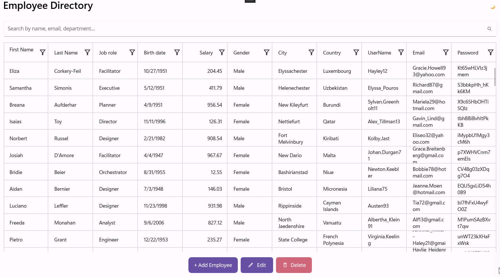

# Employee Directory: .NET MAUI Use Case Sample

An employee directory built with **Syncfusion .NET MAUI SfDataGrid**. It loads packaged JSON records, supports grid search, sorting, and filtering, and provides add, edit, and delete workflows backed by in-memory collections.

## Overview

The sample presents employee records in a searchable grid and a separate form for adding or editing entries:

- **What the sample does**: Loads employees from `Resources/Raw/EmployeeData.json`, displays selected employee fields, and allows users to add, edit, or delete entries in the current app session.
- **Who it is for**: Developers building directory or staff-list interfaces with .NET MAUI and Syncfusion DataGrid.
- **What it demonstrates**: Syncfusion grid search, multi-column sorting and filtering, CommunityToolkit observable models, and Shell theme switching.
- **What outcome the user gets**: A local directory sample with no backend connection; edits are held in memory and are not written back to the packaged JSON.

## Key Features

- Employee grid with first name, last name, job role, birth date, salary amount, gender, city, and country.
- Grid search through the DataGrid search controller and built-in filtering and multiple-column sorting.
- Add and edit forms for employee identity, job, email, city, and country fields.
- Required-field checks for first name, last name, email, job type, and user name before saving a form.
- Delete selected employee after confirmation.
- Light/dark theme toggle updates app colors and the Syncfusion visual theme.
- Employees are loaded from a bundled JSON resource; create, update, and delete operations affect only the in-memory collections.

## Data Flow

1. `EmployeeListPage` creates an `EmployeeViewModel` and executes its load command.
2. `EmployeeService` reads `EmployeeData.json` from the app package and deserializes it into `Employee` models.
3. The viewmodel populates its `Employees` and `FilteredEmployees` observable collections, which are bound to `SfDataGrid`.
4. Text entered in the search bar is passed to the DataGrid `SearchController`; grid filtering and sorting are provided by the grid.
5. Add and edit workflows use the same viewmodel and collections; delete removes the selected model from those collections.
6. No service writes changes to the JSON file or to persistent storage.

## Controls Used

- `SfDataGrid` (Syncfusion DataGrid): Employee rows, multiple-column sorting, filtering, selection, and search controller.
- `SearchBar` (MAUI): Search text forwarded to the DataGrid search controller.
- `Entry` (MAUI): Add/edit form fields.
- `Button` (MAUI): Add, edit, delete, save, cancel, and theme toggle actions.
- `Shell` / `ToolbarItem` (MAUI): Employee directory route and theme toggle.
- `DisplayAlertAsync` (MAUI): Required-field messages and delete confirmation.

## Architecture

The sample uses a viewmodel, a JSON-loading service, and an observable model:

- **Views**: `Views/EmployeeListPage.xaml` contains the searchable directory grid; `Views/AddEditEmployeePage.xaml` contains the add/edit form. `AppShell.xaml` hosts the directory page and theme toggle.
- **ViewModels**: `EmployeeViewModel.cs` loads employees and updates the in-memory collections used by the pages.
- **Models**: `Employee.cs` is a `CommunityToolkit.Mvvm` `ObservableObject` with JSON property mappings and a clone method for editing.
- **Services**: `EmployeeService.cs` reads the packaged JSON; `ThemeService.cs` updates the app resource colors, `UserAppTheme`, and Syncfusion theme.
- **Resources**: `Resources/Raw/EmployeeData.json` is packaged as a MAUI asset; `Resources/Styles/` contains the shared styles and colors.
- **Startup and navigation**: `MauiProgram.cs` registers MAUI and Syncfusion core, fonts, and a routing setup method; the employee page constructs its viewmodel and service directly.

Data flows from the packaged JSON through `EmployeeService` and `EmployeeViewModel` to `FilteredEmployees` and the bound grid. Add/edit/delete operations update the observable collections only.

## Prerequisites

- .NET 10 SDK
- .NET MAUI workload and the workload for the target platform
- Visual Studio 2022 (17.14+) or VS Code with the MAUI extension
- CommunityToolkit.Mvvm 8.4.0 and Syncfusion .NET MAUI DataGrid/Core packages (Syncfusion versions use `*` in the project file and restore from NuGet)

## Configuration

No API configuration, environment variables, or credentials are required. The employee records are loaded from the bundled `Resources/Raw/EmployeeData.json` asset.

### Default Behavior

- **Local data**: The JSON asset is read-only at runtime. New, changed, and deleted employees are not persisted across app launches.
- **Theme**: The app starts with the light color set; the toolbar button switches between the light and dark palettes.

### Environment Variables / Secrets

None required. The sample does not call an external service.

### Notes

- `MauiProgram.cs` does not register a Syncfusion license key. If your Syncfusion license requires registration, add it in `CreateMauiApp()` and keep the key out of source control. See [Syncfusion licensing](https://help.syncfusion.com/common/licensing/how-to-register-maui-license-key).

## Run

From the repository root, build and run on Android:

```bash
dotnet build "SfDataGrid\EmployeeDirectory\EmployeeDirectory\EmployeeDirectory.csproj" -t:Run -f net10.0-android
```

Other target frameworks configured by the project:

```bash
dotnet build "SfDataGrid\EmployeeDirectory\EmployeeDirectory\EmployeeDirectory.csproj" -t:Run -f net10.0-ios
dotnet build "SfDataGrid\EmployeeDirectory\EmployeeDirectory\EmployeeDirectory.csproj" -t:Run -f net10.0-maccatalyst
dotnet build "SfDataGrid\EmployeeDirectory\EmployeeDirectory\EmployeeDirectory.csproj" -t:Run -f net10.0-windows10.0.19041.0
```

The project includes Android, iOS, and Mac Catalyst targets and adds Windows when built on Windows. The solution is `SfDataGrid\EmployeeDirectory\EmployeeDirectory\EmployeeDirectory.slnx`.

## Output



## Project Structure

- `EmployeeDirectory/`: MAUI app project, application startup, Shell, and root page
- `EmployeeDirectory/Views/`: Employee list and add/edit pages
- `EmployeeDirectory/ViewModels/`: Employee list, search, and collection operations
- `EmployeeDirectory/Models/`: Observable employee model with JSON mappings
- `EmployeeDirectory/Services/`: Packaged JSON loader and theme service
- `EmployeeDirectory/Resources/`: Employee JSON asset, styles, images, app icon, and splash screen
- `EmployeeDirectory/Platforms/`: Platform startup and configuration

## Troubleshooting

**Issue 1: The employee list is empty**  
Cause: The packaged JSON asset is missing or cannot be deserialized.  
Fix: Confirm `Resources/Raw/EmployeeData.json` is included as a `MauiAsset` with the logical name `EmployeeData.json`.

**Issue 2: Added or edited employees revert after restarting**  
Cause: `EmployeeService` only reads the packaged JSON, while form operations modify the viewmodel's in-memory collections.  
Fix: This is the current sample behavior; persistence requires a storage implementation.

**Issue 3: Build or workload errors**  
Cause: The .NET 10 SDK, MAUI workload, platform workload, or NuGet restore is missing.  
Fix: Check `dotnet --version`, install the required MAUI workload (`dotnet workload install maui`), and restore packages.

## Security and Privacy Notes

- `EmployeeData.json` is packaged in the app, and the `Employee` model deserializes a `password` property as well as employee fields. The current directory and add/edit UI do not display a password field. Treat this bundled data as sample-only; do not package real employee credentials or sensitive employee information in a client app.
- The sample has no authentication, backend, or external data calls. Employee edits remain in memory.
- The grid displays salary, birth date, location, and gender fields from the employee model; consider data minimization and access controls before adapting it for real staff records.
- Do not commit a Syncfusion license key to source control.

## Supported Platforms

- Android
- iOS
- Windows
- macOS (Mac Catalyst)
