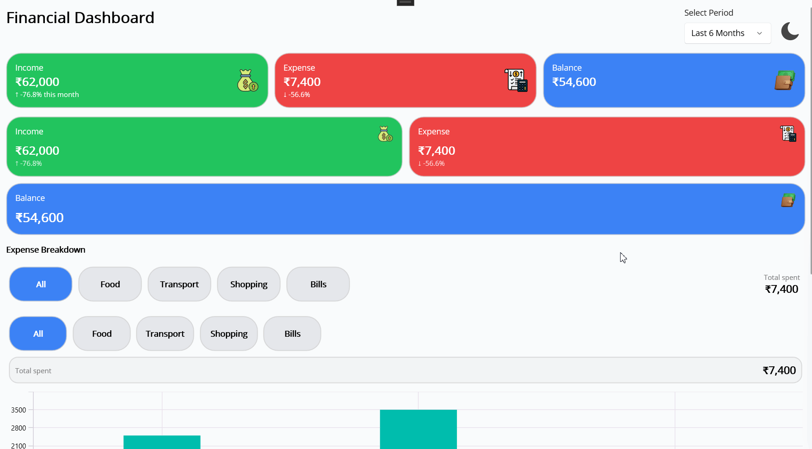

# Financial Tracker: .NET MAUI Use Case Sample

A personal-finance dashboard built with **Syncfusion .NET MAUI controls**, presenting bundled transaction data as income and expense summaries, a category breakdown, and a filterable transaction grid.

## Overview

The sample shows one way to explore local financial transactions in a .NET MAUI application:

- **What the sample does**: Displays income, expense, balance, and change summaries; filters transactions by date period and expense category; and visualizes expenses by category.
- **Who it is for**: Developers exploring data grids, charts, and local-data filtering in .NET MAUI.
- **What it demonstrates**: Binding a view model to Syncfusion DataGrid, ListView, and Cartesian Chart controls, and loading transaction records from an app-bundled JSON file.
- **What outcome the user gets**: An interactive financial dashboard using local sample data; it does not connect to a bank or other service.

## Key Features

- Summary values for income, expenses, and balance, with changes calculated against the preceding period for the selected date filter.
- Date filters for All, This Month, Last Month, Last 3 Months, Last 6 Months, This Year, and Last Year.
- Expense category selection for All, Food, Transport, Shopping, and Bills.
- Expense-by-category column chart and transaction table showing date, category, type, amount, and running balance.
- Light/dark appearance toggle.
- Transaction records loaded from the bundled `transactions.json` file; the app does not provide transaction editing or entry screens.

## Data Flow

1. The single Shell content page creates a `FinanceViewModel`.
2. The view model reads `transactions.json` from the app package and deserializes it into `Transaction` objects.
3. It calculates running balances in date order and publishes observable transaction and chart collections.
4. Changing the date period recalculates the date-scoped summary and filters the transaction data. Changing the category further filters the grid and expense chart; the income, expense, and balance summary remains date-scoped.
5. The bound labels, `SfListView`, `SfCartesianChart`, and `SfDataGrid` display the updated values. All records remain bundled/local; the app has no backend calls.

## Controls Used

- `SfDataGrid` (DataGrid): Transaction table with date, category, type, amount, and balance columns.
- `SfCartesianChart` / `ColumnSeries` (Charts): Expense totals grouped by category.
- `SfListView` (ListView): Category selection.
- .NET MAUI `Picker`: Date-period selection.
- .NET MAUI `ImageButton`: Dashboard actions and light/dark appearance toggle.

## Architecture

The sample uses a small MVVM structure without a separate service layer:

- **Views**: `MainPage.xaml` defines the dashboard and creates its view model in XAML; `MainPage.xaml.cs` handles category selection and theme changes.
- **ViewModel**: `ViewModel/FinanceViewModel.cs` loads the bundled data, calculates summaries and balances, applies filters, and prepares chart data.
- **Models**: `Model/Transaction.cs` and `Model/ChartData.cs` describe transaction and chart records.
- **Startup and resources**: `MauiProgram.cs` configures MAUI and Syncfusion; `AppShell` opens `MainPage`. Shared colors and styles are under `Resources/Styles/`.

Data flows from `Resources/Raw/transactions.json` through `FinanceViewModel` to the bound dashboard controls. The app does not persist user changes.

## Prerequisites

- .NET 10 SDK
- .NET MAUI workload and the workload for the target platform (Android, iOS, Mac Catalyst, or Windows)
- NuGet restore access for the project dependencies. Syncfusion Charts, Core, DataGrid, and ListView package references use floating (`*`) versions in the project file.

## Configuration

No application configuration is required. Transactions are read from the bundled `Resources/Raw/transactions.json` asset; there are no environment variables, API keys, or credentials.

### Default Behavior

- **Local/offline logic**: The dashboard uses the bundled sample data and makes no network requests.
- The displayed transaction amounts use Indian rupee formatting in the dashboard.

### Environment Variables / Secrets

None required.

### Notes

- Syncfusion controls may show evaluation-mode indicators without a registered license. If you have a Syncfusion license, register it in `MauiProgram.cs` using the [Syncfusion MAUI licensing instructions](https://help.syncfusion.com/common/licensing/how-to-register-maui-license-key). Do not commit a license key.

## Run

From the repository root:

```bash
dotnet build SfDataGrid\FinancialTracker\FinancialTracker\FinancialTracker.csproj -t:Run -f net10.0-android
```

Other target frameworks declared by the project:

```bash
dotnet build SfDataGrid\FinancialTracker\FinancialTracker\FinancialTracker.csproj -t:Run -f net10.0-ios
dotnet build SfDataGrid\FinancialTracker\FinancialTracker\FinancialTracker.csproj -t:Run -f net10.0-maccatalyst
dotnet build SfDataGrid\FinancialTracker\FinancialTracker.csproj -t:Run -f net10.0-windows10.0.19041.0
```

Or open `SfDataGrid\FinancialTracker\FinancialTracker.slnx` in a compatible .NET MAUI IDE, restore packages, and deploy to a target platform.

## Output



## Project Structure

- `FinancialTracker/`: MAUI application source and project file
- `FinancialTracker/MainPage.xaml`: Dashboard layout, data grid, category list, and chart
- `FinancialTracker/ViewModel/`: Finance dashboard state and filtering logic
- `FinancialTracker/Model/`: Transaction and chart data models
- `FinancialTracker/Resources/Raw/transactions.json`: Bundled transaction data
- `FinancialTracker/Resources/Styles/`: App colors and styles
- `FinancialTracker/Platforms/`: Platform entry points and configuration
- `FinancialTracker.slnx`: Solution file
- `FinanceTrackerDemo.gif`: Sample output animation

## Troubleshooting

**Issue 1: The dashboard has no transaction rows or chart data**  
Cause: The bundled JSON asset is missing, renamed, or cannot be deserialized.  
Fix: Confirm `FinancialTracker/Resources/Raw/transactions.json` exists and is included as a MAUI asset in the project.

**Issue 2: Build or workload errors**  
Cause: The .NET 10 SDK or target platform workload is unavailable.  
Fix: Check `dotnet --version` and install the MAUI workload and required platform workload.

**Issue 3: Syncfusion evaluation indicators appear**  
Cause: A Syncfusion license has not been registered.  
Fix: Follow the licensing instructions under Configuration.

## Security and Privacy Notes

- The bundled transactions are sample data; the app does not access accounts, request credentials, or send financial data over a network.
- Do not add real financial records or credentials to the bundled JSON file.
- If extending the sample to use real account data, use an appropriately secured data source and protect any credentials; this sample does not implement those protections.

## Supported Platforms

- Android
- iOS
- Windows
- macOS (Mac Catalyst)
