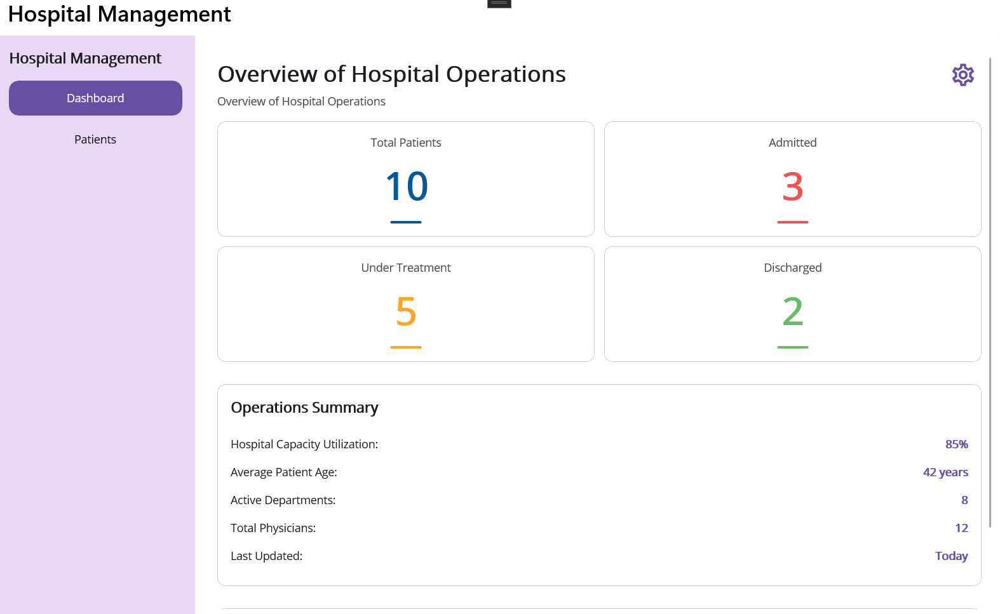

# Hospital Management: .NET MAUI Use Case Sample

A hospital operations and patient-records sample built with **Syncfusion .NET MAUI DataGrid**, showing status summaries, searchable patient records, and a patient entry form backed by in-memory sample records.

## Overview

The sample demonstrates a basic hospital dashboard and patient-record workflow:

- **What the sample does**: Shows patient counts by status, displays patient records in a searchable and status-filterable grid, and provides a form to add a patient.
- **Who it is for**: Developers exploring data-grid workflows, forms, and platform-specific navigation in .NET MAUI.
- **What it demonstrates**: Using a shared in-memory `PatientService`, view models for dashboard and record data, Syncfusion DataGrid and Button controls, and light/dark styling.
- **What outcome the user gets**: A local demonstration of patient-record browsing and entry. Records are not saved beyond the running app process.

## Key Features

- Dashboard counts for total patients, admitted, discharged, and under-treatment patients. These counts come from the current in-memory patient list.
- Patient record grid with patient ID, name, age, diagnosis, assigned doctor, admission date, status, and department columns.
- Search by patient name, diagnosis, patient ID, or assigned doctor.
- Status filter for All, Admitted, Discharged, or Under Treatment, plus a refresh action.
- Add-patient form with input validation for name, age, and status.
- Mobile Shell tabs for Dashboard and Patients; Windows and Mac Catalyst use a custom dashboard/patient navigation panel.
- Light/dark theme selection. The dashboard's Operations Summary values are displayed as fixed sample text, not calculated from patient records.

## Data Flow

1. App startup selects the mobile tab layout or desktop `RootPage`, based on platform.
2. `PatientService` initializes a static in-memory list with ten hard-coded example records.
3. `DashboardViewModel` reads the list to calculate its four status counts; `PatientRecordsViewModel` provides the records, search, and status filter to the grid.
4. The Add Patient screen validates the entered name, age, and status, then calls `PatientService.AddPatient`. A service event allows the records screen to refresh.
5. Navigation returns to the records list. Changes are held in process memory and are not written to a file or remote service.

## Controls Used

- `SfDataGrid` (DataGrid): Patient records table.
- `SfButton` (Buttons): Add Patient, Refresh, and form actions.
- .NET MAUI `SearchBar`: Patient-record search.
- .NET MAUI `Picker`, `Entry`, and `Editor`: Status filter and patient entry fields.
- .NET MAUI Shell: Mobile tabs and navigation to the add-patient form; desktop navigation is provided by `RootPage`.

## Architecture

The app separates patient records, presentation state, and pages:

- **Views** (`View/`): `DashboardPage`, `DataGridPage`, `AddPatientPage`, `PatientDetailsPage`, and desktop `RootPage`.
- **ViewModels** (`ViewModels/`): Dashboard counts, patient-record filtering, and patient detail editing.
- **Model** (`Models/Patient.cs`): Patient record fields, including diagnosis, status, department, and contact details.
- **Service** (`Services/PatientService.cs`): Static in-memory patient list and search, filtering, and CRUD operations.
- **Startup and styling**: `MauiProgram.cs` registers view models and configures Syncfusion; `AppShell.xaml.cs` registers the add-patient route and selects platform navigation. Light/dark palettes and styles are under `Resources/Styles/`.

The patient detail/edit page is present, but selecting a row in the records grid currently logs the selection rather than navigating to that page. The implemented records workflow navigates to the add-patient form.

## Prerequisites

- .NET 10 SDK
- .NET MAUI workload and the workload for the target platform (Android, iOS, Mac Catalyst, or Windows)
- NuGet restore access. The project references `Syncfusion.Maui.DataGrid` with a floating (`*`) version.

## Configuration

No application configuration is required. Patient examples are initialized in code; there are no environment variables, API keys, or external data services.

### Default Behavior

- **Local/offline logic**: The sample uses only its in-memory patient list and does not make network requests.
- Data added during a run is not persisted between app launches.

### Environment Variables / Secrets

None required.

### Notes

- Syncfusion controls may show evaluation-mode indicators without a registered license. If you have a Syncfusion license, register it in `MauiProgram.cs` using the [Syncfusion MAUI licensing instructions](https://help.syncfusion.com/common/licensing/how-to-register-maui-license-key). Do not commit a license key.

## Run

From the repository root:

```bash
dotnet build SfDataGrid\HospitalManagement\HospitalManagement\HospitalManagement.csproj -t:Run -f net10.0-android
```

Other target frameworks declared by the project:

```bash
dotnet build SfDataGrid\HospitalManagement\HospitalManagement\HospitalManagement.csproj -t:Run -f net10.0-ios
dotnet build SfDataGrid\HospitalManagement\HospitalManagement\HospitalManagement.csproj -t:Run -f net10.0-maccatalyst
dotnet build SfDataGrid\HospitalManagement\HospitalManagement\HospitalManagement.csproj -t:Run -f net10.0-windows10.0.19041.0
```

Or open `SfDataGrid\HospitalManagement\HospitalManagement.slnx` in a compatible .NET MAUI IDE, restore packages, and deploy to a target platform.

## Output



## Project Structure

- `HospitalManagement/`: MAUI application source and project file
- `HospitalManagement/View/`: Dashboard, records grid, add-patient, details, and desktop root pages
- `HospitalManagement/ViewModels/`: Dashboard, patient-record, and patient-detail presentation logic
- `HospitalManagement/Models/`: Patient record model
- `HospitalManagement/Services/`: In-memory patient data service
- `HospitalManagement/Resources/Styles/`: Color palettes and app styles
- `HospitalManagement/Platforms/`: Platform entry points and configuration
- `HospitalManagement.slnx`: Solution file
- `HospitalManagementDemo.gif`: Sample output animation

## Troubleshooting

**Issue 1: New patient records disappear after restarting the app**  
Cause: Patient records are stored in a static in-memory list only.  
Fix: This is the sample's current storage behavior; add a persistence layer if records must survive an app restart.

**Issue 2: Build or workload errors**  
Cause: The .NET 10 SDK or target platform workload is unavailable.  
Fix: Check `dotnet --version` and install the MAUI workload and required platform workload.

**Issue 3: Syncfusion evaluation indicators appear**  
Cause: A Syncfusion license has not been registered.  
Fix: Follow the licensing instructions under Configuration.

## Security and Privacy Notes

- Patient names and contact details are hard-coded sample records, not data from a hospital service. Treat them as demonstration data only.
- No credentials are required and no network requests are made.
- Do not enter real patient information into an extended version without implementing appropriate access controls, secure storage, and privacy safeguards.

## Supported Platforms

- Android
- iOS
- Windows
- macOS (Mac Catalyst)
