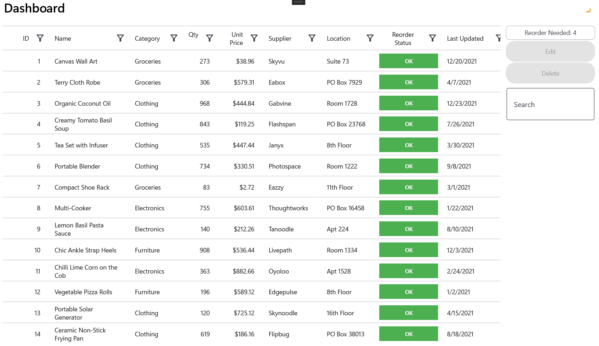

# Inventory Stock Monitor: .NET MAUI Use Case Sample

An inventory monitoring and item-editing app built with **Syncfusion .NET MAUI controls**, featuring a searchable stock grid, a low-stock count, and local JSON-backed item updates.

## Overview

The sample demonstrates a local inventory workflow in .NET MAUI:

- **What the sample does**: Loads inventory records, highlights items at or below the reorder threshold, filters by item name or category, and opens an item form for editing or deletion.
- **Who it is for**: Developers building inventory, catalog, or data-entry experiences with .NET MAUI.
- **What it demonstrates**: Syncfusion DataGrid, Chips, Buttons, ComboBox, NumericEntry, CommunityToolkit.Mvvm source-generated view models, and app-local JSON storage.
- **What outcome the user gets**: An interactive inventory list whose edits and deletions are saved to a JSON file in the app's local data directory.

## Key Features

- Inventory grid with item ID, name, category, quantity, unit price, supplier, location, reorder status, and date fields.
- Reorder status for quantities less than or equal to 50, with a `Reorder Needed` count for the currently displayed rows.
- Search by item name or category.
- Open the item detail form by double-tapping a row or selecting a row and choosing Edit.
- Edit category, quantity, price, supplier, location, and last-ordered value; item ID and last-updated date are read-only in the form.
- Save validates required text fields and non-negative quantity and unit price; saving recalculates reorder status and last-updated date.
- Delete requires confirmation. Cancel returns without applying edits made in the cloned form item.
- Light/dark theme toggle.

## Data Flow

1. `MauiProgram.cs` registers `InventoryService` as a singleton and registers the dashboard and detail pages/view models.
2. `InventoryService` loads the local `Inventroy_Stock_Data.json` file from the app data directory. On first use, it seeds that file from the bundled JSON asset under `Resources/Raw/`.
3. `DashboardViewModel` exposes inventory rows, search results, selection, and the count of items at or below the threshold.
4. Selecting Edit or double-tapping a row navigates to the detail page with its item ID. `InventoryDetailViewModel` loads a clone so edits do not affect the current item until saved.
5. Save and confirmed Delete update the app-local JSON file through `InventoryService`; the dashboard refreshes its grid when the detail page closes.

## Controls Used

- `SfDataGrid` (DataGrid): Inventory table, selection, and row double-tap.
- `SfChip` (Core): Reorder-needed indicator and detail-page status.
- `SfButton` (Buttons): Edit, Delete, Save, and Cancel actions.
- `SfTextInputLayout` (Core): Search field container.
- `SfComboBox` and `SfNumericEntry` (Inputs): Category, quantity, and unit-price editing.
- .NET MAUI `Entry`: Text fields and search input.
- .NET MAUI Shell: Dashboard/detail navigation and theme toolbar item.

## Architecture

The sample follows MVVM using **CommunityToolkit.Mvvm**:

- **Views** (`Views/`): `DashboardPage.xaml` and `InventoryDetailPage.xaml` define the grid and edit form.
- **ViewModels** (`ViewModels/`): `DashboardViewModel` manages loading, search, reorder count, and navigation; `InventoryDetailViewModel` loads, validates, saves, and deletes the selected item.
- **Model** (`Models/InventoryItem.cs`): Observable inventory record mapped to the JSON snake-case property names.
- **Services** (`Services/`): `InventoryService` seeds, reads, and writes the local JSON file; `ThemeService` changes the MAUI and Syncfusion light/dark appearance.
- **Converters** (`Converters/`): Quantity/reorder, enabled-state, and chip color display helpers.
- **Startup and resources**: `MauiProgram.cs` wires services and pages; `AppShell` defines the dashboard route, item-detail route, and theme toggle. Shared styles and colors are under `Resources/Styles/`.

The bundled `Resources/Raw/Inventroy_Stock_Data.json` supplies the initial records. The misspelling in `Inventroy` is part of the asset and local filename used by the implementation.

## Prerequisites

- .NET 10 SDK
- .NET MAUI workload and the workload for the target platform (Android, iOS, Mac Catalyst, or Windows)
- NuGet restore access. The project references CommunityToolkit.Mvvm 8.4.0 and Syncfusion DataGrid, Core, Inputs, and Buttons packages with floating (`*`) versions.

## Configuration

No application configuration is required. The initial data is bundled with the app; subsequent edits are written to `FileSystem.AppDataDirectory\Inventroy_Stock_Data.json` on the device. No API keys, environment variables, or network service are used.

### Default Behavior

- **Local/offline logic**: The app loads from its local data file and does not make network requests.
- The minimum-stock threshold is 50; items with quantity `<= 50` are marked as requiring reorder.

### Environment Variables / Secrets

None required.

### Notes

- Syncfusion controls may show evaluation-mode indicators without a registered license. If you have a Syncfusion license, register it in `MauiProgram.cs` using the [Syncfusion MAUI licensing instructions](https://help.syncfusion.com/common/licensing/how-to-register-maui-license-key). Do not commit a license key.
- The local inventory JSON file is app data, not encrypted storage. Avoid storing sensitive business information in this sample without adding appropriate protections.

## Run

From the repository root:

```bash
dotnet build SfDataGrid\InventoryStockMonitor\InventoryStockMonitor\InventoryStockMonitor.csproj -t:Run -f net10.0-android
```

Other target frameworks declared by the project:

```bash
dotnet build SfDataGrid\InventoryStockMonitor\InventoryStockMonitor\InventoryStockMonitor.csproj -t:Run -f net10.0-ios
dotnet build SfDataGrid\InventoryStockMonitor\InventoryStockMonitor\InventoryStockMonitor.csproj -t:Run -f net10.0-maccatalyst
dotnet build SfDataGrid\InventoryStockMonitor\InventoryStockMonitor\InventoryStockMonitor.csproj -t:Run -f net10.0-windows10.0.19041.0
```

Or open `SfDataGrid\InventoryStockMonitor\InventoryStockMonitor\InventoryStockMonitor.slnx` in a compatible .NET MAUI IDE, restore packages, and deploy to a target platform.

## Output



## Project Structure

- `InventoryStockMonitor/`: MAUI application source and project file
- `InventoryStockMonitor/Views/`: Dashboard and inventory-detail pages
- `InventoryStockMonitor/ViewModels/`: Dashboard and item-detail presentation logic
- `InventoryStockMonitor/Models/`: Inventory item model
- `InventoryStockMonitor/Services/`: JSON-backed inventory service and theme service
- `InventoryStockMonitor/Converters/`: Reorder, quantity, and enabled-state converters
- `InventoryStockMonitor/Resources/Raw/Inventroy_Stock_Data.json`: Bundled seed inventory data
- `InventoryStockMonitor/Resources/Styles/`: App colors and styles
- `InventoryStockMonitor/Platforms/`: Platform entry points and configuration
- `InventoryStockMonitor/InventoryStockMonitor.slnx`: Solution file
- `InventoryStockMonitorDemo.gif`: Sample output animation

## Troubleshooting

**Issue 1: Inventory records do not load**  
Cause: The bundled seed JSON is missing or invalid, or the local JSON file cannot be read.  
Fix: Confirm `Resources/Raw/Inventroy_Stock_Data.json` is present and included as a MAUI asset. If the local file is corrupt, the service's load path attempts to re-seed from the bundled data.

**Issue 2: Changes do not appear in the grid after returning from an item**  
Cause: The grid needs its in-memory collection refreshed after detail navigation.  
Fix: Return through the page's Cancel, Save, or Delete action so the dashboard's appearance refresh runs.

**Issue 3: Build or workload errors**  
Cause: The .NET 10 SDK or target platform workload is unavailable.  
Fix: Check `dotnet --version` and install the MAUI workload and required platform workload.

## Security and Privacy Notes

- Inventory data is stored as a JSON file in the app's local data directory; the sample does not encrypt that file.
- No credentials or external services are used.
- Do not place confidential stock, supplier, or pricing information in this sample unless you add suitable storage protections.

## Supported Platforms

- Android
- iOS
- Windows
- macOS (Mac Catalyst)
