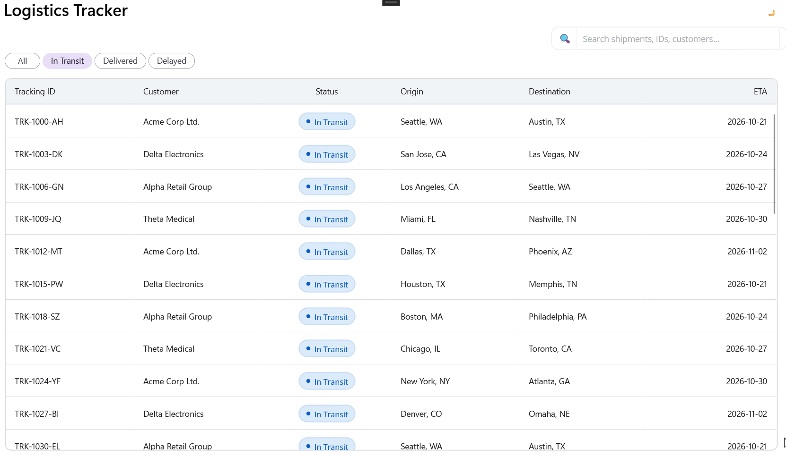

# Logistic Tracking App: .NET MAUI Use Case Sample

A shipment lookup and tracking-detail sample built with **Syncfusion .NET MAUI controls**, displaying locally bundled shipment records in a searchable, status-filterable grid and a read-only detail view.

## Overview

The sample demonstrates a local shipment tracking interface:

- **What the sample does**: Lists shipments, filters them by status or search text, and opens selected shipments to show delivery details and a route progress indicator.
- **Who it is for**: Developers exploring data grids, status filtering, and detail navigation in .NET MAUI.
- **What it demonstrates**: Syncfusion DataGrid, ChipGroup, and StepProgressBar, JSON deserialization into a shipment model, and a light/dark theme toggle.
- **What outcome the user gets**: A read-only tracking experience based on bundled records; it does not retrieve live carrier updates or alter shipment data.

## Key Features

- Shipment grid with tracking ID, customer, status, origin, destination, and ETA.
- Status chips for All, In Transit, Delivered, and Delayed.
- Search by tracking ID, customer name, origin, or destination.
- Selecting a grid row opens shipment details with customer/service information, delivery window, driver, latest update, value, category, and requirements.
- Route progress steps display origin, current location, and destination; the active step is set according to the shipment status.
- Status badges use distinct templates, and the app provides a Shell toolbar light/dark theme toggle.

## Data Flow

1. `ShipmentTracking` creates a `ShipmentViewModel` and requests shipment loading.
2. `ShipmentService` opens the bundled `Resources/Raw/LogisticsData.json` asset and deserializes it into `Shipment` records.
3. The view model maintains the full and filtered collections. Selecting a status chip or entering search text applies the corresponding filters.
4. Selecting a grid row puts that record on the shared `ShipmentViewModel.Instance`, builds the three route progress items, and navigates to `ShipmentDetails`.
5. The details page binds to the selected record and sets the step-progress state based on its status. Shipment records are not updated or persisted.

## Controls Used

- `SfDataGrid` (DataGrid): Shipment list with status templates and row selection.
- `SfChipGroup` / `SfChip` (Core): Status filtering.
- `SfStepProgressBar` (ProgressBar): Origin, current location, and destination tracking steps.
- .NET MAUI `Entry`: Search input.
- .NET MAUI Shell and navigation: Main tracking page, details navigation, and theme toggle.

## Architecture

The app uses a view-model and service structure:

- **Views** (`Views/`): `ShipmentTracking.xaml` defines search, status filters, and the shipment grid; `ShipmentDetails.xaml` presents selected shipment data; `SharedHeader.xaml` defines a reusable header view.
- **ViewModel** (`ViewModels/ShipmentViewModel.cs`): Loads and filters shipment records, stores the current selection, and creates step-progress items. The details page uses its shared singleton instance for the selected shipment.
- **Model** (`Models/Shipment.cs`): Shipment properties mapped to the JSON field names, with status and priority color helpers.
- **Services** (`Services/`): `ShipmentService` reads bundled JSON and handles load/deserialization failures; `ThemeService` updates app and Syncfusion theme resources.
- **Converters** (`Converters/ValueConverters.cs`): Status template selection for grid status cells.
- **Startup and resources**: `MauiProgram.cs` configures MAUI and Syncfusion; `AppShell` sets the tracking page as its content and adds the theme toolbar item. Shared styles and colors are under `Resources/Styles/`.

Data flows from the bundled JSON asset through `ShipmentService` and the view model to the tracking and detail pages. The sample has no live location, carrier API, or shipment-editing workflow.

## Prerequisites

- .NET 10 SDK
- .NET MAUI workload and the workload for the target platform (Android, iOS, Mac Catalyst, or Windows)
- NuGet restore access. CommunityToolkit.Mvvm 8.4.2 and Syncfusion Core, DataGrid, and ProgressBar packages are referenced; Syncfusion package versions use floating (`*`) values.

## Configuration

No application configuration is required. Shipment records are bundled in `Resources/Raw/LogisticsData.json`; there are no environment variables, API keys, or external data services.

### Default Behavior

- **Local/offline logic**: The app reads bundled records and makes no network requests.
- The list starts with all shipment statuses selected; status selection and search only filter the in-memory records.

### Environment Variables / Secrets

None required.

### Notes

- Syncfusion controls may show evaluation-mode indicators without a registered license. If you have a Syncfusion license, register it in `MauiProgram.cs` using the [Syncfusion MAUI licensing instructions](https://help.syncfusion.com/common/licensing/how-to-register-maui-license-key). Do not commit a license key.

## Run

From the repository root:

```bash
dotnet build SfDataGrid\LogisticTrackingApp\LogisticTrackingApp\LogisticTrackingApp.csproj -t:Run -f net10.0-android
```

Other target frameworks declared by the project:

```bash
dotnet build SfDataGrid\LogisticTrackingApp\LogisticTrackingApp\LogisticTrackingApp.csproj -t:Run -f net10.0-ios
dotnet build SfDataGrid\LogisticTrackingApp\LogisticTrackingApp\LogisticTrackingApp.csproj -t:Run -f net10.0-maccatalyst
dotnet build SfDataGrid\LogisticTrackingApp\LogisticTrackingApp\LogisticTrackingApp.csproj -t:Run -f net10.0-windows10.0.19041.0
```

Or open `SfDataGrid\LogisticTrackingApp\LogisticTrackingApp.slnx` in a compatible .NET MAUI IDE, restore packages, and deploy to a target platform.

## Output



## Project Structure

- `LogisticTrackingApp/`: MAUI application source and project file
- `LogisticTrackingApp/Views/`: Tracking grid, shipment details, and shared header
- `LogisticTrackingApp/ViewModels/`: Shipment loading, selection, filtering, and progress-step data
- `LogisticTrackingApp/Models/`: Shipment record model
- `LogisticTrackingApp/Services/`: JSON shipment loader and theme service
- `LogisticTrackingApp/Converters/`: Status template selector and value converters
- `LogisticTrackingApp/Resources/Raw/LogisticsData.json`: Bundled shipment records
- `LogisticTrackingApp/Resources/Styles/`: App colors and styles
- `LogisticTrackingApp/Platforms/`: Platform entry points and configuration
- `LogisticTrackingApp/LogisticTrackingApp.slnx`: Solution file
- `LogisticTrackingDemo.gif`: Sample output animation

## Troubleshooting

**Issue 1: The shipment grid is empty**  
Cause: The bundled JSON file is missing, invalid, or not deserialized. The service logs load failures and returns an empty list.  
Fix: Confirm `Resources/Raw/LogisticsData.json` exists and is included as a MAUI asset; check debug output for JSON or file-loading errors.

**Issue 2: A selected shipment's details or progress are not shown**  
Cause: Details are populated from the selected shipment in the shared view-model instance.  
Fix: Open details by selecting a row in the shipment grid so the selection and progress items are set before navigation.

**Issue 3: Build or workload errors**  
Cause: The .NET 10 SDK or target platform workload is unavailable.  
Fix: Check `dotnet --version` and install the MAUI workload and required platform workload.

## Security and Privacy Notes

- Shipment records are bundled sample data. The app does not contact a carrier or transmit tracking information.
- No credentials or secrets are required.
- If connecting a live carrier service, add appropriate authentication and protect customer and tracking data; those mechanisms are not implemented here.

## Supported Platforms

- Android
- iOS
- Windows
- macOS (Mac Catalyst)
