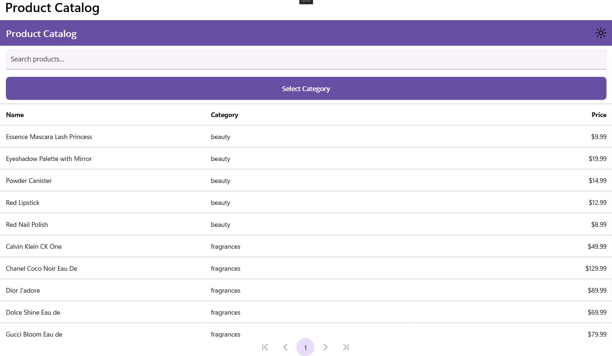

# Product Catalog Viewer: .NET MAUI Use Case Sample

A product-catalog browsing app built with **Syncfusion .NET MAUI controls**, demonstrating remote product loading, category and text filtering, sorting, paging, and product details.

## Overview

The sample presents products in a searchable, paged catalog and lets users inspect a selected product:

- **What the sample does**: Loads product data from DummyJSON, falls back to FakeStoreAPI if that request fails, and displays the results in a catalog with category filtering and product details.
- **Who it is for**: Developers building catalog, inventory-viewing, or data-grid experiences with .NET MAUI.
- **What it demonstrates**: Syncfusion `SfDataGrid`, `SfDataPager`, `SfPicker`, and `SfBusyIndicator` with MVVM, DI, remote JSON loading, and Shell navigation.
- **What outcome the user gets**: A product catalog that runs on supported MAUI platforms and retrieves its data from public sample APIs.

## Key Features

- Loads products from `https://dummyjson.com/products?limit=100`; attempts `https://fakestoreapi.com/products` if the first request fails.
- Filters by product title and category; category options are derived from the loaded products.
- Sorts the grid by product name or price and pages results with 15 rows per `SfDataPager` page.
- Shows a busy state, load errors with retry, and an empty-results message.
- Opens a product detail page with its image, category, price, rating, and description.
- Includes a light/dark theme toggle.

## Data Flow

1. The Shell opens the catalog page, which asks `ProductCatalogViewModel` to load products when the page appears.
2. `ProductService` requests DummyJSON data and, if that request throws, tries FakeStoreAPI. It maps valid API records into the shared `Product` model.
3. The ViewModel builds the category list and applies the selected category, title search, and sort to its product collection.
4. The `SfDataPager` pages the filtered collection and the `SfDataGrid` displays it.
5. Selecting a product passes it through Shell navigation to the details page. Product images are loaded from the image URLs supplied by the data source.

## Controls Used

- `SfDataGrid` (DataGrid): Product name, category, and price columns, including sorting and search highlighting.
- `SfDataPager` (DataPager): Pages the grid source with a page size of 15.
- `SfPicker` (Picker): Selects a product category.
- `SfBusyIndicator` (Core): Loading feedback while products are requested.
- .NET MAUI `Entry`, `Button`, `Image`, and Shell navigation: Search, category-picker launch, product details, and theme toggle.

## Architecture

The sample uses MVVM with constructor-injected services:

- **Views** (`Views/`): `ProductCatalogPage` and `ProductDetailPage`; the catalog code-behind handles grid events, category selection, theme switching, and navigation.
- **ViewModels** (`ViewModels/`): `ProductCatalogViewModel` manages loading, filtering, sorting, paging state, and errors; `ProductDetailViewModel` formats selected-product details.
- **Models** (`Models/`): The normalized `Product` model and API DTOs for the FakeStore response.
- **Services** (`Services/`): `ProductService` fetches, validates, and maps API responses; `IProductService` defines the service contract.
- **Supporting files**: `Converters/` contains the catalog's boolean converter; `Resources/` contains app images, icons, splash screen, and styles.
- **Startup and navigation**: `MauiProgram.cs` configures Syncfusion and registers the service, ViewModels, and pages. `AppShell` defines the catalog entry and registers the details route.

## Prerequisites

- .NET 10 SDK
- .NET MAUI workload and workloads for the target platform
- An IDE that supports .NET 10 MAUI projects
- NuGet access to restore the project packages; the Syncfusion package versions are specified as `*` in the project file

## Configuration

No API keys, environment variables, or local data files are required. The sample makes public HTTPS requests to the two product endpoints above; network access is needed to load product data.

### Default Behavior

- DummyJSON is tried first; FakeStoreAPI is tried if the first request fails. Each request uses a five-second `HttpClient` timeout.
- Product and category searches are applied to the data loaded into the app. There is no local product-data persistence.

### Environment Variables / Secrets

None. The APIs are called without credentials.

### Notes

- The app does not register a Syncfusion license key in `MauiProgram.cs`. Register a valid key there if required for your Syncfusion usage; do not commit license keys to source control. See [Syncfusion MAUI licensing](https://help.syncfusion.com/common/licensing/how-to-register-maui-license-key).

## Run

From the repository root:

```bash
dotnet build SfDataGrid\ProductCatalogViewerApp\ProductCatalogViewerApp\ProductCatalogViewerApp.csproj -t:Run -f net10.0-android
```

Other supported targets:

```bash
dotnet build SfDataGrid\ProductCatalogViewerApp\ProductCatalogViewerApp\ProductCatalogViewerApp.csproj -t:Run -f net10.0-ios
dotnet build SfDataGrid\ProductCatalogViewerApp\ProductCatalogViewerApp\ProductCatalogViewerApp.csproj -t:Run -f net10.0-maccatalyst
dotnet build SfDataGrid\ProductCatalogViewerApp\ProductCatalogViewerApp\ProductCatalogViewerApp.csproj -t:Run -f net10.0-windows10.0.19041.0
```

Alternatively, open `SfDataGrid\ProductCatalogViewerApp\ProductCatalogViewerApp.slnx` in an IDE that supports .NET 10 MAUI.

## Output



## Project Structure

- `ProductCatalogViewerApp/Views/`: Catalog and product-details pages
- `ProductCatalogViewerApp/ViewModels/`: Catalog and detail presentation logic
- `ProductCatalogViewerApp/Models/`: Product and API response models
- `ProductCatalogViewerApp/Services/`: Product API client and service interface
- `ProductCatalogViewerApp/Converters/`: XAML value converter
- `ProductCatalogViewerApp/Resources/`: Images, app icon, splash screen, fonts, and styles
- `ProductCatalogViewerApp/Platforms/`: Platform entry points
- `ProductCatalogDemo.gif`: Sample output recording

## Troubleshooting

**Issue 1: Product list is empty or shows a connection error**  
Cause: Both public API requests failed or could not be reached.  
Fix: Check network access and retry from the catalog. There is no bundled product-data fallback.

**Issue 2: Build or workload errors**  
Cause: The .NET 10 SDK, MAUI workload, or target-platform workload is missing.  
Fix: Verify the installed SDK with `dotnet --version` and install the workload for the selected target.

**Issue 3: Syncfusion evaluation notice**  
Cause: No valid Syncfusion license key is registered by the sample.  
Fix: Register a valid key in `MauiProgram.cs` as described in the Notes section.

## Security and Privacy Notes

- Product data and image URLs come from public third-party endpoints. No API credentials are used.
- Search and category filtering operate on the loaded product list; the sample does not send those filter values to an API.
- The sample does not collect personal data or persist product records.
- Review the external data providers and their terms before adapting the sample for production use.

## Supported Platforms

- Android (API 21+)
- iOS (15+)
- Windows (10.0.17763.0+)
- macOS (Mac Catalyst 15+)
