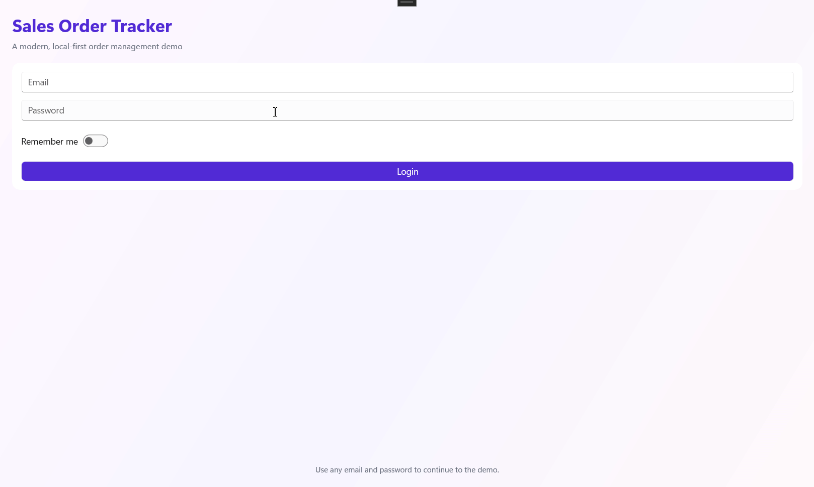

# Sales Order Tracker: .NET MAUI Use Case Sample

A sales-order tracking app built with **Syncfusion .NET MAUI controls**, demonstrating order browsing, local SQLite storage, status updates, and order history with optional DummyJSON seeding.

## Overview

The sample provides a small order-management workflow backed by a device-local SQLite database:

- **What the sample does**: Loads orders into an order grid, filters by status, opens order details, and records status changes and their history.
- **Who it is for**: Developers building order-management or line-of-business apps with .NET MAUI.
- **What it demonstrates**: Syncfusion `SfDataGrid`, a SQLite repository, startup seeding from DummyJSON or Bogus-generated data, and platform-adaptive Shell navigation.
- **What outcome the user gets**: A local order tracker with sample data, order-detail views, and status actions.

## Key Features

- Shows a welcome screen when the stored login flag is false (the default). The demo accepts any email and password; selecting “Remember me” stores a login flag and email in MAUI Preferences.
- Displays the newest orders in `SfDataGrid`, with a text search, status picker, colored status cells, and an inline “Toggle Status” action.
- Advances an order through Pending, Processing, Shipped, and Delivered with the inline action; Delivered and Cancelled are not advanced.
- Opens order details from a grid row, showing customer, line items, and status history, with buttons to set Processing, Shipped, Delivered, or Cancelled.
- Stores orders, customers, line items, and status entries in a SQLite database at `FileSystem.AppDataDirectory/orders.db`.
- Provides Settings with sample-data and DummyJSON preference switches and a logout action.
- Uses bottom tabs on Android/iOS and a flyout on Windows/Mac Catalyst.

## Data Flow

1. At app startup, the app creates the SQLite tables and starts seeding asynchronously.
2. The `UseDummyJson` preference (default `true`) chooses the startup seed path. When enabled, the seeder requests up to 50 carts from `https://dummyjson.com/carts?limit=50`; when disabled, the repository can generate fake orders and customers with Bogus.
3. `OrderListViewModel` queries the repository for up to 100 recent orders. The status picker applies a status query, and the grid's search controller filters displayed text.
4. A row opens `OrderDetailsPage`, where the repository loads the order, related items, and status history.
5. Status actions write an order status and a corresponding history entry to SQLite; the details page reloads the updated order.

## Controls Used

- `SfDataGrid` (DataGrid): Order list with status and inline status-toggle columns.
- .NET MAUI `Entry`, `Picker`, `CollectionView`, `Button`, and `Switch`: Order search/filter, item and history lists, order actions, and Settings.
- .NET MAUI Shell: Login-to-app transition and platform-specific tab/flyout navigation.

## Architecture

The sample separates the UI, ViewModels, repository contract, and SQLite persistence:

- **Views** (`Views/`): Welcome, order list, order details, and settings pages.
- **ViewModels** (`ViewModels/`): Login prototype, order list and status actions, order details, and Settings preferences.
- **Models** (`Models/`): Orders, customers, line items, status history, query, and list DTO types.
- **Repository and storage**: `Contracts/IOrderRepository.cs` defines the data contract; `Services/Repositories/SqliteOrderRepository.cs` implements it; `Services/Storage/Database.cs` initializes tables.
- **Seeding and diagnostics** (`Services/Seeders/`, `Services/Repositories/`, `Services/Logging/`): DummyJSON cart mapping, Bogus sample generation, startup seed selection, and logging configuration.
- **Startup and navigation**: `MauiProgram.cs` configures Syncfusion, registers the database and repository, and starts initialization/seeding. `AppShell` exposes Orders and Settings.
- **Resources** (`Resources/`): App icon, splash screen, images, and styles.

## Prerequisites

- .NET 10 SDK
- .NET MAUI workload and workloads for the target platform
- An IDE that supports .NET 10 MAUI projects
- NuGet access to restore the project packages; Syncfusion package versions are specified as `*` in the project file

## Configuration

No API keys or environment variables are required. The app stores order data in its local SQLite database. Startup seeding is best-effort and does not block the UI.

### Default Behavior

- The `Use DummyJSON (remote)` preference defaults to enabled and causes startup seeding to request DummyJSON carts. When disabled, startup uses Bogus-generated local sample data.
- The setting is stored in MAUI Preferences and is read during startup. The remote seeder does not replace existing orders if the database already contains an order.
- The “Enable Sample Data on Startup” switch also stores a preference, but the current startup seeding code does not use it to enable or disable seeding.

### Environment Variables / Secrets

None required. The DummyJSON request is unauthenticated.

### Notes

- The welcome screen is a prototype, not authentication: any email and password are accepted. The password is not persisted; when “Remember me” is selected, the email and login flag are stored in Preferences.
- Do not use real customer or order data in this sample without adding appropriate access controls, protections, and data handling.
- The app does not register a Syncfusion license key in `MauiProgram.cs`. Register a valid key if required for your Syncfusion usage; do not commit license keys. See [Syncfusion MAUI licensing](https://help.syncfusion.com/common/licensing/how-to-register-maui-license-key).

## Run

From the repository root:

```bash
dotnet build SfDataGrid\SalesOrderTracker\SalesOrderTracker\SalesOrderTracker.csproj -t:Run -f net10.0-android
```

Other supported targets:

```bash
dotnet build SfDataGrid\SalesOrderTracker\SalesOrderTracker\SalesOrderTracker.csproj -t:Run -f net10.0-ios
dotnet build SfDataGrid\SalesOrderTracker\SalesOrderTracker\SalesOrderTracker.csproj -t:Run -f net10.0-maccatalyst
dotnet build SfDataGrid\SalesOrderTracker\SalesOrderTracker\SalesOrderTracker.csproj -t:Run -f net10.0-windows10.0.19041.0
```

Alternatively, open `SfDataGrid\SalesOrderTracker\SalesOrderTracker.slnx` in an IDE that supports .NET 10 MAUI.

## Output



## Project Structure

- `SalesOrderTracker/Views/`: Welcome, order-list, order-detail, settings, and empty-state views
- `SalesOrderTracker/ViewModels/`: Page presentation logic and commands
- `SalesOrderTracker/Models/`: Order and related domain/query models
- `SalesOrderTracker/Contracts/`: Repository interface
- `SalesOrderTracker/Services/Repositories/`: SQLite repository, sample-data generation, and seed selection
- `SalesOrderTracker/Services/Storage/`: SQLite database initialization
- `SalesOrderTracker/Services/Seeders/`: DummyJSON cart seeder
- `SalesOrderTracker/Resources/`: App icon, splash screen, images, and styles
- `SalesOrderDemo.gif`: Sample output recording

## Troubleshooting

**Issue 1: No orders appear**  
Cause: Startup database initialization or seeding may still be running, or DummyJSON could not be reached while the remote source is selected.  
Fix: Check network access and startup logs. For local sample records, disable “Use DummyJSON (remote)” in Settings and restart the app so startup seeding runs with the local source.

**Issue 2: Changes to the data-source preference do not appear immediately**  
Cause: The preference is read during startup, and the remote seeder skips its import when an order already exists.  
Fix: Restart after changing the preference. The sample does not provide a UI action to clear or reseed the database.

**Issue 3: Build or workload errors**  
Cause: The .NET 10 SDK, MAUI workload, or selected platform workload is missing.  
Fix: Verify `dotnet --version` and install the workload for the target platform.

## Security and Privacy Notes

- Orders and related records are stored in the app's local SQLite database; the sample does not synchronize them to a backend.
- When DummyJSON seeding is enabled, the app makes an unauthenticated request to DummyJSON. No app credentials are sent.
- The login screen is only a demo gate. It accepts arbitrary credentials and does not authenticate users; the remembered email and login flag are stored in MAUI Preferences.
- Seeded orders and customers are demonstration data. Do not enter real credentials or sensitive customer information.

## Supported Platforms

- Android (API 21+)
- iOS (15+)
- Windows (10.0.17763.0+)
- macOS (Mac Catalyst 15+)
