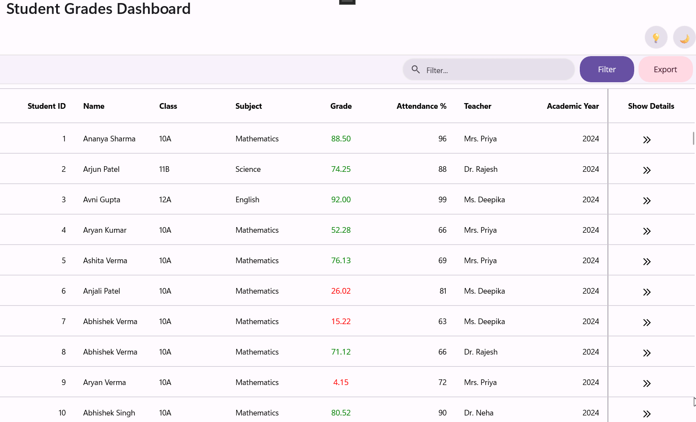

# Student Grades Dashboard: .NET MAUI Use Case Sample

A student-record dashboard built with **Syncfusion .NET MAUI controls**, demonstrating a searchable student grid, grade and attendance editing, validation, and PDF/Excel export.

## Overview

The sample displays student information and lets users review and update academic values:

- **What the sample does**: Loads student records into a grid, filters the displayed students by name, opens a detail form, and exports the grid to PDF or Excel.
- **Who it is for**: Developers building student, roster, or tabular data-management apps with .NET MAUI.
- **What it demonstrates**: Syncfusion `SfDataGrid`, numeric editors, DataGrid PDF/Excel exporting, MVVM, validation, Shell routing, and platform-specific save/preview code.
- **What outcome the user gets**: A local, editable student dashboard with generated sample records and no backend dependency.

## Key Features

- Loads the packaged `Resources/Raw/students.json` file when available. The included file contains three records; the data service fills the collection to 1,000 with generated mock records.
- Generates an in-memory mock dataset if the packaged JSON cannot be read.
- Displays student ID, name, class, subject, grade, attendance, teacher, academic year, and a details action in `SfDataGrid`.
- Filters by student name using the dashboard's Filter action.
- Opens a student detail page from the Show Details grid column; grade and attendance can be edited and validated to be between 0 and 100.
- Exports the displayed grid to PDF or Excel and hands the file to the platform-specific save/preview implementation.
- Includes a light/dark theme toggle.

## Data Flow

1. The Shell opens the dashboard, whose ViewModel loads records from `DataService`.
2. `DataService` attempts to read `students.json`, maps its records, and appends generated mock records until the collection has 1,000 students. If the asset cannot be read, it uses generated in-memory data.
3. The dashboard's Filter action applies the entered name term and the ViewModel's grade bounds (which default to 0–100) to the collection displayed by the grid.
4. Selecting the Show Details column navigates with a student ID. The detail ViewModel loads that record, validates grade and attendance values, and updates the shared in-memory data service when saved.
5. The PDF or Excel action exports the current grid and passes its stream to `SaveService` for platform-specific file handling.

## Controls Used

- `SfDataGrid` (DataGrid): Student records and the Show Details action column.
- `SfMaskedEntry` (Inputs): Name filter input on the dashboard.
- `SfNumericEntry` (Inputs): Grade and attendance editors on the detail page.
- DataGrid PDF/Excel exporting controllers (DataGridExport): Export the displayed grid.
- .NET MAUI `Button`, `Border`, `Frame`, and Shell navigation: Filter/export actions, theme toggle, and student details navigation.

## Architecture

The sample uses MVVM with constructor-injected data and validation services:

- **Views** (`Views/`): Dashboard and student-detail XAML pages; code-behind handles lifecycle, grid navigation, export, and theme switching.
- **ViewModels** (`ViewModels/`): Dashboard filtering and save actions, student detail editing, and shared loading/error state.
- **Models** (`Models/`): Student and validation-result data types.
- **Services** (`Services/`): `DataService` reads bundled JSON and manages in-memory records; `ValidationService` checks grade/attendance values; `SaveService` dispatches exports to platform implementations.
- **Converters** (`Converters/`): Grade color, inverse boolean, and string-to-boolean converters used by the UI.
- **Resources** (`Resources/`): `Raw/students.json`, images, app icon, splash screen, and styles.
- **Platform save handlers** (`Platforms/`): Android, iOS, Mac Catalyst, and Windows implementations for saving/viewing exported files.
- **Startup and navigation**: `MauiProgram.cs` configures Syncfusion and registers data/validation services, ViewModels, and pages. `AppShell` registers the `student-detail` route.

## Prerequisites

- .NET 10 SDK
- .NET MAUI workload and workloads for the target platform
- An IDE that supports .NET 10 MAUI projects
- NuGet access to restore the project packages; Syncfusion package versions are specified as `*` in the project file

## Configuration

No API keys, environment variables, or backend services are required. Student changes are held in the in-memory data service and are not written to a database or file.

### Default Behavior

- The packaged JSON contains three student records; the service appends generated records to reach 1,000.
- PDF and Excel export behavior is implemented separately for Android, iOS, Mac Catalyst, and Windows.

### Environment Variables / Secrets

None required. The sample does not call an external service.

### Notes

- The app does not register a Syncfusion license key in `MauiProgram.cs`. Register a valid key if required for your Syncfusion usage; do not commit license keys. See [Syncfusion MAUI licensing](https://help.syncfusion.com/common/licensing/how-to-register-maui-license-key).
- Generated student data is fictitious sample data. It is not a suitable store for real student records.

## Run

From the repository root:

```bash
dotnet build SfDataGrid\StudentGradesDashboard\StudentGradesDashboard\StudentGradesDashboard.csproj -t:Run -f net10.0-android
```

Other supported targets:

```bash
dotnet build SfDataGrid\StudentGradesDashboard\StudentGradesDashboard\StudentGradesDashboard.csproj -t:Run -f net10.0-ios
dotnet build SfDataGrid\StudentGradesDashboard\StudentGradesDashboard\StudentGradesDashboard.csproj -t:Run -f net10.0-maccatalyst
dotnet build SfDataGrid\StudentGradesDashboard\StudentGradesDashboard\StudentGradesDashboard.csproj -t:Run -f net10.0-windows10.0.19041.0
```

Alternatively, open `SfDataGrid\StudentGradesDashboard\StudentGradesDashboard.slnx` in an IDE that supports .NET 10 MAUI.

## Output



## Project Structure

- `StudentGradesDashboard/Views/`: Dashboard and student-detail pages
- `StudentGradesDashboard/ViewModels/`: Dashboard and detail presentation logic
- `StudentGradesDashboard/Models/`: Student and validation models
- `StudentGradesDashboard/Services/`: In-memory data loading, validation, DTO mapping, and export service
- `StudentGradesDashboard/Converters/`: XAML value converters
- `StudentGradesDashboard/Resources/Raw/`: Bundled `students.json` sample data
- `StudentGradesDashboard/Platforms/`: Platform entry points and export save/view implementations
- `StudentGradeDashboardDemo.gif`: Sample output recording

## Troubleshooting

**Issue 1: The grid contains more records than the JSON file**  
Cause: The data service appends generated mock records to reach 1,000 students.  
Fix: This is the sample's normal behavior; edit `Resources/Raw/students.json` and the fill logic if a smaller dataset is desired.

**Issue 2: Export does not save or preview a file**  
Cause: Export handling uses platform-specific file and preview APIs.  
Fix: Confirm the target platform builds and that its save/view workflow can open the exported file type.

**Issue 3: Build or workload errors**  
Cause: The .NET 10 SDK, MAUI workload, or selected platform workload is missing.  
Fix: Verify `dotnet --version` and install the workload for the target platform.

**Issue 4: Syncfusion evaluation notice**  
Cause: No valid Syncfusion license key is registered by the sample.  
Fix: Register a valid key in `MauiProgram.cs` as described in the Notes section.

## Security and Privacy Notes

- All included and generated student data is mock data. Changes exist only in the app's in-memory data service and are lost when the process ends.
- No credentials, API keys, or network services are used.
- Exported files contain the student data displayed in the grid. Handle and share those files appropriately if you adapt the sample to use real records.

## Supported Platforms

- Android (API 21+)
- iOS (15+)
- Windows (10.0.17763.0+)
- macOS (Mac Catalyst 15+)
