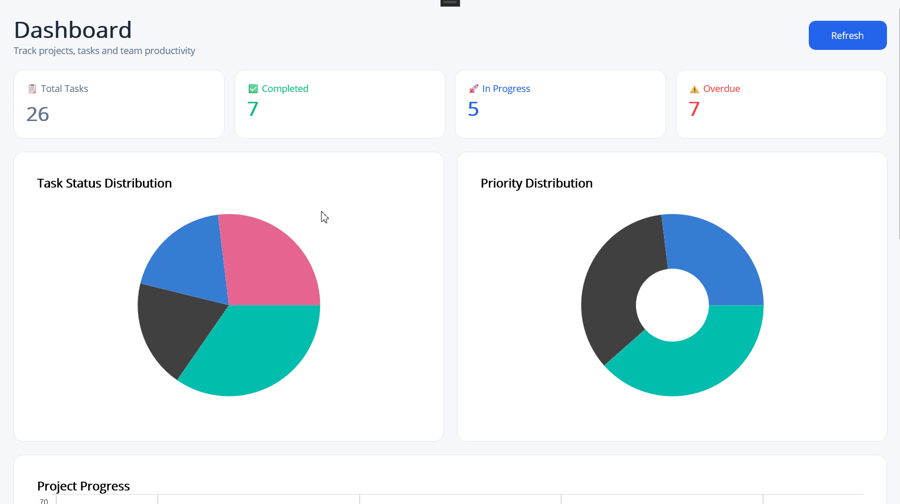

# Task Management: .NET MAUI Use Case Sample

A task and project dashboard built with **Syncfusion .NET MAUI controls**, demonstrating task-list filtering, Kanban status columns, task details, and summary charts over generated in-memory data.

## Overview

The sample organizes example project tasks across a dashboard, grid, and Kanban board:

- **What the sample does**: Generates sample tasks and presents them in a dashboard, a searchable/filterable data grid, and a Kanban board.
- **Who it is for**: Developers building task tracking, project operations, or team dashboard apps with .NET MAUI.
- **What it demonstrates**: Syncfusion `SfDataGrid`, `SfKanban`, `SfComboBox`, `SfDatePicker`, `SfCircularChart`, and `SfCartesianChart` with custom MVVM ViewModels and Shell navigation.
- **What outcome the user gets**: A runnable task-management UI with sample data, task summaries, and a task form.

## Key Features

- Creates 25 generated sample tasks in the in-memory `TaskService`.
- Dashboard cards summarize total, completed, in-progress, and overdue tasks; charts show status, priority, project progress, and assignee completion counts.
- Task list searches title, description, assignee, and project; filters by priority and status; and shows task, assignment, due-date, progress, and effort columns.
- Kanban view groups tasks into To Do, In Progress, Review, and Done columns, with search plus priority and assignee filters.
- New Task opens a task form with title, description, project, assignment, status, priority, schedule, and effort fields.
- Task details calculate schedule and task-health information and validate that the due date is not before the start date.
- Dashboard, Tasks, and Kanban are available from the Shell flyout; the task-details route is hidden from the flyout.

## Data Flow

1. The app opens `AppShell`; the registered singleton `TaskService` initializes a set of generated tasks when first resolved.
2. Each page's ViewModel obtains the service through `ServiceHelper` and loads task data for its view.
3. The dashboard derives summary/chart values from the in-memory task list. The task list and Kanban ViewModels apply their respective search and filter values.
4. Choosing New Task navigates to the hidden task-details route. The form saves a new task through `TaskService`; the details ViewModel also supports loading an existing task by its route ID.
5. Data and edits remain in memory. There is no database or remote service backing the sample.

## Controls Used

- `SfDataGrid` (DataGrid): Task list with sortable task, project, status, assignment, due date, progress, and effort columns.
- `SfKanban` (Kanban): Workflow columns bound to each task's `Status`.
- `SfComboBox` (Inputs): Priority, status, project, user, and team selections and filters.
- `SfDatePicker` (Picker): Start and due dates in the task-details form.
- `SfCircularChart` / `SfCartesianChart` (Charts): Status/priority distributions, project progress, and team-performance summaries.
- .NET MAUI `Entry`, `Editor`, `ProgressBar`, and Shell navigation: Task text fields, progress display, and navigation.

## Architecture

The sample uses ViewModels and a shared in-memory service:

- **Pages** (`Pages/`): Dashboard, task list, Kanban board, and task details.
- **ViewModels** (`ViewModels/`): Dashboard/chart calculations, list search/filtering, Kanban filtering, and task-detail workflows.
- **Models** (`Models/`): `TaskItem` and chart summary data types.
- **Services** (`Services/`): `TaskService` generates and manages in-memory task records.
- **Helpers** (`Helpers/`): Static selection lists and value converters; `ServiceHelper` resolves the singleton service from MAUI's service provider.
- **Startup and navigation**: `MauiProgram.cs` configures Syncfusion and registers `TaskService`; `AppShell` provides the flyout and hidden details route.
- **Resources** (`Resources/`): App icon, splash screen, images, and styles.

## Prerequisites

- .NET 10 SDK
- .NET MAUI workload and workloads for the target platform
- An IDE that supports .NET 10 MAUI projects
- NuGet access to restore the project packages; Syncfusion package versions are specified as `*` in the project file

## Configuration

No API keys, environment variables, or database configuration are required. The sample generates task data locally and does not persist it.

### Default Behavior

- The task service generates 25 sample tasks on first initialization. Tasks and edits are held in a static in-memory list for the process lifetime.
- `MauiProgram.cs` currently calls Syncfusion license registration with the literal placeholder `LICENSE_KEY`. Replace it with a valid key for licensed use; never commit a real key.

### Environment Variables / Secrets

None required. The sample does not call an external service.

### Notes

- A valid Syncfusion license key may be required instead of the placeholder described above. See [Syncfusion MAUI licensing](https://help.syncfusion.com/common/licensing/how-to-register-maui-license-key).
- Task data is generated for demonstration and does not represent a persisted project workspace.

## Run

From the repository root:

```bash
dotnet build SfDataGrid\TaskManagement\TaskManagement\TaskManagement.csproj -t:Run -f net10.0-android
```

Other supported targets:

```bash
dotnet build SfDataGrid\TaskManagement\TaskManagement\TaskManagement.csproj -t:Run -f net10.0-ios
dotnet build SfDataGrid\TaskManagement\TaskManagement\TaskManagement.csproj -t:Run -f net10.0-maccatalyst
dotnet build SfDataGrid\TaskManagement\TaskManagement\TaskManagement.csproj -t:Run -f net10.0-windows10.0.19041.0
```

Alternatively, open `SfDataGrid\TaskManagement\TaskManagement.slnx` in an IDE that supports .NET 10 MAUI.

## Output



## Project Structure

- `TaskManagement/Pages/`: Dashboard, task list, Kanban, and task-details pages
- `TaskManagement/ViewModels/`: Page logic and commands
- `TaskManagement/Models/`: Task and chart-summary models
- `TaskManagement/Services/`: In-memory task generation and operations
- `TaskManagement/Helpers/`: Static selection data, service helper, and converters
- `TaskManagement/Resources/`: App icon, splash screen, images, and styles
- `TaskManagement/Platforms/`: Platform entry points
- `TaskManagementDemo.gif`: Sample output recording

## Troubleshooting

**Issue 1: Task changes disappear after closing the app**  
Cause: The task service stores records in memory and does not write to persistent storage.  
Fix: This is the current sample behavior; add a persistence layer if data must survive process restarts.

**Issue 2: A page cannot resolve `TaskService`**  
Cause: The service is registered in `MauiProgram.cs` and obtained through `ServiceHelper`.  
Fix: Confirm the app starts through `MauiProgram.CreateMauiApp()` and that the `TaskService` registration remains present.

**Issue 3: Build or workload errors**  
Cause: The .NET 10 SDK, MAUI workload, or selected platform workload is missing.  
Fix: Verify `dotnet --version` and install the workload for the target platform.

**Issue 4: Syncfusion licensing or evaluation notice**  
Cause: `MauiProgram.cs` contains a placeholder string rather than a valid license key.  
Fix: Replace `LICENSE_KEY` with a valid key in your local setup. Do not commit the key.

## Security and Privacy Notes

- The sample uses generated task names, assignments, and project labels. It does not collect data from users or send tasks over the network.
- Task data is kept in process memory and is not encrypted or persisted.
- The Syncfusion license registration currently contains only the literal placeholder `LICENSE_KEY`; do not commit a real license key.

## Supported Platforms

- Android (API 21+)
- iOS (15+)
- Windows (10.0.17763.0+)
- macOS (Mac Catalyst 15+)
