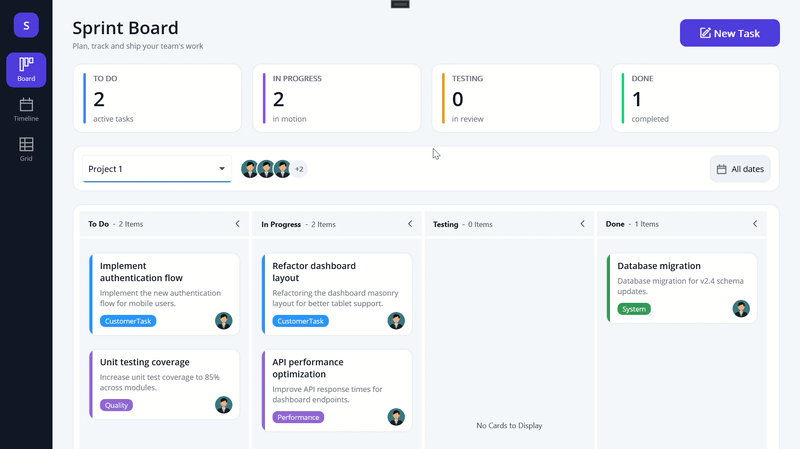

# Sprint Management Board

A cross-platform .NET MAUI sprint planning board for visualizing, filtering, and managing project tasks.

## Overview

The Sprint Management Board helps project teams organize work across Kanban, timeline, and tabular views. It provides a unified workspace where managers and developers can monitor task status, assignments, priorities, schedules, and progress.

## What the Sample Does

- Displays tasks in Kanban, Scheduler, and DataGrid views
- Filters tasks by project and date range
- Creates tasks with assignees, statuses, and schedule information

## Who It Is For

- Scrum teams
- Developers evaluating Syncfusion controls
- .NET MAUI application builders

## Outcome

Users get a practical sprint management workspace that works seamlessly across desktop and mobile devices.

## Key Features

- Three synchronized task views: Kanban, Timeline Scheduler, and DataGrid
- Project and date-range filtering
- Task creation with assignee, status, dates, and progress
- Status summary cards for To Do, In Progress, Testing, and Done work
- Responsive navigation and layouts for desktop, tablet, and mobile
- Light and dark theme support

## Workflow

1. The application loads sample projects, users, and tasks.
2. The user selects a project or date range.
3. The ViewModel filters the in-memory task collection.
4. The Kanban board, Scheduler, and DataGrid receive the filtered data.
5. The user creates a task through the task creation popup.
6. The mock service stores the task and notifies the UI.
7. The updated task appears in the selected project view.

## Controls Used

| Control | Purpose |
|----------|----------|
| SfKanban | Displays tasks grouped by workflow status |
| SfScheduler | Shows task schedules and resource timelines |
| SfDataGrid | Presents task details in a filterable tabular view |
| SfComboBox | Allows project selection |
| SfPopup | Hosts the new-task dialog |
| SfButton | Provides primary actions and navigation |
| Picker | Selects assignees and statuses |
| DatePicker | Selects task and filter dates |
| ProgressBar | Displays task completion progress |
| Border / Card Styles | Creates consistent, theme-aware UI surfaces |

## Architecture

The sample follows a simple MVVM architecture:

### View / Page

`MainPage.xaml` hosts:

- Kanban Board
- Scheduler
- DataGrid
- Filter controls
- New Task Popup

### ViewModel

`TasksViewModel`

Responsibilities:

- Loading sample data
- Managing filters
- Creating tasks
- Updating observable collections

### Service Layer

- `ITaskService` defines task operations
- `MockTaskService` provides in-memory sample data

### Models

- `TaskModel`
- `UserModel`
- `ProjectModel`

### Converters

Used for:

- Formatting progress values
- Mapping priorities and tags to UI colors

### Supporting UI

- Platform resources
- Styles
- Fonts
- Icons
- Application shell and navigation

## Prerequisites

- .NET 10 SDK
- .NET MAUI workload
- Visual Studio 2022 or a compatible IDE
- Syncfusion MAUI NuGet packages
- Valid Syncfusion license (if required by the installed package version)

## Default Behavior

The sample uses mock in-memory data.

No cloud services, APIs, AI providers, databases, environment variables, or secrets are required.

## Run the Application

From the solution directory:

```bash
cd "SprintManagementBoard"

dotnet restore

dotnet build SprintManagementBoard.sln

dotnet build SprintManagementBoard.sln -t:Run -f net10.0-windows10.0.19041.0

dotnet build SprintManagementBoard.sln -t:Run -f net10.0-android

dotnet build SprintManagementBoard.sln -t:Run -f net10.0-ios

dotnet build SprintManagementBoard.sln -t:Run -f net10.0-maccatalyst
```

> Platform availability depends on the operating system and installed workloads.

## Output

The application displays a responsive sprint management workspace featuring:

- Status summary cards
- Project and date filters
- Kanban board
- Timeline scheduler
- DataGrid task view

**Demo**



## Project Structure

```text
Sprint Management/
├── README.md
├── SprintManagementDemo.gif
└── SprintManagementBoard/
    ├── Controls/
    ├── Converters/
    ├── Models/
    ├── Platforms/
    ├── Resources/
    ├── Services/
    ├── ViewModels/
    ├── App.xaml
    ├── AppShell.xaml
    ├── MainPage.xaml
    └── SprintManagementBoard.csproj
```

## Troubleshooting

### Path Too Long Exception

If you encounter a **"Path Too Long"** exception while building the project:

1. Close Visual Studio.
2. Rename the repository folder to a shorter path.
3. Reopen the solution.
4. Rebuild the project.

This issue is caused by Windows path-length limitations when the project is stored in a deeply nested folder structure.