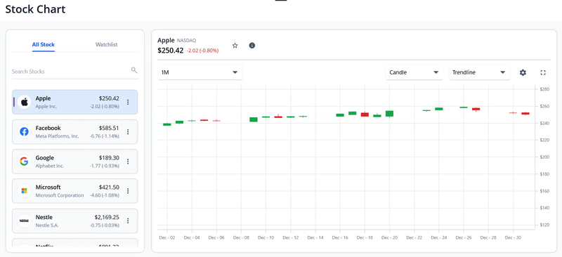

# Stock Chart: .NET MAUI Use Case Sample



A desktop and mobile market-analysis application built with [Syncfusion .NET MAUI controls](https://help.syncfusion.com/maui/overview), demonstrating candlestick charts, watchlists, stock selection, time ranges, trendlines, and chart settings using local sample data.

---

## Overview

Stock Chart demonstrates a responsive financial dashboard using `SfCartesianChart` and supporting Syncfusion controls. The app provides desktop and mobile layouts, predefined stocks and watchlists, local candle data, time-range selection, trendlines, chart settings, and workflow popups.

The sample does not connect to a live market-data provider.

---

## Key Features

### Stock Chart

- Display OHLC candle data.
- Change stock selection and chart time range.
- Use local generated or seeded market data.
- Show volume or indicator-related chart series implemented by the sample.

### Watchlists

- Browse predefined watchlists.
- Select stocks from the active watchlist.
- Apply watchlist additions/removals in the mobile and desktop flows.

### Chart Configuration

- Open chart settings.
- Configure supported trendline and chart options.
- Change the displayed time range and chart presentation.

### Responsive Layout

- Desktop and phone layouts are implemented in separate partial view-model and page-surface files.
- Mobile pickers present stock, watchlist, range, and settings choices.

---

## Syncfusion Controls Used

| Control | Purpose |
|---|---|
| `SfCartesianChart` | Candlestick and financial chart series |
| `SfPopup` | Chart settings and mobile workflow popups |
| `SfComboBox` | Stock and option selection |
| `SfSlider` | Numeric chart settings |
| `SfCalendar` | Date-related sample workflows |
| `SfTabView` | Mobile tabbed navigation |
| `SfButton` | Chart and workflow actions |

### Additional Technologies

- CommunityToolkit.Mvvm
- Dependency Injection
- MVVM architecture pattern
- Local candle and watchlist models

---

## Supported Platforms

| Platform | Target Framework |
|---|---|
| Android | `net10.0-android` |
| iOS | `net10.0-ios` |
| macOS (Mac Catalyst) | `net10.0-maccatalyst` |
| Windows | `net10.0-windows10.0.19041.0` |

> iOS and Mac Catalyst targets require a compatible non-Linux host. The Windows target is available on Windows hosts.

---

## Prerequisites

- .NET 10 SDK or later
- .NET MAUI workloads
- Visual Studio 2022 (17.14+), Visual Studio Code with the .NET MAUI extension, or JetBrains Rider
- A platform emulator, simulator, or physical device
- Syncfusion .NET MAUI NuGet packages restored from NuGet

---

## Getting Started

### Open the Solution

```text
StockChart/StockChart.slnx
```

### Restore Packages

```bash
dotnet restore StockChart/StockChart/StockChart.csproj
```

### Build and Run

Example for Android:

```bash
dotnet build StockChart/StockChart/StockChart.csproj -f net10.0-android
```

---

## Architecture

### Core Layers

- **Main page** (`MainPage.xaml`) - responsive chart surface.
- **Chart surface** - `MainPage.ChartSurface.cs`.
- **Mobile layout** - `MainPage.MobileLayout.cs`.
- **Popup workflows** - `MainPage.PopupWorkflows.cs`.
- **ViewModels** (`ViewModels/`) - stock, chart series, chart settings, watchlists, ranges, trendlines, mobile pickers, and workflows.
- **Models** (`Models/`) - candle, stock, selection, and watchlist models.
- **Services** (`Services/`) - `StockDataService`.
- **Converters** (`Converters/`) - stock equality conversion.
- **Helpers** (`Helpers/`) - popup presentation behavior.

### Runtime Flow

1. `StockChartViewModel` coordinates stock selection, watchlists, chart settings, time ranges, and chart series.
2. `StockDataService` supplies local sample stock/candle data.
3. Chart partial classes update series and chart presentation.
4. Mobile picker and popup partials present selection workflows.
5. Watchlist operations update the local selected watchlist and stock collection.

---

## Project Structure

```text
StockChart/
├── StockChart.slnx
├── stock-chart-demo.gif
└── StockChart/
    ├── MainPage.xaml
    ├── MainPage.ChartSurface.cs
    ├── MainPage.MobileLayout.cs
    ├── MainPage.PopupWorkflows.cs
    ├── ViewModels/
    ├── Models/
    ├── Services/
    ├── Converters/
    ├── Helpers/
    ├── Resources/
    └── Platforms/
```

---

## Configuration

No API key or external market-data configuration is required.

- Stock and candle data is local sample data.
- Chart settings and watchlist changes are application-state only.
- The sample does not retrieve live prices or execute trades.

---

## Syncfusion Licensing

The project currently contains a license registration placeholder in `MauiProgram.cs`.

Replace the placeholder with a valid license key for licensed use. Do not commit a real key to source control.

---

## Limitations

- Prices and candle values are sample data.
- The app does not stream live market data.
- Watchlist and chart settings are not required to persist after restart.
- The sample does not support orders or brokerage operations.

---

## Troubleshooting

### Chart Data Is Not Live

This is expected: `StockDataService` supplies local sample data.

### Syncfusion Evaluation Warning

Replace the license placeholder in `MauiProgram.cs` with a valid license key.

### Target Platform Build Errors

Install the required .NET MAUI workload and target-specific tooling.

---

## Related Documentation

- [.NET MAUI Documentation](https://learn.microsoft.com/dotnet/maui/)
- [.NET MAUI MVVM Guidance](https://learn.microsoft.com/dotnet/architecture/maui/mvvm)
- [Syncfusion .NET MAUI Charts](https://help.syncfusion.com/maui/cartesian-charts/overview)
- [Syncfusion Licensing Documentation](https://help.syncfusion.com/common/licensing/how-to-register-maui-license-key)

---

## License

This sample is provided for demonstration and learning purposes. Syncfusion controls used in this sample require a valid Syncfusion license for production use.
