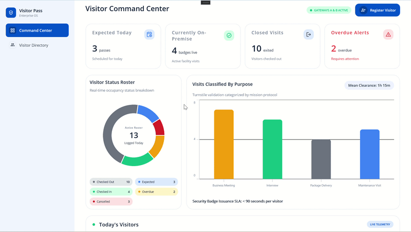

# Visitor Pass Management - .NET MAUI Sample

A Syncfusion-powered .NET MAUI app for managing on-site visitors: dashboard with KPIs and charts, searchable directory, digital pass with barcode and journey timeline, and a multi-step registration wizard.

## Overview

A facility operations team needs a single app to track every visitor across the day: who is expected, who is checked in, who is overdue, and what pass code was issued.

- **What the sample does** - Dashboard, searchable directory, digital pass with barcode, and a three-step visitor registration wizard.
- **Who it is for** - Facility / security / front-desk operators who manage on-site visitors.
- **What AI capability it uses** - None. The sample is a pure Syncfusion UI showcase with in-memory mock data; no AI service is wired in.
- **What outcome the user gets** - A working facility command centre that can be extended with AI (e.g. anomaly detection on overdue visits) in future iterations.

## Key Features

- Real-time dashboard with KPI tiles, status doughnut chart, and visits-by-purpose column chart.
- Searchable, filterable visitor directory with status chips and an active-dossier preview.
- Digital Visitor Pass with Code128 barcode, identity card, host block, escort policy, telemetry tiles, and a journey timeline.
- One-tap Check In / Check Out / Cancel actions on the digital pass.
- Three-step registration wizard (Identity → Schedule → Pass Generated).
- Light / Dark theme toggle via the global `ThemeService`.
- Adaptive routing: `SfPopup` for desktop / tablet, full-page wizard on phone.

## App Flow

1. Operator opens the app - `AppShell` routes to the Dashboard page.
2. Dashboard reads aggregated KPIs and charts from `IVisitorStore`.
3. Operator taps a visitor → navigates to the Digital Pass or Directory.
4. Operator searches / filters the directory or opens the registration wizard.
5. Pass code is generated by `PassCodeGenerator` and rendered as a Code128 barcode.
6. Mutations (check-in, check-out, register, cancel) raise `VisitorsChanged`; every page re-derives its collections from the same store.

## Controls Used

- `SfDataGrid` - Dashboard "Today's Visitors" grid and Directory visitor grid.
- `SfCircularChart` (DoughnutSeries) - Dashboard "Visitor Status Roster".
- `SfCartesianChart` (ColumnSeries) - Dashboard "Visits Classified By Purpose".
- `SfBarcodeGenerator` (Code128) - Digital Visitor Pass barcode.
- `SfStepProgressBar` - Digital Pass "Visit Journey Progression".
- `SfPopup` - Register Visitor dialog (desktop / tablet).
- `SfChipGroup` - Directory status filter chips.
- `SfBadgeView` - Status badges inside `VisitorStatusBadge`.
- `SfAvatarView` - Visitor avatar tiles.
- `SfListView` - Mobile "Today's Visitors" list, Active Dossier card, Journey checkpoints.
- `SfButton` - Register trigger, Check In / Check Out / Cancel.
- `SfTextInputLayout` - Register form fields.
- `SfDatePicker`, `SfTimePicker` - Register scheduling step.
- `SfEntry` - Search Entry in TopNavBar / Directory (local borderless subclass).

## Architecture

Strict MVVM with `CommunityToolkit.Mvvm` source generators (`[ObservableProperty]`, `[RelayCommand]`) over a `BaseViewModel : ObservableObject`.

- **View / Page** - `Views/` (Dashboard, Directory, VisitorDetails, Register)
- **ViewModel** - `ViewModels/` (Dashboard, Directory, VisitorDetails, Register)
- **Models** - `Models/` (Visitor, VisitorStatus, VisitPurpose, …)
- **AI service** - *Not used. The single source of truth is `IVisitorStore` / `VisitorStore` (in-memory).*
- **Supporting UI components** - `Controls/` (TopNavBar, SideNavigation, SfEntry, VisitorAvatar, VisitorStatusBadge), `Converters/`, `Resources/`

Data flow: every page and view-model resolves `IVisitorStore` from DI. Mutations raise `VisitorsChanged`; every page re-derives its filtered / aggregate collections from the same store.

## Prerequisites

- **.NET SDK 10.0.x** with the **MAUI workload** (`maui-android`, plus `maui-ios` / `maui-maccatalyst` / `maui-windows` for those targets)
- **Visual Studio 2026** (or equivalent) with the MAUI workload installed
- **Syncfusion MAUI licence** - required at build and run time. See [Syncfusion licensing](https://www.syncfusion.com/sales/license).
- **No AI provider account** - this sample runs fully offline.

## AI Configuration

This sample does not use AI. See [Data Configuration](#data-configuration) below.

## Data Configuration

### Default Behavior

The sample uses **mock, in-memory data only**:

- Seed data is loaded from `Services/VisitorData.cs` at startup.
- A single `IVisitorStore` / `VisitorStore` singleton is registered in `MauiProgram`.
- `PassCodeGenerator` produces per-day pass codes deterministically.
- No network calls, no database, no external services - the app is fully offline.

### Environment Variables / Secrets

| Variable | Required | Description |
|---|---|---|
| *None* | - | No environment variables are required. The app has no external dependencies. |

### Notes

- Reloading the app restores the original seeded state.
- The sample intentionally has no configuration surface - it is a UI showcase.
- If you intend to extend the sample with an AI service (e.g. anomaly detection on overdue visits), wire it through a new `Services/` implementation behind an interface so existing view-models remain unchanged.

## Run

```bash
dotnet build VisitorPassManagement/VisitorPass.slnx -t:Run -f net10.0-android
```

Other target frameworks:

```bash
# iOS (macOS host)
dotnet build VisitorPassManagement/VisitorPass.slnx -t:Run -f net10.0-ios
# Mac Catalyst (macOS host)
dotnet build VisitorPassManagement/VisitorPass.slnx -t:Run -f net10.0-maccatalyst
# Windows
dotnet build VisitorPassManagement/VisitorPass.slnx -t:Run -f net10.0-windows10.0.19041.0
```

From Visual Studio: open `VisitorPassManagement/VisitorPass.slnx`, set `VisitorPass` as the startup project, pick a target framework, press **F5**.

## Output



## Project Structure

```
VisitorPass/
├── App.xaml(.cs)              # Syncfusion theme + palette + converters
├── AppShell.xaml(.cs)        # Shell root hosting DashboardPage
├── MauiProgram.cs             # DI registrations + Syncfusion hosting
├── Controls/                  # Reusable ContentView controls
├── Converters/                # IValueConverter helpers
├── Models/                    # Visitor, VisitorStatus, VisitPurpose, …
├── Services/                  # IVisitorStore, VisitorStore, VisitorData, PassCodeGenerator, ThemeService
├── ViewModels/                # Dashboard, Directory, VisitorDetails, Register
└── Views/                     # ContentPages + shared RegisterVisitorView
```

- **Views/** - UI pages and layouts
- **ViewModels/** - presentation logic
- **Models/** - data structures
- **Services/** - AI and helper services *(no AI service in this sample)*
- **Resources/** - styles, images, and assets

## Troubleshooting

### Path too long exception

If you encounter a "Path Too Long" exception while building the project, close Visual Studio, rename the repository folder to a shorter name, and rebuild the project.