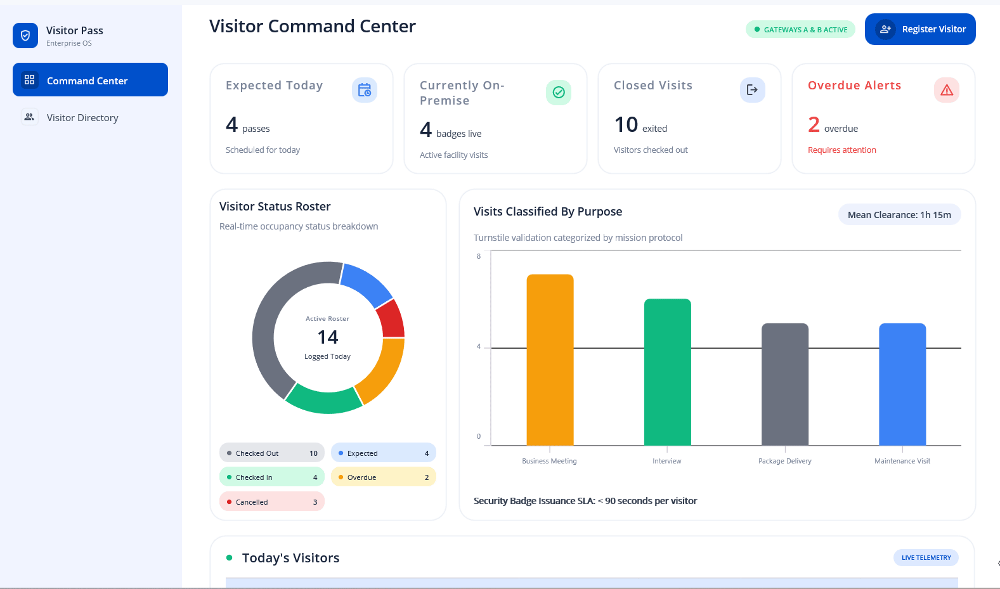

# Visitor Pass Management: .NET MAUI Use Case Sample



A visitor-access management application built with [Syncfusion .NET MAUI controls](https://help.syncfusion.com/maui/overview), demonstrating visitor registration, check-in/check-out, directory filtering, dashboard analytics, digital passes, and light/dark theme switching.

---

## Overview

Visitor Pass Management provides Dashboard, Directory, and visitor-registration surfaces. It uses one singleton `IVisitorStore` instance as the source of truth for visitors, with a pass-code generator, theme service, desktop and mobile layout controls, and local pass-code simulation.

The sample does not integrate with a physical access-control system or external visitor management service.

---

## Key Features

### Dashboard

- Show visitor totals and status breakdowns.
- Display purpose and status charts.
- Show the visitor timeline.
- Recalculate KPIs when visitor state changes.

### Visitor Directory

- Browse all visitor records.
- Filter by status and search the directory.
- Open visitor details.
- Check in or check out eligible visitors.

### Visitor Registration

- Use a desktop popup or phone page to register a visitor.
- Select host and visit purpose.
- Enter visit date/time and expected duration.
- Generate a pass identifier and pass code.

### Digital Pass

- Display a generated pass identifier.
- Show check-in/check-out actions for the selected visitor.
- Cancel an eligible expected visit.
- Recompute overdue statuses.

### Theme Support

- Switch between Light, Dark, and System themes.
- Persist theme selection through `Application.Current.UserAppTheme`.
- Reuse the singleton `ThemeService` across navigation.

---

## Syncfusion Controls Used

| Control | Purpose |
|---|---|
| `SfDataGrid` | Visitor directory tables |
| `SfCharts` | Status and purpose analytics |
| `SfBadgeView` | Status and count indicators |
| `SfAvatarView` | Visitor profile presentation |
| `SfStepProgressBar` | Registration and pass workflows |
| `SfChips` | Filter controls |
| `SfPopup` | Desktop registration and overlay workflows |
| `SfTextInputLayout` | Registration form fields |
| `SfDatePicker` | Visit date selection |
| `SfTimePicker` | Visit time selection |
| `SfBarcodeGenerator` | Digital-pass barcode presentation |

### Additional Technologies

- CommunityToolkit.Mvvm
- Dependency Injection
- MVVM architecture pattern
- Singleton visitor store and pass-code generator
- MAUI `AppThemeBinding` and `UserAppTheme`

---

## Supported Platforms

| Platform | Target Framework |
|---|---|
| Android | `net10.0-android` |
| iOS | `net10.0-ios` |
| macOS (Mac Catalyst) | `net10.0-maccatalyst` |
| Windows | `net10.0-windows10.0.19041.0` |

> iOS and Mac Catalyst targets require a compatible non-Linux host. The Windows target is available on Windows hosts.

---

## Prerequisites

- .NET 10 SDK or later
- .NET MAUI workloads
- Visual Studio 2022 (17.14+), Visual Studio Code with the .NET MAUI extension, or JetBrains Rider
- A platform emulator, simulator, or physical device
- Syncfusion .NET MAUI NuGet packages restored from NuGet

---

## Getting Started

### Open the Solution

```text
VisitorPassManagement/VisitorPass.slnx
```

### Restore Packages

```bash
dotnet restore VisitorPassManagement/VisitorPass/VisitorPass.csproj
```

### Build and Run

Example for Android:

```bash
dotnet build VisitorPassManagement/VisitorPass/VisitorPass.csproj -f net10.0-android
```

---

## Architecture

### Core Layers

- **Views** (`Views/`) - Dashboard, Directory, Registration, and Visitor Details pages.
- **Controls** (`Controls/`) - side/top navigation, page headers, visitor cards, and status badge controls.
- **ViewModels** (`ViewModels/`) - dashboard, directory, registration, details, and base presentation state.
- **Models** (`Models/`) - hosts, purposes, timeline steps, visitors, statuses, and analytics points.
- **Services** (`Services/`) - visitor store, pass-code generation, seed data, and theme state.

### Runtime Flow

1. `MauiProgram.CreateMauiApp()` registers `IVisitorStore`, `PassCodeGenerator`, `ThemeService`, view models, and pages.
2. `VisitorStore` seeds visitors through `VisitorData.BuildVisitors()` and exposes an observable collection.
3. Registration creates a visitor and assigns a pass identifier from `PassCodeGenerator`.
4. Check-in/check-out/cancel operations update visitor status and raise `VisitorsChanged`.
5. Dashboard and directory view models subscribe to store changes and refresh derived counts, charts, and lists.
6. `ThemeService` applies and observes the Light/Dark/System theme choice.

---

## Project Structure

```text
VisitorPassManagement/
├── VisitorPass.slnx
├── VisitorPassManagementDemo.gif
└── VisitorPass/
    ├── Views/
    ├── Controls/
    ├── ViewModels/
    ├── Models/
    ├── Services/
    ├── Converters/
    ├── Resources/
    └── Platforms/
```

---

## Configuration

No external account or API configuration is required.

- Visitor records and pass codes are generated locally.
- The seed list is fixed at store construction.
- The visitor store is singleton-scoped for the application process.
- Theme selection follows System unless changed through `ThemeService`.

---

## Syncfusion Licensing

Register a valid Syncfusion license for licensed use.

Do not commit license keys to source control. For details, refer to [Syncfusion Licensing Documentation](https://help.syncfusion.com/common/licensing/how-to-register-maui-license-key).

---

## Limitations

- Visitor records reset when the app restarts.
- Pass codes and pass identifiers are local demonstration values.
- The sample does not integrate with physical access-control devices.
- Registration and status changes are not persisted.
- Theme selection is an app-level preference and is not backed by a database.

---

## Troubleshooting

### Visitor Changes Disappear After Restart

`VisitorStore` is an in-memory singleton and recreates the seed data.

### A Visitor Cannot Be Checked In

Only an Expected visitor can be checked in. Checked-in, checked-out, and cancelled visitors follow separate status rules.

### A Visitor Cannot Be Cancelled

Checked-out and already cancelled visitors cannot be cancelled.

### Theme Does Not Change

Verify that `ThemeService.SetTheme()` or `Toggle()` is being called and that `Application.Current.UserAppTheme` is supported on the selected target.

### Syncfusion Evaluation Warning

Register a valid Syncfusion license.

---

## Related Documentation

- [.NET MAUI Documentation](https://learn.microsoft.com/dotnet/maui/)
- [.NET MAUI MVVM Guidance](https://learn.microsoft.com/dotnet/architecture/maui/mvvm)
- [.NET MAUI App Themes](https://learn.microsoft.com/dotnet/maui/user-interface/system-theme-changes)
- [Syncfusion .NET MAUI Controls](https://help.syncfusion.com/maui/overview)
- [Syncfusion Licensing Documentation](https://help.syncfusion.com/common/licensing/how-to-register-maui-license-key)

---

## License

This sample is provided for demonstration and learning purposes. Syncfusion controls used in this sample require a valid Syncfusion license for production use.
