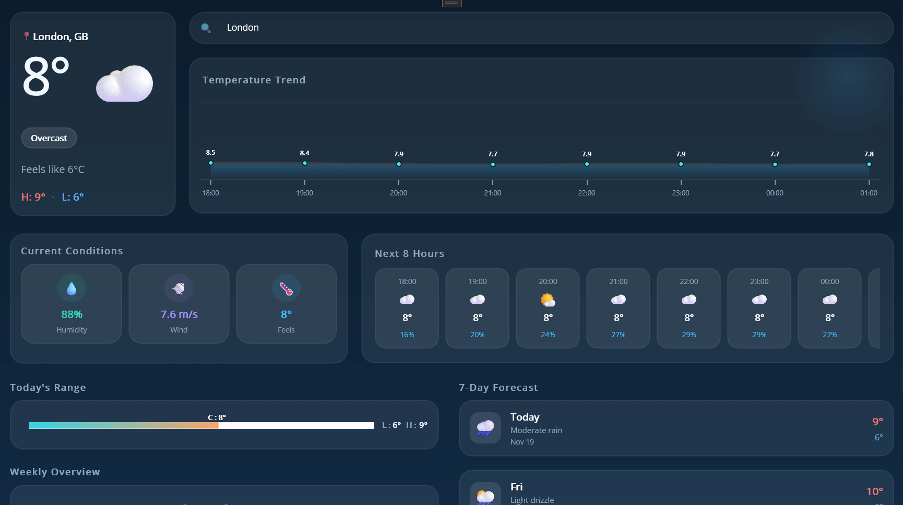

# Weather Forecast: .NET MAUI Use Case Sample



A cross-platform weather dashboard built with [Syncfusion .NET MAUI controls](https://help.syncfusion.com/maui/overview), demonstrating city search, live Open-Meteo forecast data, hourly and seven-day forecasts, pull-to-refresh, and responsive desktop/mobile layouts.

---

## Overview

Weather Forecast demonstrates an online weather experience using the Open-Meteo geocoding and forecast APIs. The app accepts a city name, geocodes it to coordinates, and retrieves current, hourly, and daily forecast data.

The sample uses desktop and mobile page surfaces selected by the application at runtime.

---

## Key Features

### City Search

- Search by city name.
- Use the seeded city suggestion list.
- Load the selected city from desktop or mobile controls.

### Current Weather

- Show current temperature and apparent temperature.
- Display the WMO weather description and icon/emoji.
- Show humidity and wind speed.
- Show the current day high and low.

### Hourly Forecast

- Display up to eight upcoming hourly entries.
- Show temperature, weather description, precipitation chance, and time.
- Skip hourly entries that are before the current time.

### Seven-Day Forecast

- Display daily maximum and minimum temperatures.
- Show weather descriptions and precipitation probability.

### Responsive and Refresh Behavior

- Use separate desktop and mobile dashboard pages.
- Show loading and error states.
- Support pull-to-refresh on the dashboard.

---

## Syncfusion Controls Used

| Control | Purpose |
|---|---|
| `SfCardView` | Weather information cards |
| `SfCartesianChart` | Forecast visualizations |
| `SfCircularGauge` | Weather metric presentation |
| `SfTextInputLayout` | City search fields |
| `SfListView` | Forecast and suggestion collections |
| `SfLinearProgressBar` | Metric and loading presentation |
| `SfPullToRefresh` | Pull-to-refresh behavior |
| `SfTabView` | Mobile tabbed presentation |

### Additional Technologies

- .NET MAUI `HttpClientFactory`
- Open-Meteo geocoding and forecast APIs
- MVVM with manual `INotifyPropertyChanged`
- Dependency Injection

---

## Supported Platforms

| Platform | Target Framework |
|---|---|
| Android | `net10.0-android` |
| iOS | `net10.0-ios` |
| macOS (Mac Catalyst) | `net10.0-maccatalyst` |
| Windows | `net10.0-windows10.0.19041.0` |

> iOS and Mac Catalyst targets require a compatible non-Linux host. The Windows target is available on Windows hosts.

---

## Prerequisites

- .NET 10 SDK or later
- .NET MAUI workloads
- Internet connectivity
- Visual Studio 2022 (17.14+), Visual Studio Code with the .NET MAUI extension, or JetBrains Rider
- A platform emulator, simulator, or physical device
- Syncfusion .NET MAUI NuGet packages restored from NuGet

---

## Getting Started

### Open the Solution

```text
WeatherForecast/WeatherForecast.sln
```

### Restore Packages

```bash
dotnet restore WeatherForecast/WeatherForecast/WeatherForecast.csproj
```

### Build and Run

Example for Android:

```bash
dotnet build WeatherForecast/WeatherForecast/WeatherForecast.csproj -f net10.0-android
```

---

## Architecture

### Core Layers

- **Views** (`Views/`) - `WeatherDashboardPageDesktop` and `WeatherDashboardPageMobile`.
- **ViewModel** (`ViewModels/`) - `WeatherViewModel`.
- **Models** (`Models/`) - weather response, current/daily/hourly forecast, and result types.
- **Services** (`Services/`) - `WeatherService`.
- **Converters** (`Converters/`) - percent-to-rectangle presentation conversion.

### Runtime Flow

1. `MauiProgram.CreateMauiApp()` registers an `HttpClient`-based `WeatherService` and transient view models/pages.
2. The page calls `WeatherViewModel.InitializeAsync()` after appearing.
3. City selection or search sets `SelectedCity`.
4. `WeatherViewModel` calls `WeatherService.GetForecastAsync()`.
5. `WeatherService` geocodes the city through Open-Meteo and requests the forecast with current, hourly, and daily fields.
6. The service maps WMO codes and API response values to `WeatherResult`, hourly entries, and daily entries.
7. The view model updates loading, error, refresh, and weather presentation properties.

---

## Project Structure

```text
WeatherForecast/
├── WeatherForecast.sln
├── WeatherForecastDemo.gif
└── WeatherForecast/
    ├── Views/
    ├── ViewModels/
    ├── Models/
    ├── Services/
    ├── Converters/
    ├── Resources/
    └── Platforms/
```

---

## Configuration

Open-Meteo is used without an API key.

- Geocoding and forecast requests use public Open-Meteo endpoints.
- Requests have a 20-second HTTP timeout.
- The app does not store API credentials.
- Forecast data is not persisted.

---

## Syncfusion Licensing

The project contains a license registration call with a placeholder key and catches license validation exceptions.

Replace the placeholder with a valid license key for licensed use. Do not commit a real key to source control.

---

## Limitations

- Weather data requires network connectivity.
- City geocoding is limited to the first Open-Meteo search result.
- Forecast data is not cached or persisted.
- The app does not provide severe-weather alerts or offline historical forecasts.
- A forecast API failure is displayed through the view-model error state.

---

## Troubleshooting

### City Is Not Found

Verify the city name and spelling. `WeatherService` reports that no geocoding result was found.

### Network or Timeout Error

Check internet connectivity and the Open-Meteo endpoint availability.

### Initial Loading Is Slow

The page initializes weather data in `OnAppearing` instead of starting the network call from the view-model constructor.

### Syncfusion Evaluation Warning

Replace the license placeholder in `MauiProgram.cs` with a valid license key.

---

## Related Documentation

- [.NET MAUI Documentation](https://learn.microsoft.com/dotnet/maui/)
- [.NET MAUI HttpClient Guidance](https://learn.microsoft.com/dotnet/maui/data-cloud/rest)
- [Open-Meteo API](https://open-meteo.com/)
- [Syncfusion .NET MAUI Controls](https://help.syncfusion.com/maui/overview)
- [Syncfusion Licensing Documentation](https://help.syncfusion.com/common/licensing/how-to-register-maui-license-key)

---

## License

This sample is provided for demonstration and learning purposes. Syncfusion controls used in this sample require a valid Syncfusion license for production use.
